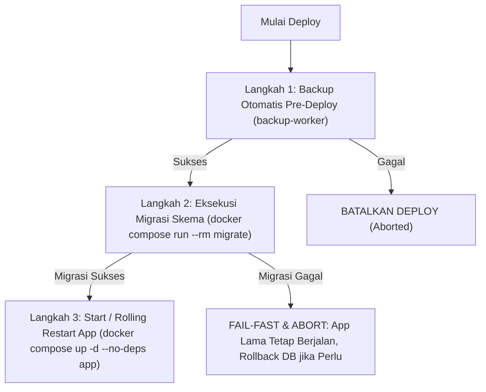

# 11-migration-plan.md — Panduan Migrasi Basis Data, Deployment & Portabilitas Mesin Docker

> **Status Dokumen**: Wajib Dipatuhi (Normatif & Mengikat)  
> **Klasifikasi**: Prosedur Operasional Standar (SOP) DevOps & Database Administrator  
> **Sasaran**: Seluruh pengembang dan operator sistem Yayasan Nurjaman Bongas Purwakarta.

Dokumen ini mendefinisikan tata kelola migrasi skema basis data, urutan sakral deployment produksi, rancangan container worker cadangan/pemulihan, serta prosedur resmi pemindahan mesin (_cross-machine transfer_) antara server VPS produksi dan laptop pengembang.

---

## 1. Prinsip Utama Migrasi Basis Data

1. **Layanan Sekali Jalan (_One-Off Container_)**:
   Migrasi basis data dieksekusi melalui container khusus sekali jalan (`prisma migrate deploy`), **BUKAN** dijalankan otomatis pada saat container aplikasi (`app`) dinyalakan (_start/entrypoint_).
2. **Alasan Arsitektural**:
   - Menghindari _race condition_ atau _deadlock_ DDL ketika beberapa replika container aplikasi dijalankan secara bersamaan.
   - Mencegah container aplikasi mengalami _restart loop_ berulang tanpa akhir jika migrasi mengalami kegagalan.
   - Memberikan kontrol deterministik bagi operator/pipeline CI-CD untuk memverifikasi keberhasilan migrasi sebelum lalu lintas pengguna diarahkan ke kode baru.

---

## 2. Urutan Deployment Produksi Baku (Urutan Sakral 3 Langkah)

Setiap proses pembaruan sistem di lingkungan produksi wajib mematuhi urutan sekuensial berikut tanpa kompromi:



### Langkah 1: Cadangan Otomatis Pre-Deploy

Sebelum menyentuh skema atau kode aplikasi, container `backup-worker` secara otomatis mengeksekusi dump logis basis data lengkap via `pg_dump`. Snapshot ini diberi label penanda `PRE_DEPLOY_<TIMESTAMP>` sebagai jaring pengaman utama.

### Langkah 2: Eksekusi Migrasi Skema

Jalankan layanan migrasi sekali jalan menggunakan sintaks Docker Compose v2:

```bash
docker compose run --rm migrate
```

Layanan ini mengeksekusi `prisma migrate deploy` terhadap PostgreSQL.

#### Perilaku Bila Migrasi Gagal:

- **Prinsip Fail-Fast & Abort**: Proses deployment **SEGERA DIBATALKAN**.
- **App Lama Tetap Aktif**: Container aplikasi versi lama **TIDAK DIHENTIKAN / TIDAK DIRESTART**, sehingga layanan publik dan tata kelola internal tetap beroperasi melayani pengguna dengan skema yang stabil.
- **Notifikasi Galat**: Log kegagalan dari container `migrate` dicatat dan operator sistem segera diberi tahu.
- **Rollback Skema**: Jika migrasi gagal di tengah jalan (khususnya untuk pernyataan DDL non-transaksional), operator memulihkan basis data ke titik awal menggunakan snapshot cadangan Langkah 1 melalui container `backup-worker`.

### Langkah 3: Start / Restart Aplikasi

Hanya jika container `migrate` keluar dengan kode status sukses (`exit code 0`), container aplikasi diperbarui dan di-restart:

```bash
docker compose up -d --no-deps app
```

Pemeriksaan kesehatan (_healthcheck_) internal container `app` akan memverifikasi kesiapan rute `/api/health` sebelum reverse proxy mengalirkan beban trafik baru.

---

## 3. Arsitektur Worker Backup & Restore Terpisah

Pencadangan dan pemulihan data tidak dibebankan pada container aplikasi Next.js demi isolasi beban kerja dan pembatasan hak akses (_least privilege_).

### 3.1 Karakteristik Container `backup-worker`

1. **Kesetaraan Versi PostgreSQL Client**:
   Container `backup-worker` dibangun menggunakan image PostgreSQL Alpine dengan versi mayor yang persis sama dengan database server (contoh: `postgres:17.2-alpine`). Hal ini mencegah ketidakcocokan format dump logis pada `pg_dump` dan `pg_restore`.
2. **Kredensial Hak Minimal (_Least Privilege_)**:
   Container cadangan terhubung ke PostgreSQL menggunakan pengguna khusus (`backup_user`), bukan akun `superuser`. Akun ini hanya memiliki izin `SELECT` pada seluruh tabel dan hak `LOCK TABLES` untuk pembacaan konsisten, tanpa izin melakukan `DROP`, `DELETE`, atau `ALTER`.

### 3.2 Model Data `backup_jobs` yang Diperluas

Tabel `backup_jobs` pada basis data wajib mencatat metadata lingkungan saat pencadangan dilakukan:

| Kolom Tambahan     | Tipe | Null  | Keterangan                                                                           |
| :----------------- | :--- | :---- | :----------------------------------------------------------------------------------- |
| `postgres_version` | text | Tidak | Versi PostgreSQL saat backup dibuat (misal: `"17.2"`)                                |
| `schema_version`   | text | Tidak | Nama berkas migrasi Prisma terakhir yang aktif (misal: `"20261105000000_init_auth"`) |
| `app_version`      | text | Tidak | Versi rilis aplikasi atau Git commit SHA (misal: `"0.1.0-e825d51"`)                  |

### 3.3 Validasi Kecocokan Sebelum Restore

Saat proses pemulihan (_restore_) dipicu:

1. Container `backup-worker` membaca manifest metadata dari berkas cadangan.
2. Memeriksa kecocokan versi PostgreSQL: Mesin target wajib memiliki versi mayor PostgreSQL yang **SAMA atau LEBIH BARU** dari `postgres_version` pada berkas cadangan.
3. Memeriksa keselarasan `schema_version`: Jika versi skema pada cadangan lebih baru daripada migrasi yang dimiliki oleh kode aplikasi target, proses restore **DITOLAK SECARA OTOMATIS** sebelum merusak konsistensi data.

---

## 4. Prosedur Resmi Pemindahan Mesin (_Cross-Machine Transfer_)

Panduan ini mengatur pemindahan sistem secara menyeluruh antara **Server VPS $\leftrightarrow$ Laptop Pengembang** atau **Antar-Server VPS**.

### 4.1 Larangan Mutlak Pemindahan Data Mentah

> [!CAUTION] **Dilarang Keras Memindahkan Direktori Data Mentah PostgreSQL**
> DILARANG memindahkan direktori data fisik `/var/lib/postgresql/data` atau folder named volume Docker mentah antar-mesin. Berkas biner database mentah **TIDAK AMAN** dipindahkan lintas versi mayor PostgreSQL, lintas arsitektur prosesor (x86_64 vs ARM64), maupun perbedaan kompilasi pustaka C (glibc vs musl libc).
> Pemindahan data **HANYA BOLEH** dilakukan melalui **dump logis terstruktur (`pg_dump`)**.

### 4.2 Empat Komponen Wajib yang Dipindahkan

Untuk memindahkan sistem secara utuh tanpa kehilangan data, 4 komponen berikut wajib ditransfer:

```text
[ Paket Pemindahan Mesin ]
├── 1. Dump Logis Basis Data       (dump_<timestamp>.pgdump)
├── 2. Arsip Berkas Uploads        (uploads_private.tar.gz & uploads_public.tar.gz)
├── 3. Konfigurasi Lingkungan      (.env)
└── 4. KUNCI ENKRIPSI APLIKASI     (ENCRYPTION_SECRET di dalam .env) ──> WAJIB SAMA!
```

> [!WARNING] **KUNCI ENKRIPSI (`ENCRYPTION_SECRET`) ADALAH KEWAJIBAN MUTLAK**
> Kolom data sensitif pada basis data (seperti NIK anggota, nomor rekening bank, NPWP yayasan, dan kunci rahasia TOTP 2FA) dienkripsi di level aplikasi menggunakan AES-256-GCM dengan kunci master `ENCRYPTION_SECRET`.
> **JIKA KUNCI ENKRIPSI INI TIDAK DISALIN SECARA IDENTIK KE MESIN TUJUAN, SELURUH DATA TERENKRIPSI TERSEBUT TIDAK AKAN BISA DIBACA SELAMANYA (_PERMANENTLY LOST / UNREADABLE_) MESKIPUN BASIS DATA BERHASIL DI-RESTORE PENUH!**

### 4.3 Panduan Langkah demi Langkah Pemindahan

#### Tahap A: Pencadangan di Mesin Asal (Sumber)

1. Buat dump logis basis data via container worker:
   ```bash
   docker compose exec backup-worker pg_dump -U backup_user -d yayasan_db -Fc -f /backups/migration_transfer.dump
   ```
2. Buat arsip volume unggahan:
   ```bash
   docker run --rm -v yayasan_uploads_private:/data/private -v yayasan_uploads_public:/data/public -v $(pwd):/backup alpine \
     tar -czvf /backup/uploads_archive.tar.gz -C /data private public
   ```
3. Salin berkas `migration_transfer.dump`, `uploads_archive.tar.gz`, dan `.env` ke mesin tujuan melalui saluran terenkripsi (SCP/SSH).

#### Tahap B: Pemulihan di Mesin Tujuan (Target)

1. Pastikan Docker dan Docker Compose v2 telah terpasang di mesin target.
2. Tempatkan berkas `.env` (pastikan `ENCRYPTION_SECRET` persis sama dengan mesin asal).
3. Nyalakan basis data PostgreSQL:
   ```bash
   docker compose up -d postgres
   ```
4. Pulihkan data basis data logis:
   ```bash
   docker compose run --rm -v $(pwd)/migration_transfer.dump:/tmp/transfer.dump backup-worker \
     pg_restore -U postgres -d yayasan_db --clean --if-exists /tmp/transfer.dump
   ```
5. Ekstrak volume unggahan ke named volume tujuan:
   ```bash
   docker run --rm -v yayasan_uploads_private:/data/private -v yayasan_uploads_public:/data/public -v $(pwd):/backup alpine \
     tar -xzvf /backup/uploads_archive.tar.gz -C /data
   ```
6. Jalankan migrasi basis data untuk memastikan keselarasan skema:
   ```bash
   docker compose run --rm migrate
   ```
7. Jalankan seluruh layanan aplikasi:
   ```bash
   docker compose up -d
   ```
8. Verifikasi status kesehatan sistem via `curl http://127.0.0.1:3000/api/health` atau dashboard admin.

---

## 5. Standar Docker Multi-Arsitektur (_Multi-Arch_)

Agar sistem dapat dijalankan dengan mulus baik di laptop pengembang (arsitektur ARM64 seperti Apple Silicon M1/M2/M3 atau prosesor ARM) maupun di server VPS produksi (arsitektur x86_64 / amd64):

1. **Docker Buildx**:
   Seluruh image kustom (`app`, `migrate`, `backup-worker`) wajib dibangun dengan dukungan multi-platform:
   ```bash
   docker buildx build --platform linux/amd64,linux/arm64 -t yayasan/app:0.1.0 .
   ```
2. **Kemandirian Platform**:
   Dilarang keras menggunakan biner atau pustaka pihak ketiga yang hanya mendukung satu jenis arsitektur CPU tanpa varian multi-arch resmi.
