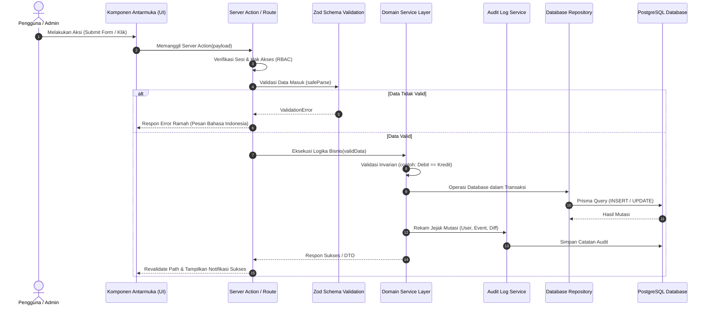
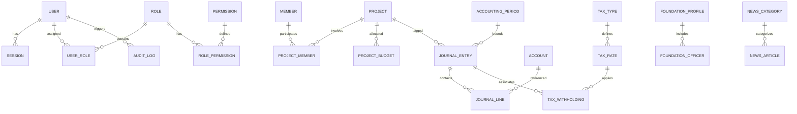

# Arsitektur Sistem (Architecture Specification)

## Yayasan Nurjaman Bongas Purwakarta

Dokumen ini menjelaskan struktur arsitektur teknis, pola rekayasa perangkat lunak, model data konseptual, sistem keamanan, dan panduan infrastruktur untuk Yayasan Nurjaman Bongas Purwakarta.

---

## 1. Stack Teknologi & Versi Eksak Terpasang

Seluruh dependensi dikunci pada versi eksak (_pinned versions_) tanpa rentang dinamis (`^` atau `~`):

| Komponen                | Pustaka / Runtime    | Versi Eksak         | Peran / Alasan                                                          |
| ----------------------- | -------------------- | ------------------- | ----------------------------------------------------------------------- |
| **Framework Utama**     | Next.js (App Router) | `15.2.1`            | Full-stack framework dengan React Server Components & Standalone output |
| **Runtime UI**          | React & React DOM    | `19.0.0`            | Library antarmuka deklaratif dengan React 19 Action & Form handling     |
| **Bahasa Pemrograman**  | TypeScript           | `5.7.3`             | Strict type checking dengan `noUncheckedIndexedAccess: true`            |
| **Styling & CSS**       | Tailwind CSS         | `3.4.17`            | Utility-first CSS terbukti stabil dengan plugin PostCSS & Purge optimal |
| **ORM & Database Tool** | Prisma ORM           | `6.4.1`             | Type-safe database client & migrasi terstruktur PostgreSQL              |
| **Mesin Basis Data**    | PostgreSQL           | `17-alpine`         | RDBMS enterprise ACID-compliant via Docker & VPS                        |
| **Validasi Skema**      | Zod                  | `3.24.2`            | Validasi runtime fail-fast pada batas sistem (env & payload)            |
| **Pengujian Unit**      | Vitest               | `3.0.7`             | Test runner modern berkecepatan tinggi berbasis Vite/ESM                |
| **Pengujian E2E**       | Playwright           | `1.50.1`            | End-to-end browser automation & smoke test keandalan                    |
| **Ikonografi**          | Lucide React         | `0.475.0`           | Set ikon stroke konsisten, profesional, dan seragam                     |
| **Tooling & Penegakan** | ESLint & Prettier    | `9.21.0` / `3.5.2`  | Penjaga kualitas kode dan pemformatan otomatis                          |
| **Git Automation**      | Husky & lint-staged  | `9.1.7` / `15.4.3`  | Penegakan otomatis aturan git pre-commit dan changelog                  |
| **Package Manager**     | pnpm                 | `12.16.1` (>=9.0.0) | Pengelola paket efisien berbasis hard-links                             |

### Dependensi yang Ditunda (Direncanakan pada Fase Lanjutan)

Sesuai batasan pengerjaan, paket-paket berikut **belum diinstal sekarang** dan akan ditambahkan pada fase terkait:

- `react-hook-form` & `@hookform/resolvers`: Untuk manajemen formulir kompleks (Fase 1).
- `@tanstack/react-table`: Untuk tabel data akuntansi, sortir, filter, dan pagination server-side (Fase 1/4).
- `@tiptap/react` & `@tiptap/starter-kit`: Untuk editor konten berita dan artikel publik (Fase 2).
- Autentikasi: Better Auth atau Auth.js (Fase 1, setelah keputusan arsitektur sesi ditetapkan).

---

## 2. Struktur Direktori & Tanggung Jawab Lapisan

Arsitektur menggunakan pendekatan **Modular Monolith** berbasis domain di dalam folder `src/modules/`:

```
d:\PROJECT\yayasan-nurjaman/
├── .husky/                  # Git hook scripts (pre-commit changelog enforcer)
├── changelogs/              # Catatan riwayat perubahan (append-only)
│   ├── README.md            # Aturan & template changelog
│   └── 0001-*.md            # File entri berurutan NNNN
├── docs/                    # Dokumen aturan, panduan & arsitektur
├── prisma/                  # Skema database & file migrasi
│   └── schema.prisma
├── public/                  # Aset statis publik
│   └── brand/               # Logo resmi & favicon yayasan
├── scripts/                 # Skrip utilitas CLI (new-changelog, check-changelog)
├── src/
│   ├── app/                 # Next.js App Router (Routing, Layout & Page)
│   │   ├── (public)/        # Rute situs publik (Profil, Berita, Donasi, Kontak)
│   │   ├── (admin)/admin/   # Rute panel admin internal
│   │   ├── api/health/      # Route kesehatan sistem & koneksi database
│   │   └── dev/tokens/      # Pratinjau design tokens (dev-only, 404 di prod)
│   ├── modules/             # Modular Domain Packages
│   │   ├── auth/            # Manajemen autentikasi, session, akun pengurus
│   │   ├── members/         # Manajemen pengurus, anggota, relawan & donatur
│   │   ├── finance/         # Inti akuntansi: COA, Jurnal Umum, Buku Kas, ISAK 35
│   │   ├── projects/        # Proyek/kegiatan sosial dan pagu anggaran
│   │   ├── tax/             # Konfigurasi tarif pajak dinamis & bukti potong
│   │   ├── content/         # Profil yayasan dinamis, berita, artikel & galeri
│   │   ├── settings/        # Pengaturan umum yayasan, preferensi sistem
│   │   ├── audit/           # Service & viewer jejak audit aktivitas (audit trail)
│   │   └── backup/          # Utilitas pencadangan dan pemulihan database
│   ├── lib/                 # Utilitas lintas modul (env, db, format, errors)
│   └── styles/              # Design tokens (tokens.css) & Tailwind (globals.css)
└── tests/                   # Pengujian terstruktur (unit/ & e2e/)
```

### Tanggung Jawab Lapisan per Modul Domain (`src/modules/<domain>/`)

Setiap modul domain ketika diimplementasikan pada fase berikutnya memiliki subdivisi lapisan terpisah:

- **`actions/`**: Next.js Server Actions yang mengekspos titik masuk untuk mutasi data dari client. Bertugas mengecek autentikasi, memvalidasi input via Zod, dan memanggil layer Service.
- **`services/`**: Pusat logika bisnis (_business domain logic_). Menangani kalkulasi (misal: verifikasi keseimbangan jurnal, perhitungan tarif pajak, pelacakan serapan anggaran), mengoordinasikan pemanggilan repository, dan memicu penulisan audit log.
- **`repositories/`**: Mengenkapsulasi seluruh kueri database (Prisma Client). Menyediakan fungsi murni seperti `findMany`, `create`, `update`, `transaction`.
- **`schemas/`**: Definisi skema Zod dan inferensi tipe TypeScript untuk validasi input form dan API.
- **`components/`**: Komponen antarmuka pengguna khusus domain tersebut (misal: tabel jurnal, kartu anggota, modal cetak kuitansi).

---

## 3. Alur Permintaan (Request Flow)

Pola aliran data satu arah menjamin komponen antarmuka tidak pernah berinteraksi langsung dengan database:



---

## 4. Model Entitas Database Konseptual

Berikut adalah diagram hubungan entitas (_Entity-Relationship Diagram_) tingkat konseptual yang mencakup domain utama:



### Entitas Kunci

1. **Keamanan & Otorisasi**:
   - `User`, `Session`, `Role`, `Permission`, `UserRole`, `RolePermission`.
2. **Keuangan & Akuntansi (ISAK 35)**:
   - `Account` (Bagan Akun/COA dengan klasifikasi: Aset, Liabilitas, Aset Neto Dengan/Tanpa Pembatasan, Pendapatan, Beban).
   - `AccountingPeriod` (Periode buku bulanan/tahunan dengan status `OPEN` atau `CLOSED`).
   - `JournalEntry` (Kepala jurnal transaksi: nomor bukti, tanggal, deskripsi, status `DRAFT`/`POSTED`/`VOID`, referensi proyek).
   - `JournalLine` (Baris jurnal: account_id, debit integer, kredit integer, memo).
   - `CashBank` (Master rekening kas/bank yayasan).
3. **Proyek & Anggaran**:
   - `Project` (Nama program, tanggal mulai-selesai, penanggung jawab, status).
   - `ProjectBudget` (Pos anggaran RAB yang terhubung ke kode akun).
4. **Perpajakan**:
   - `TaxType` (PPh 21, PPh 23, PPh 4(2)).
   - `TaxRate` (Tarif persentase, tanggal mulai berlaku `effective_date`, tanggal akhir `expiry_date`).
   - `TaxWithholding` (Bukti potong pajak: NPWP/NIK penerima, nilai bruto, tarif, nilai potong, nomor bukti potong).
5. **Keanggotaan**:
   - `Member` (Data personal, kategori, status keaktifan).
6. **Profil & Konten Publik**:
   - `FoundationProfile` (Informasi legalitas tunggal yayasan).
   - `FoundationOfficer` (Susunan dewan pengurus).
   - `NewsArticle`, `NewsCategory` (Warta dan publikasi).
7. **Jejak Audit**:
   - `AuditLog` (Tabel append-only untuk seluruh perubahan sensitif).

---

## 5. Rencana Autentikasi & RBAC (Role-Based Access Control)

1. **Manajemen Sesi**:
   - Sesi disimpan pada basis data (`Session` table) dengan token terenkripsi.
   - Dikirim ke browser melalui cookie aman: `HttpOnly`, `SameSite=Lax`, `Secure` (di production).
2. **Format Permission Granular**:
   Izin menggunakan format terstandar: `<modul>.<aksi>`.
   Contoh permission:
   - `finance.read`, `finance.create_journal`, `finance.post_journal`, `finance.void_journal`, `finance.close_period`
   - `projects.manage`, `projects.approve_budget`
   - `members.view`, `members.export`, `members.manage`
   - `tax.manage_rates`, `tax.issue_withholding`
   - `content.publish_news`, `content.edit_profile`
   - `system.manage_users`, `system.view_audit_logs`, `system.backup_restore`
3. **Pengecekan Otorisasi**:
   Setiap fungsi Server Action atau API endpoint mengeksekusi helper otorisasi server:
   ```ts
   await requirePermission("finance.post_journal");
   ```
   Kegagalan pengecekan otomatis melempar `ForbiddenError` yang ditangani oleh handler error terpusat.

---

## 6. Rencana Jejak Audit (Audit Trail)

- **Tabel `AuditLog`** berstruktur:
  - `id`: CUID / UUID
  - `user_id`: ID pengguna pelaku aksi (nullable jika sistem)
  - `action`: Event aksi (CREATE, UPDATE, DELETE, POST, VOID, LOGIN, LOGOUT, EXPORT, BACKUP)
  - `entity_type`: Nama entitas (misal: "JournalEntry", "TaxRate", "Member")
  - `entity_id`: ID entitas terkait
  - `old_values`: JSON data sebelum perubahan
  - `new_values`: JSON data sesudah perubahan
  - `ip_address`: Alamat IP klien
  - `user_agent`: Informasi peramban klien
  - `created_at`: Stempel waktu pencatatan
- **Aturan Audit**: Tabel audit log bersifat **append-only murni**, tidak ada rute pembaruan atau penghapusan catatan audit.

---

## 7. Rencana Abstraksi Penyimpanan Berkas (Storage Abstraction)

Untuk memfasilitasi unggahan berkas (foto kegiatan, avatar pengurus, berkas pendukung kuitansi, dokumen SK Kemenkumham), arsitektur menerapkan pola _Storage Provider_:

- Antarmuka generik: `StorageService` dengan metode `uploadFile`, `deleteFile`, `getFileUrl`.
- **Implementasi Awal**: Local Disk Storage (`public/uploads/` atau folder terlindung `/uploads/private/` dengan serving rute aman bertanda tangan).
- **Implementasi Produksi (Siap Pakai)**: S3-Compatible Object Storage (seperti MinIO, Cloudflare R2, atau AWS S3) tanpa perlu merombak logika bisnis modul.

---

## 8. Rencana Pencadangan & Pemulihan (Backup & Disaster Recovery)

- **Otomatisasi Backup**: Skrip CLI terjadwal yang memanfaatkan `pg_dump` dengan kompresi gzip.
- **Enkripsi File Cadangan**: Berkas dump dienkripsi secara simetris (AES-256) sebelum disimpan.
- **Retensi**: Menyimpan cadangan harian (7 hari terakhir), mingguan (4 minggu terakhir), dan bulanan (12 bulan terakhir).
- **Pengujian Pemulihan**: Prosedur pemulihan (_restore_) diuji berkala pada lingkungan terisolasi untuk memastikan file cadangan tidak korup.

---

## 9. Strategi Lingkungan & Deployment

1. **Pengembangan Lokal (Development)**:
   - Next.js berjalan di host via `pnpm dev`.
   - PostgreSQL berjalan via `docker-compose.yml` dengan volume persisten `yayasan_nurjaman_postgres_data` dan port 5432.
2. **Produksi (Production)**:
   - Containerization multi-stage `Dockerfile` menghasilkan build `standalone` Next.js yang sangat ringan dan efisien memory.
   - Opsi Deployment:
     - **Opsi A (Rekomendasi VPS Mandiri)**: Docker Compose memuat container `app` + `postgres` + reverse proxy Nginx/Caddy dengan sertifikat SSL Let's Encrypt otomatis.
     - **Opsi B (Layanan Cloud / PaaS)**: Next.js di-deploy pada Vercel/Railway dan basis data PostgreSQL pada penyedia terkelola (Neon / Supabase).

---

## 10. Catatan Keputusan Arsitektur (Architectural Decision Records / ADR)

Berikut ringkasan keputusan teknis penting yang telah ditetapkan:

| Tanggal        | Keputusan Teknis            | Pilihan yang Diambil & Alasan                                                                                                                                                                   |
| -------------- | --------------------------- | ----------------------------------------------------------------------------------------------------------------------------------------------------------------------------------------------- |
| **2026-11-04** | **Tipe Data Mata Uang**     | Ditetapkan menggunakan **BigInt (atau Decimal)** integer Rupiah terkecil. **Alasan**: Mencegah galat pembulatan floating point yang dapat memicu ketidakseimbangan jurnal akuntansi.            |
| **2026-11-04** | **Versi Dependensi**        | Seluruh dependensi dikunci pada versi eksak (_pinned versions_). **Alasan**: Menghindari kerusakan build akibat rilis otomatis versi minor/patch pihak ketiga.                                  |
| **2026-11-04** | **Palet Warna Desain**      | Warna brand disampling langsung dari file logo resmi: Hijau `#29c668`, Kuning `#ffff00`, Hitam `#020202`. **Alasan**: Menjamin akurasi identitas visual lembaga secara presisi tanpa rekayasa.  |
| **2026-11-04** | **Penegakan Changelog**     | Ditegakkan melalui Git Pre-Commit Hook Husky. **Alasan**: Menjamin disiplin dokumentasi append-only pada setiap langkah pengembangan.                                                           |
| **2026-11-04** | **Isolasi Rute Dev Tokens** | Halaman `/dev/tokens` secara eksplisit memanggil `notFound()` saat `NODE_ENV === "production"`. **Alasan**: Memastikan halaman internal desainer tidak dapat diakses publik di server produksi. |
