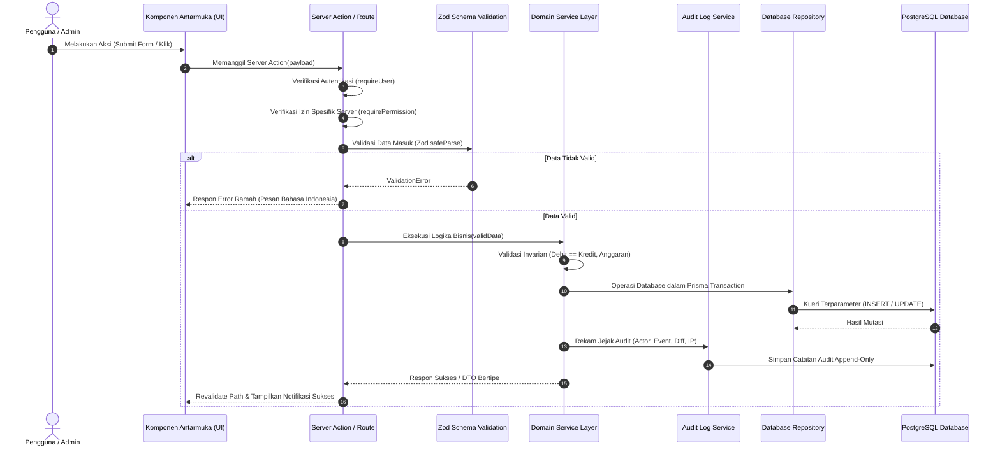
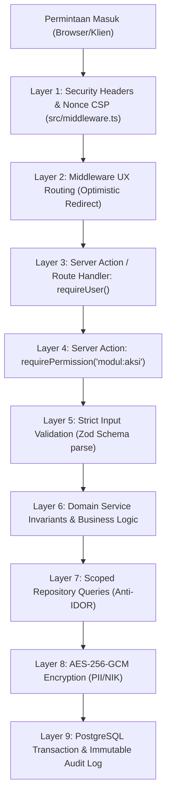
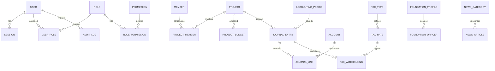

# Arsitektur Sistem (Architecture Specification)

## Yayasan Nurjaman Bongas Purwakarta

Dokumen ini menjelaskan struktur arsitektur teknis, pola rekayasa perangkat lunak, model data konseptual, sistem keamanan siber berlapis, dan keputusan arsitektur (ADR) untuk sistem digital Yayasan Nurjaman Bongas Purwakarta.

---

## 1. Stack Teknologi & Versi Eksak Terpasang

Seluruh dependensi dikunci pada versi eksak (_pinned versions_) tanpa rentang dinamis (`^` atau `~`):

| Komponen                | Pustaka / Runtime      | Versi Eksak         | Peran / Alasan                                                                                                     |
| :---------------------- | :--------------------- | :------------------ | :----------------------------------------------------------------------------------------------------------------- |
| **Framework Utama**     | Next.js (App Router)   | `15.5.28`           | Full-stack framework dengan React Server Components (diperbarui dari 15.2.1 untuk menutup kerentanan keamanan CVE) |
| **Runtime UI**          | React & React DOM      | `19.0.0`            | Library antarmuka deklaratif dengan React 19 Action & Form handling                                                |
| **Bahasa Pemrograman**  | TypeScript             | `5.7.3`             | Strict type checking dengan `noUncheckedIndexedAccess: true`                                                       |
| **Styling & CSS**       | Tailwind CSS & PostCSS | `3.4.17` / `8.5.23` | Utility-first CSS terbukti stabil dengan patch override PostCSS terhadap path traversal                            |
| **ORM & Database Tool** | Prisma ORM             | `6.4.1`             | Type-safe database client & migrasi terstruktur PostgreSQL                                                         |
| **Mesin Basis Data**    | PostgreSQL             | `17-alpine`         | RDBMS enterprise ACID-compliant via Docker & VPS                                                                   |
| **Validasi Skema**      | Zod                    | `3.24.2`            | Validasi runtime fail-fast pada batas sistem (env & payload)                                                       |
| **Pengujian Unit**      | Vitest                 | `3.0.7`             | Test runner modern berkecepatan tinggi berbasis Vite/ESM                                                           |
| **Pengujian E2E**       | Playwright             | `1.50.1`            | End-to-end browser automation & smoke test keandalan                                                               |
| **Ikonografi**          | Lucide React           | `0.475.0`           | Set ikon stroke konsisten, profesional, dan seragam                                                                |
| **Tooling & Penegakan** | ESLint & Prettier      | `9.21.0` / `3.5.2`  | Penjaga kualitas kode (max-lines 250, complexity 10) dan pemformatan otomatis                                      |
| **Git Automation**      | Husky & lint-staged    | `9.1.7` / `15.4.3`  | Penegakan otomatis aturan pre-commit: changelog, scan-secrets, dan check-layers                                    |
| **Package Manager**     | pnpm                   | `12.16.1` (>=9.0.0) | Pengelola paket efisien berbasis hard-links                                                                        |

---

## 2. Struktur Direktori & Tanggung Jawab Lapisan

Sistem menggunakan pola **Modular Monolith** berbasis domain di dalam `src/modules/` dengan pemisahan komponen bersama di `src/components/`:

```text
d:\PROJECT\yayasan-nurjaman/
├── .github/                 # Konfigurasi CI/CD & dependabot
│   ├── workflows/ci.yml     # Automated build, lint, test & secret scan
│   └── dependabot.yml       # Weekly dependency check
├── .husky/                  # Git hook scripts (changelog, secrets, layers enforcer)
├── changelogs/              # Catatan riwayat perubahan (append-only)
│   ├── README.md            # Aturan & template changelog
│   └── 0001-*.md            # File entri berurutan NNNN
├── docs/                    # Dokumen aturan, panduan & arsitektur
│   ├── MASTER-PLAN.md       # Rencana induk sekuensial (11 fase)
│   ├── WORKING-RULES.md     # Aturan kerja & invarian akuntansi
│   ├── CODE-STANDARDS.md    # Batas ukuran kode & clean code
│   ├── SECURITY.md          # Standar keamanan OWASP ASVS L2
│   ├── UI-UX-RULES.md       # Desain kelembagaan & komponen bersama
│   └── ARCHITECTURE.md      # Spesifikasi arsitektur teknis & ADR
├── prisma/                  # Skema database & file migrasi
│   └── schema.prisma
├── public/                  # Aset statis publik
│   └── brand/               # Logo resmi & favicon yayasan
├── scripts/                 # Skrip utilitas CLI
│   ├── check-changelog.mjs  # Enforcer entri changelog di git pre-commit
│   ├── check-layers.mjs     # Enforcer batas arsitektur berlapis
│   ├── new-changelog.mjs    # Generator template changelog baru
│   └── scan-secrets.mjs     # Pemindai kunci rahasia & kredensial bocor
├── src/
│   ├── app/                 # Next.js App Router (Routing, Layout & Page)
│   │   ├── (public)/        # Rute situs publik (Fase 9)
│   │   ├── (admin)/admin/   # Rute panel admin internal (Fase 1 s.d. 8)
│   │   ├── api/health/      # Route kesehatan sistem & koneksi database
│   │   ├── dev/tokens/      # Pratinjau design tokens (dev-only, 404 di prod)
│   │   └── robots.ts        # Dynamic robots.txt (disallow admin & api)
│   ├── components/          # Komponen Antarmuka Bersama
│   │   ├── ui/              # Komponen atomik/primitif (Button, Input, Badge, Dialog)
│   │   ├── shared/          # Komponen komposit (DataTable, PageHeader, MoneyInput)
│   │   └── layout/          # Kerangka tata letak (AdminShell, Header, Sidebar)
│   ├── modules/             # Modular Domain Packages
│   │   ├── auth/            # Autentikasi, 2FA, sesi, akun pengurus
│   │   ├── members/         # Manajemen anggota, pengurus, relawan & data masking
│   │   ├── finance/         # Inti akuntansi: COA, Jurnal Umum, Buku Kas, ISAK 35
│   │   │   └── services/    # Subfolder service (journal/, reporting/, period/)
│   │   ├── projects/        # Proyek/kegiatan sosial dan pagu anggaran
│   │   ├── tax/             # Konfigurasi tarif pajak dinamis & bukti potong
│   │   ├── content/         # CMS profil yayasan, berita, artikel & galeri
│   │   ├── settings/        # Pengaturan umum yayasan, preferensi sistem
│   │   ├── audit/           # Service & viewer jejak audit aktivitas (audit trail)
│   │   └── backup/          # Utilitas pencadangan dan pemulihan database
│   ├── lib/                 # Utilitas lintas modul (env, db, format, errors)
│   ├── middleware.ts        # Security headers, nonce-based CSP & robots tags
│   └── styles/              # Design tokens (tokens.css) & Tailwind (globals.css)
└── tests/                   # Pengujian terstruktur (unit/ & e2e/)
```

### Tanggung Jawab Lapisan per Modul Domain (`src/modules/<domain>/`)

- **`actions/`**: Next.js Server Actions tipis: autentikasi → otorisasi (`requirePermission`) → validasi Zod → panggil service → respons terstruktur.
- **`services/`**: Logika bisnis domain, kalkulasi finansial, validasi invarian, transaksi multi-tabel, pemicu audit log. Terisolasi dari objek HTTP.
- **`repositories/`**: Satu-satunya lapisan yang mengakses Prisma Client. Mengabstraksi kueri database.
- **`schemas/`**: Definisi skema Zod dan inferensi tipe TypeScript.
- **`components/`**: Komponen UI khusus milik modul tersebut. Dilarang mengimpor database/repository.
- **`index.ts`**: Pintu gerbang publik tunggal modul (_public API_). Modul luar dilarang melakukan _deep import_ ke internal folder.

---

## 3. Alur Permintaan (Request Flow)



---

## 4. Arsitektur Keamanan Siber & Pertahanan Berlapis (_Defense in Depth_)



### Prinsip Pertahanan Berlapis Utama

1. **Otorisasi Server-Side vs Middleware**:
   Next.js Middleware hanya bertindak sebagai pelindung rute awal (_optimistic redirect_). Seluruh evaluasi otorisasi otoritatif WAJIB dijalankan di sisi server (`requirePermission`) di dalam Server Action atau Route Handler. Hal ini mengeliminasi risiko _middleware bypass_.
2. **Keamanan Sesi & Kredensial**:
   - Sandi di-hash menggunakan Argon2id (memory 64MB, iterations 3, parallelism 4) atau bcrypt cost 12+.
   - Cookie sesi berflag `HttpOnly`, `Secure`, `SameSite=Lax`, prefiks `__Host-`.
   - TOTP 2FA wajib untuk Super Admin, Ketua, dan Bendahara.
3. **Enkripsi Data Pribadi (PII) at Rest**:
   Data NIK anggota dienkripsi menggunakan AES-256-GCM sebelum disimpan di basis data dan ditampilkan tersamar di antarmuka (`3201************`).
4. **Header Keamanan Ketat**:
   CSP berbasis nonce, HSTS (`max-age=63072000`), `X-Frame-Options: DENY`, `X-Content-Type-Options: nosniff`, serta pemblokiran mesin pencari pada panel admin (`X-Robots-Tag: noindex, nofollow, noarchive`).

---

## 5. Model Entitas Database Konseptual



---

## 6. Catatan Keputusan Arsitektur (Architectural Decision Records / ADR)

| ID ADR      | Tanggal    | Topik Keputusan             | Pilihan yang Ditetapkan & Alasan Teknis                                                                                                                                                                  |
| :---------- | :--------- | :-------------------------- | :------------------------------------------------------------------------------------------------------------------------------------------------------------------------------------------------------- |
| **ADR-001** | 2026-11-04 | **Arsitektur Aplikasi**     | **Next.js App Router + Modular Monolith**. Menggabungkan kemudahan pemeliharaan monolit dengan isolasi batas domain yang tegas di `src/modules/`.                                                        |
| **ADR-002** | 2026-11-04 | **Manajemen Basis Data**    | **PostgreSQL + Prisma Migration Only**. Menolak keras `prisma db push` demi jejak migrasi skema yang terlacak dan reproduktif.                                                                           |
| **ADR-003** | 2026-11-05 | **Prioritas Roadmap**       | **Admin Panel Terlebih Dahulu, Situs Publik Terakhir**. Membangun fondasi internal, data anggota, keuangan ISAK 35, proyek, dan CMS sebelum membuka wajah publik.                                        |
| **ADR-004** | 2026-11-05 | **Model Otorisasi Aman**    | **Defense in Depth Server-Side Authorization**. Middleware hanya untuk redirect; pengecekan izin mutlak dilakukan di Server Action (`requirePermission`) guna menangkal potensi middleware route bypass. |
| **ADR-005** | 2026-11-04 | **Presisi Finansial**       | **BigInt / Decimal Integer Rupiah**. Dilarang menggunakan tipe float. Invarian debit = kredit diverifikasi sebelum transaksi ditulis ke basis data.                                                      |
| **ADR-006** | 2026-11-04 | **Konfigurasi Tarif Pajak** | **Master Data Berversi Tanggal Efektif**. Tarif pajak (PPh 21, 23, Final) tidak di-hardcode di kode, melainkan dibaca dinamis dari tabel berversi tanggal.                                               |
| **ADR-007** | 2026-11-05 | **Header Keamanan & CSP**   | **Nonce-based CSP & Strict HTTP Headers**. Menerapkan CSP dengan nonce per request, HSTS 2 tahun, X-Frame-Options: DENY, dan X-Robots-Tag noindex untuk rute admin/API.                                  |
