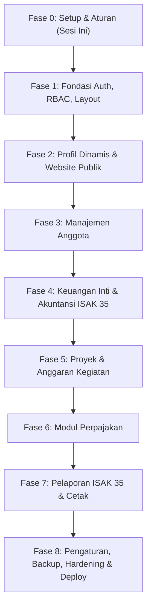

# Rencana Induk Pengembangan (Master Plan)

## Yayasan Nurjaman Bongas Purwakarta

Dokumen ini adalah cetak biru komprehensif pengembangan sistem web publik dan panel administrasi terpadu Yayasan Nurjaman Bongas Purwakarta. Dokumen ini menjadi peta jalan tunggal (_single source of truth_) yang memandu urutan fase, lingkup kerja, dan kriteria penyelesaian.

---

## A. Tujuan & Ruang Lingkup Proyek

### 1. Tujuan Sistem

Membangun platform digital kelembagaan terintegrasi yang:

1. Menyajikan profil, visi misi, kegiatan sosial, dan keterbukaan informasi publik Yayasan Nurjaman Bongas Purwakarta kepada masyarakat luas dan donatur.
2. Menyediakan perangkat tata kelola internal berbasis tata buku akuntansi nirlaba modern sesuai standar **ISAK 35** (Interpretasi Standar Akuntansi Keuangan untuk Entitas Berorientasi Nonlaba).
3. Mengelola keanggotaan, anggaran program/kegiatan, pemotongan pajak berkonfigurasi dinamis, serta perlindungan data melalui jejak audit ketat dan cadangan berkala.

### 2. Ruang Lingkup (In Scope)

- Website publik responsif dan elegan dengan tata letak editorial.
- Modul profil dinamis (nama, logo, visi misi, legalitas SK Kemenkumham, struktur pengurus dapat diubah dari admin).
- Publikasi berita, artikel, dan galeri dokumentasi kegiatan yayasan.
- Manajemen anggota (pengurus, pembina, relawan, donatur tetap).
- Sistem akuntansi entitas nonlaba (Bagan Akun Standar/COA, Jurnal Umum, Buku Besar, Kas & Bank, Aset Neto Dengan dan Tanpa Pembatasan).
- Manajemen proyek/kegiatan yang terhubung dengan pos anggaran dan pencairan dana.
- Modul kalkulasi perpajakan (PPh 21, PPh 23, PPh Final, dll.) dengan tarif berversi tanggal.
- Laporan Keuangan ISAK 35 (Posisi Keuangan, Penghasilan Komprehensif, Arus Kas, Catatan atas Laporan Keuangan).
- Panel pengaturan sistem, Role-Based Access Control (RBAC), Audit Trail, dan Backup/Restore data.

### 3. Di Luar Lingkup (Out of Scope)

- Sistem pembayaran daring otomatis / Payment Gateway real-time (fase ini pencatatan penerimaan kas dicatat manual oleh bendahara berdasarkan bukti transfer).
- Aplikasi mobile native (iOS/Android) — sistem fokus pada web responsif PWA-ready.
- Integrasi otomatis langsung ke server DJP / e-Faktur (sistem menyediakan modul hitung dan pencetakan bukti potong standar, pelaporan SPT dilakukan terpisah).

---

## B. Pengguna & Peran Sistem (User Roles)

Sistem memiliki 7 tingkatan peran dengan hierarki dan kebutuhan spesifik:

1. **Super Admin**:
   - Memiliki kendali teknis penuh: konfigurasi server, manajemen user & permission, audit trail, backup/restore database, pemulihan sistem.
2. **Pembina Yayasan**:
   - Akses read-only ke seluruh laporan keuangan eksekutif, rekapitulasi aset neto, ringkasan audit, dan evaluasi capaian program.
3. **Ketua Yayasan**:
   - Memantau dasbor kinerja lembaga, persetujuan rencana anggaran proyek, dan otorisasi kebijakan umum.
4. **Sekretaris**:
   - Mengelola data anggota/pengurus, surat-menyurat kelembagaan, arsip legalitas, dan publikasi profil/berita kegiatan.
5. **Bendahara**:
   - Operator utama transaksi keuangan: input kas masuk/keluar, penjurnalan, rekonsiliasi bank, pemotongan pajak, tutup buku periode, pencetakan laporan ISAK 35.
6. **Pengawas Yayasan**:
   - Akses pengawasan independen: memverifikasi keabsahan jurnal, memantau audit log mutasi kas, dan memeriksa kepatuhan anggaran.
7. **Editor Konten**:
   - Dibatasi hanya untuk menyusun draf berita, mengunggah galeri foto, dan mengelola artikel website publik.

---

## C. Rincian Modul & Fungsionalitas

### 1. Profil Yayasan Dinamis (`src/modules/content/`)

- Manajemen identitas: Nama resmi, logo, favicon, slogan, sejarah, visi misi, nomor kontak, email, alamat kantor (Bongas, Purwakarta), koordinat peta.
- Legalitas hukum: Nomor Akta Notaris, SK Kemenkumham, NPWP Yayasan, Rekening Bank Resmi.
- Struktur organisasi dinamis: Bagan dewan pembina, pengawas, dan pengurus harian dengan foto dan jabatan.

### 2. Website Publik (`src/app/(public)/`)

- Halaman Beranda: Tajuk editorial, program unggulan, ringkasan dampak sosial, dokumentasi terbaru.
- Halaman Profil & Visi Misi: Gambaran lembaga dan susunan pengurus.
- Halaman Program / Proyek: Portofolio aksi sosial dan pemberdayaan masyarakat di Purwakarta.
- Halaman Berita & Galeri: Liputan kegiatan dengan filter kategori.
- Halaman Transparansi Opsional: Ringkasan laporan publikasi donasi dan penggunaan dana.
- Halaman Kontak: Formulir pesan dan peta lokasi sekretariat.

### 3. Manajemen Anggota (`src/modules/members/`)

- Kategori anggota: Pengurus, Pembina, Pengawas, Relawan, Donatur.
- Biodata lengkap, nomor kontak, riwayat keikutsertaan program, dan status keaktifan.

### 4. Akuntansi & Keuangan ISAK 35 (`src/modules/finance/`)

- **Bagan Akun (Chart of Accounts / COA)**:
  - Klasifikasi Aset, Liabilitas, Aset Neto Tanpa Pembatasan, Aset Neto Dengan Pembatasan, Pendapatan, dan Beban.
- **Jurnal Umum & Transaksi**:
  - Validasi ketat keseimbangan Debit = Kredit.
  - Alur transaksi: DRAFT → POSTED. Transaksi posted terkunci permanen, koreksi via VOID / Jurnal Pembalik.
- **Buku Kas & Bank**:
  - Pencatatan mutasi kas kecil, rekening giro, dan rekonsiliasi kas masuk/keluar.
- **Penguncian Periode (Tutup Buku)**:
  - Penutupan bulanan/tahunan untuk mencegah posting susulan ke periode lampau.

### 5. Proyek & Anggaran (`src/modules/projects/`)

- Rencana Anggaran Biaya (RAB) per proyek/kegiatan.
- Pelacakan realisasi pengeluaran terhadap pagu anggaran (indikator peringatan jika mendekati batas).
- Hubungan langsung ke kode akun jurnal pembukuan.

### 6. Perpajakan Berkonfigurasi (`src/modules/tax/`)

- Master data jenis pajak: PPh 21 (honor/upah relawan/narasumber), PPh 23 (sewa/jasa), PPh Final 4(2), dll.
- Konfigurasi tarif dengan rentang tanggal berlaku (`effective_date` & `expiry_date`).
- Pembuatan dan pencetakan Bukti Potong Pajak standar.
- _Catatan Kepatuhan_: Seluruh aturan penerapan tarif wajib diverifikasi oleh akuntan/konsultan pajak yayasan.

### 7. Pelaporan ISAK 35 & Pendukung (`src/modules/finance/`)

- Laporan Posisi Keuangan (Neraca).
- Laporan Penghasilan Komprehensif (Aktivitas).
- Laporan Arus Kas (Metode Langsung / Tidak Langsung).
- Laporan Perubahan Aset Neto.
- Tampilan cetak standar dokumen resmi dengan kop surat dan kolom tanda tangan pengurus.

### 8. Tata Kelola, Keamanan & Pengaturan (`src/modules/settings/`, `audit/`, `backup/`)

- Autentikasi aman dan RBAC berbasis permission granular (`modul.aksi`).
- Audit trail tak terhapus untuk seluruh aksi mutasi data penting.
- Fasilitas backup berkala database dan pemulihan (restore).

---

## D. Fase Pengerjaan & Roadmap Sekuensial

### Fase 0: Setup, Tooling & Konfigurasi (Sesi Ini)

- **Tujuan**: Membangun fondasi arsitektur terstandar, dokumen kerja, dan sistem changelog.
- **Ruang Lingkup**:
  - [x] Inisialisasi git, Next.js, TypeScript strict (`noUncheckedIndexedAccess`), Tailwind, ESLint, Prettier, Husky.
  - [x] Salin logo resmi yayasan ke `public/brand/` dan sampling palet warna langsung dari pixel logo.
  - [x] Desain token sistem (`tokens.css`), konfigurasi font (`Source Serif 4` & `Plus Jakarta Sans`).
  - [x] Halaman placeholder minimal `/`, route `/api/health`, dan pratinjau dev-only `/dev/tokens`.
  - [x] Validasi env dengan Zod (`src/lib/env.ts`), singleton Prisma (`src/lib/db.ts`), utilitas format & error.
  - [x] Sistem changelog (`changelogs/`, script CLI, penegakan git pre-commit).
  - [x] Dokumen aturan lengkap: `AGENTS.md`, `WORKING-RULES.md`, `UI-UX-RULES.md`, `MASTER-PLAN.md`, `ARCHITECTURE.md`.
- **Kriteria Selesai**: Typecheck, lint, dan test lulus; health endpoint aktif; pre-commit menolak commit tanpa changelog; entri 0001 dibuat.
- **Risiko**: Ketidaksesuaian runtime Windows diselesaikan dengan pnpm.cmd dan isolated sandbox practices.

### Fase 1: Fondasi Autentikasi, RBAC, Layout & Audit Log

- **Tujuan**: Menyiapkan akses masuk aman, hierarki izin pengguna, layout admin/publik, dan sistem perekam audit.
- **Ruang Lingkup**:
  - [ ] Implementasi skema tabel User, Session, Role, Permission, dan AuditLog di Prisma.
  - [ ] Alur masuk admin, proteksi session berbasis cookie httpOnly yang aman.
  - [ ] Sistem otorisasi middleware dan server-side permission check (`hasPermission("modul.aksi")`).
  - [ ] Shell layout admin (Sidebar navigasi, header pengurus, breadcrumbs, tombol tema).
  - [ ] Komponen UI atomik dasar sesuai token (Tombol, Input, Modal, Badge, Skeleton, Toast).
  - [ ] Service perekam Audit Trail otomatis.
- **Kriteria Selesai**: Admin dapat login, role dibatasi sesuai izin, aksi tercatat di audit log.
- **Risiko**: Kerentanan session hijacking dan IDOR; mitigasi dengan token cryptographically secure dan pengecekan otorisasi server-side.

### Fase 2: Profil Yayasan Dinamis, Berita & Website Publik

- **Tujuan**: Meluncurkan wajah publik yayasan yang dapat dikelola secara mandiri dari admin panel.
- **Ruang Lingkup**:
  - [ ] Tabel data Profil Yayasan, Struktur Pengurus, Berita/Artikel, dan Kategori.
  - [ ] Panel admin untuk mengedit identitas yayasan, susunan pengurus, dan legalitas SK.
  - [ ] Admin editor berita (rich text dengan sanitasi HTML ketat) dan galeri dokumentasi kegiatan.
  - [ ] Halaman publik: Beranda, Profil & Visi Misi, Berita, Galeri, Kontak.
- **Kriteria Selesai**: Halaman publik tampil profesional sesuai UI-UX-RULES, konten berita dan profil dinamis dapat diubah dari admin.
- **Risiko**: Masalah keamanan unggahan berkas gambar dan XSS; mitigasi dengan validasi tipe berkas dan HTML sanitizer.

### Fase 3: Manajemen Anggota & Pengurus

- **Tujuan**: Tata kelola data anggota, donatur, relawan, dan dewan pengurus yayasan.
- **Ruang Lingkup**:
  - [ ] Skema database Member, MemberCategory, dan RiwayatKeaktifan.
  - [ ] CRUD data anggota dengan filter kategori, pencarian, dan pagination.
  - [ ] Fitur ekspor data anggota (format CSV/Excel aman).
- **Kriteria Selesai**: Pengurus dapat mengelola direktori anggota dengan validasi data yang presisi.
- **Risiko**: Kebocoran data pribadi (PII); mitigasi dengan pembatasan hak akses berbasis RBAC dan audit log akses data.

### Fase 4: Keuangan Inti & Akuntansi Nirlaba ISAK 35

- **Tujuan**: Membangun mesin pencatatan transaksi jurnal berimbang dan buku besar.
- **Ruang Lingkup**:
  - [ ] Skema database Account (COA), JournalEntry, JournalLine, CashBank, AccountingPeriod.
  - [ ] Master Bagan Akun Standar Entitas Nonlaba (Aset Neto Dengan & Tanpa Pembatasan).
  - [ ] Form input transaksi kas & jurnal umum dengan validasi real-time Debit = Kredit.
  - [ ] Logika status DRAFT → POSTED dan mekanisme pembatalan VOID (jurnal pembalik).
  - [ ] Fitur Penguncian Periode / Tutup Buku Bulanan.
- **Kriteria Selesai**: Seluruh invarian akuntansi terpenuhi; transaksi tidak seimbang ditolak sistem; unit test akuntansi lulus 100%.
- **Risiko**: Kesalahan logika pembukuan; mitigasi dengan unit test komprehensif untuk seluruh skenario jurnal.

### Fase 5: Proyek & Anggaran Kegiatan

- **Tujuan**: Menghubungkan program kerja sosial dengan alokasi pos keuangan dan pelacakan realisasi.
- **Ruang Lingkup**:
  - [ ] Skema database Project, ProjectBudget, ProjectExpense.
  - [ ] Pengelolaan rencana anggaran per kegiatan sosial yayasan di Purwakarta.
  - [ ] Integrasi otomatis antara pengeluaran proyek dengan jurnal kas keluar di modul keuangan.
  - [ ] Laporan evaluasi serapan anggaran proyek (Pagu vs Realisasi vs Sisa).
- **Kriteria Selesai**: Setiap pencairan dana proyek otomatis membentuk jurnal pembukuan dan memperbarui sisa pagu anggaran.
- **Risiko**: Terjadinya pengeluaran melebihi anggaran (_over-budget_); mitigasi dengan peringatan validasi pada layer service.

### Fase 6: Perpajakan Berkonfigurasi Dinamis

- **Tujuan**: Menghitung dan menerbitkan bukti potong pajak atas honor, sewa, atau transaksi jasa.
- **Ruang Lingkup**:
  - [ ] Skema database TaxType, TaxRate (berversi tanggal efektif), dan TaxWithholding (Bukti Potong).
  - [ ] Antarmuka pengaturan tarif pajak di admin (tanpa hardcode di source code).
  - [ ] Perhitungan otomatis PPh 21 / PPh 23 pada transaksi yang relevan.
  - [ ] Fitur pencetakan Bukti Potong Pajak format standar.
- **Kriteria Selesai**: Kalkulasi pajak sesuai aturan berversi; bukti potong dapat diunduh/dicetak; unit test hitung pajak lulus.
- **Risiko**: Perubahan regulasi tarif pajak; mitigasi dengan arsitektur tarif dinamis berversi tanggal.

### Fase 7: Pelaporan Keuangan ISAK 35 & Cetak Dokumen

- **Tujuan**: Menyajikan laporan keuangan formal yang siap diaudit dan dipresentasikan kepada pembina/donatur.
- **Ruang Lingkup**:
  - [ ] Generator Laporan Posisi Keuangan (Neraca).
  - [ ] Generator Laporan Penghasilan Komprehensif (Laporan Aktivitas Yayasan).
  - [ ] Generator Laporan Arus Kas & Laporan Perubahan Aset Neto.
  - [ ] Tata letak cetak dokumen resmi (CSS Print, kop surat dinamis, blok tanda tangan pengurus).
  - [ ] Halaman transparansi publik (opsional, menampilkan ringkasan teragregasi yang telah disetujui ketua).
- **Kriteria Selesai**: Laporan akurat sesuai data jurnal; tampilan cetak presisi dan rapi pada kertas A4.
- **Risiko**: Inkonsistensi angka laporan; mitigasi dengan pengujian rekonsiliasi matematis antara neraca dan laporan aktivitas.

### Fase 8: Pengaturan Sistem, Cadangan Data, Hardening & Deployment

- **Tujuan**: Memastikan keandalan sistem, pemulihan bencana, optimasi performa, dan kesiapan rilis produksi.
- **Ruang Lingkup**:
  - [ ] Modul Backup dan Restore database otomatis (kompresi terenkripsi).
  - [ ] Peninjau audit log aktivitas admin dan pencarian log keamanan.
  - [ ] Audit keamanan menyeluruh (OWASP Top 10 checklist, rate limiting, security headers).
  - [ ] Konfigurasi deployment produksi via Docker / VPS dengan monitoring uptime.
- **Kriteria Selesai**: Sistem stabil, lolos audit keamanan, backup terverifikasi dapat di-restore, pipeline produksi siap.
- **Risiko**: Kehilangan data saat server crash; mitigasi dengan pengujian skenario pemulihan cadangan data (disaster recovery test).

---

## E. Tabel Status Fase Pengerjaan

| Fase       | Nama Fase                               | Status                             | ID Changelog Terkait | Keterangan                                   |
| ---------- | --------------------------------------- | ---------------------------------- | -------------------- | -------------------------------------------- |
| **Fase 0** | Setup Awal, Tooling, Aturan & Changelog | **Berjalan (Selesai di sesi ini)** | `[ID: 0001]`         | Fondasi arsitektur, dokumen, dan tokens siap |
| **Fase 1** | Fondasi Auth, RBAC, Layout & Audit Log  | Belum                              | -                    | Menunggu konfirmasi pemilik proyek           |
| **Fase 2** | Profil Dinamis, Berita & Website Publik | Belum                              | -                    | Tergantung Fase 1                            |
| **Fase 3** | Manajemen Anggota                       | Belum                              | -                    | Tergantung Fase 1                            |
| **Fase 4** | Keuangan Inti & Akuntansi ISAK 35       | Belum                              | -                    | Tergantung Fase 1 & 3                        |
| **Fase 5** | Proyek & Anggaran Kegiatan              | Belum                              | -                    | Tergantung Fase 4                            |
| **Fase 6** | Modul Perpajakan Berkonfigurasi         | Belum                              | -                    | Tergantung Fase 4                            |
| **Fase 7** | Pelaporan ISAK 35 & Cetak               | Belum                              | -                    | Tergantung Fase 4, 5, 6                      |
| **Fase 8** | Pengaturan, Backup, Hardening & Deploy  | Belum                              | -                    | Fase final sebelum go-live                   |

---

## F. Asumsi & Pertanyaan Terbuka untuk Pemilik Proyek

Sebelum melanjutkan ke Fase 1 dan seterusnya, terdapat beberapa pertanyaan strategis yang memerlukan keputusan dari pemilik proyek:

1. **Infrastruktur Hosting & Deployment Final**:
   Apakah sistem akan dihosting pada VPS mandiri (misal: Ubuntu Server dengan Docker Compose + Nginx/Traefik) atau pada layanan PaaS (seperti Vercel untuk Next.js + Supabase/Neon untuk PostgreSQL)?
2. **Kebutuhan Alur Persetujuan Transaksi (Approval Workflow)**:
   Apakah setiap transaksi pengeluaran kas di atas nominal tertentu (misal: di atas Rp 5.000.000) memerlukan persetujuan digital bertingkat (approval) dari Ketua Yayasan sebelum berstatus `POSTED`, atau cukup bendahara langsung memposting?
3. **Format & Kebutuhan Regulasi Bukti Potong Pajak**:
   Apakah bukti potong yang diterbitkan sistem cukup berupa format PDF standar internal yayasan, atau harus mengikuti format khusus formulir bukti potong DJP (e-Bupot)? _(Perlu verifikasi dengan akuntan / konsultan pajak yayasan)_.
4. **Kebijakan Publikasi Transparansi di Website Publik**:
   Apakah masyarakat umum diizinkan melihat rekapitulasi penggunaan donasi/dana kegiatan secara terbuka di website publik, ataukah hanya pengurus internal yang dapat mengakses seluruh laporan?
5. **Verifikasi Master Bagan Akun (Chart of Accounts)**:
   Siapa pihak akuntan atau penasihat keuangan yayasan yang akan memvalidasi daftar kode akun baku (COA) ISAK 35 sebelum dimigrasikan ke database?

---

## G. Manajemen Risiko & Strategi Mitigasi

1. **Risiko Kesalahan Pembukuan & Ketidakseimbangan Jurnal**:
   - _Mitigasi_: Validasi matematis otomatis pada level Service dan skema database constraint. Transaksi yang tidak seimbang otomatis di-rollback dalam Prisma Transaction.
2. **Risiko Kehilangan Data Finansial**:
   - _Mitigasi_: Dilarang menggunakan hard-delete pada tabel transaksi. Penyimpanan snapshot berkala dengan jadwal otomatis ke volume terpisah.
3. **Risiko Pelanggaran Akses / Kebocoran Data (IDOR & Privilege Escalation)**:
   - _Mitigasi_: Pemeriksaan otorisasi dilakukan di server-side pada setiap action/API menggunakan skema RBAC berbasis permission granular.
4. **Risiko Scope Creep (Pelebaran Lingkup)**:
   - _Mitigasi_: Penegakan aturan ketat pada WORKING-RULES.md: Dilarang menambah fitur tanpa persetujuan revisi MASTER-PLAN.md.

---

## H. Glosarium Singkat Istilah Teknis & Keuangan

- **ISAK 35**: Interpretasi Standar Akuntansi Keuangan No. 35 tentang Penyajian Laporan Keuangan Entitas Berorientasi Nonlaba yang diterbitkan oleh Ikatan Akuntan Indonesia (IAI).
- **Aset Neto Tanpa Pembatasan**: Sumber daya yayasan yang penggunaannya tidak dibatasi oleh persyaratan khusus dari penyumbang/donatur.
- **Aset Neto Dengan Pembatasan**: Sumber daya yayasan yang penggunaannya dibatasi oleh pembatasan waktu atau tujuan tertentu dari pihak donatur/wakif.
- **Penghasilan Komprehensif**: Total perubahan aset neto selama satu periode dari seluruh sumber non-pemilik (pendapatan dikurangi beban).
- **Jurnal Umum**: Catatan kronologis pertama atas seluruh transaksi keuangan yang memuat rincian akun yang didebit dan dikredit.
- **Void Transaksi**: Pembatalan resmi sebuah transaksi yang telah diposting dengan menandai status tidak berlaku dan mencatat alasan pembatalan tanpa menghapus rekam jejak aslinya.
- **Tutup Buku**: Prosedur administratif penguncian catatan keuangan akhir periode untuk memastikan integritas data audit dan persiapan saldo awal periode berikutnya.
- **Bukti Potong Pajak**: Dokumen resmi yang menyatakan bahwa pajak penghasilan telah dipotong oleh pihak pemotong (yayasan) atas pembayaran honor, sewa, atau jasa.

---

## I. Bagian Temuan (Catatan di Luar Lingkup)

Bagian ini digunakan untuk mencatat hal-hal teknis atau saran perbaikan yang ditemukan di luar lingkup tugas aktif:

- _(Belum ada temuan di luar lingkup pada Fase 0)_.
