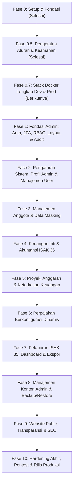

# Rencana Induk Pengembangan (Master Plan)

## Yayasan Nurjaman Bongas Purwakarta

Dokumen ini adalah cetak biru komprehensif pengembangan sistem web resmi dan panel administrasi terpadu Yayasan Nurjaman Bongas Purwakarta. Dokumen ini menjadi peta jalan tunggal (_single source of truth_) yang memandu urutan fase, lingkup kerja, checklist keamanan, dan pengujian kasus negatif.

---

## A. Tujuan & Ruang Lingkup Proyek

### 1. Tujuan Sistem

Membangun platform digital kelembagaan terintegrasi yang:

1. Menyediakan panel internal terpadu untuk tata kelola akuntansi nirlaba modern berbasis **ISAK 35** (Interpretasi Standar Akuntansi Keuangan untuk Entitas Berorientasi Nonlaba).
2. Mengelola keanggotaan (pengurus, relawan, donatur), anggaran kegiatan sosial, kalkulasi pajak berkonfigurasi tanggal, jejak audit nirubah (_immutable audit trail_), dan pencadangan data otomatis.
3. Menyajikan website profil publik editorial yang elegan dan akuntabel yang mengonsumsi data riil dari modul CMS dan laporan keuangan yang telah disahkan dari panel admin.

### 2. Prioritas Pengerjaan: Admin Panel Terlebih Dahulu, Situs Publik Terakhir

Urutan pembangunan mengutamakan **Fondasi Administratif dan Tata Kelola Keuangan Internal Terlebih Dahulu (Fase 1 s.d. 8)**, disusul oleh **Website Publik (Fase 9)**, dan diakhiri dengan **Hardening & Audit Akhir (Fase 10)**. Hal ini menjamin bahwa seluruh data profil, program, dokumentasi, dan transparansi yang ditampilkan ke publik bersumber dari basis data yang telah dikelola dan diverifikasi secara kredibel oleh pengurus.

---

## B. Pengguna & Peran Sistem (User Roles)

Sistem memiliki 7 tingkatan peran dengan pemisahan tugas (_segregation of duties_):

1. **Super Admin**: Pengaturan sistem, manajemen pengguna, role & permission, pemulihan cadangan data, dan audit keamanan.
2. **Pembina Yayasan**: Akses eksekutif _read-only_ ke seluruh laporan keuangan ISAK 35, evaluasi aset neto, dan ringkasan kepatuhan.
3. **Ketua Yayasan**: Persetujuan (_approver_) permohonan dana proyek, penutupan buku tahunan, dan kebijakan umum lembaga.
4. **Sekretaris**: Pengelolaan data anggota/relawan, surat keluar/masuk, arsip legalitas SK, dan verifikasi status anggota.
5. **Bendahara**: Operator keuangan utama (_maker_ penerimaan & _approver_ pencairan kas), penjurnalan, rekonsiliasi kas/bank, pemotongan pajak, tutup buku, dan penerbitan laporan keuangan.
6. **Pengawas Yayasan**: Akses pengawasan independen terhadap keabsahan transaksi jurnal dan integritas audit trail.
7. **Editor Konten**: Pengelolaan draf artikel berita, galeri dokumentasi kegiatan, dan konten informasi publik.

---

## C. Roadmap Sekuensial Fase Pengembangan

---

## D. Rincian Fase Pengembangan

### Fase 0: Setup Fondasi Proyek, Tooling & Konfigurasi (Status: Selesai)

- **Tujuan**: Membangun fondasi arsitektur modular, tooling, dan sistem changelog.
- **Ruang Lingkup Selesai**:
  - Inisialisasi Next.js 15, TypeScript strict (`noUncheckedIndexedAccess`), Tailwind, ESLint, Prettier, Husky.
  - Sampling token warna resmi dari logo (`#29c668`, `#ffff00`, `#020202`, `#ff4745`).
  - Halaman dev-only `/dev/tokens`, route `/api/health`, placeholder `/`.
  - Sistem changelog `pnpm changelog:new` dan pre-commit check.
  - Entri changelog `0001-2026-11-04-setup-fondasi-proyek.md`.

---

### Fase 0.5: Memperketat Aturan, Standar Kode & Fondasi Keamanan (Status: Selesai)

- **Tujuan**: Menegakkan batas kualitas kode, arsitektur berlapis, dan konfigurasi keamanan tanpa membuat fitur domain.
- **Ruang Lingkup Selesai**:
  - [x] Audit komprehensif hasil Fase 0 (inspeksi git history, port postgres 127.0.0.1, audit dependency, perbaikan CVE Next.js & PostCSS).
  - [x] Dokumen standar rekayasa: `docs/CODE-STANDARDS.md` dan `docs/SECURITY.md`.
  - [x] Pembaruan dokumen lama: `AGENTS.md`, `WORKING-RULES.md`, `MASTER-PLAN.md`, `ARCHITECTURE.md`, `UI-UX-RULES.md`.
  - [x] Penegakan tooling otomatis: ESLint max-lines 250 (error 300), complexity 10, no-console, no-any, check-layers AST script, scan-secrets hook.
  - [x] Baseline keamanan konfigurasi: Security headers & CSP nonce via `src/middleware.ts`, `src/app/robots.ts` (disallow admin/api), `.dockerignore`, `docker-compose.prod.example.yml`, `.github/workflows/ci.yml`.
  - [x] Uji E2E Playwright untuk security headers.
  - [x] Entri changelog terpisah (`0002` s.d. `0006`).
- **Checklist Keamanan Fase 0.5**:
  - [x] `pnpm secrets:scan` bersih dari kunci rahasia.
  - [x] `node scripts/check-layers.mjs` mendeteksi 0 pelanggaran batas lapis.
  - [x] Port database terikat ke 127.0.0.1; user runner Docker non-root.
  - [x] Header X-Frame-Options: DENY, X-Content-Type-Options: nosniff, CSP, dan HSTS aktif.
- **Checklist Pengujian Kasus Negatif Fase 0.5**:
  - [x] Uji coba commit file staged dengan rahasia tiruan ditolak oleh pre-commit hook.
  - [x] Uji coba impor `@prisma/client` pada komponen UI ditolak oleh linter dan check-layers.
  - [x] Uji coba akses rute `/dev/tokens` pada mode `NODE_ENV=production` mengembalikan HTTP 404 Not Found.

---

### Fase 0.7: Stack Docker Lengkap (Dev dan Prod) (Status: Belum Dimulai)

- **Tujuan**: Mengimplementasikan seluruh berkas orkestrasi Docker untuk lingkungan pengembangan (dev) dan produksi (prod) sesuai spesifikasi ADR-008, ADR-009, `docs/database/11-migration-plan.md`, dan `docs/database/14-traceability.md`.
- **Ruang Lingkup**:
  - [ ] Implementasi berkas `docker-compose.yml` untuk development (hot reload Next.js, port postgres dev terikat 127.0.0.1).
  - [ ] Implementasi berkas `docker-compose.prod.yml` untuk produksi (internal bridge network `yayasan_internal`, port DB & app tertutup dari host, resource limits).
  - [ ] Konfigurasi container `reverse-proxy` (Caddy resmi ditetapkan dengan otomatisasi TLS Let's Encrypt / ZeroSSL dan security headers).
  - [ ] Konfigurasi container `migrate` sekali jalan (`prisma migrate deploy` dengan resolusi failure `prisma migrate resolve`).
  - [ ] Konfigurasi container `backup-worker` (dengan client PostgreSQL 17, skrip backup terjadwal lokal dan offsite S3 wajib, validasi versi manifest, dan kredensial least privilege).
  - [ ] Konfigurasi multi-stage `Dockerfile` dengan dukungan multi-arsitektur (`linux/amd64` dan `linux/arm64`).
  - [ ] Uji coba simulasi pemindahan mesin (_cross-machine transfer drill_) dari lokal ke container staging.
- **Checklist Keamanan Fase 0.7**:
  - [ ] Port basis data dan aplikasi TIDAK dipublikasikan ke host publik di produksi (mencegah bypass firewall UFW di VPS Linux).
  - [ ] Port 80 dan 443 hanya dipublikasikan oleh reverse proxy.
  - [ ] Kunci rahasia dan environment variables tidak pernah dibakar ke dalam image Docker layer.
  - [ ] Seluruh container produksi berjalan sebagai user non-root dengan opsi `no-new-privileges: true`.
- **Checklist Pengujian Kasus Negatif Fase 0.7**:
  - [ ] Koneksi langsung dari luar host ke port 5432 atau 3000 ditolak / unreachable.
  - [ ] Simulasi kegagalan layanan `migrate` membatalkan deployment tanpa menghentikan container aplikasi lama.
  - [ ] Simulasi pemulihan backup dengan versi PostgreSQL yang tidak kompatibel otomatis ditolak oleh validator worker.

---

### Fase 1: Fondasi Admin: Autentikasi, 2FA, Sesi, RBAC, Layout Admin & Audit Log

- **Tujuan**: Menyiapkan akses masuk aman, hierarki izin pengguna, shell layout admin, dan audit log inti.
- **Ruang Lingkup**:
  - Skema tabel User, Session, Account, Role, Permission, dan AuditLog di Prisma.
  - Autentikasi berbasis password ter-hash Argon2id, cookie sesi aman (`HttpOnly`, `SameSite=Lax`, `Secure`, prefix `__Host-`).
  - Otentikasi dua faktor (TOTP RFC 6238) wajib untuk Super Admin, Ketua, dan Bendahara.
  - Sistem verifikasi izin server-side (`requireUser()`, `requirePermission()`) pada setiap Server Action.
  - Shell layout admin (Sidebar responsif, Header pengurus, Breadcrumb, Dark mode).
  - Pustaka komponen atomik bersama di `src/components/ui/` dan `src/components/shared/` dasar.
  - Service Audit Log append-only terpusat.
- **Checklist Keamanan**:
  - [ ] Rate limiting login (maks 5 kegagalan per 15 menit per IP).
  - [ ] Session invalidation instan saat logout dan saat pergantian password.
  - [ ] Otorisasi server-side aktif pada seluruh Server Action admin (bukan hanya middleware).
- **Checklist Pengujian Kasus Negatif**:
  - [ ] Permintaan Server Action tanpa sesi ditolak (HTTP 401 Unauthorized).
  - [ ] Pengguna tanpa hak akses ditolak saat memanggil aksi administratif (HTTP 403 Forbidden).
  - [ ] Login dengan 6 kali password salah diblokir sementara (HTTP 429 Too Many Requests).

---

### Fase 2: Pengaturan Sistem, Profil Yayasan (Sisi Admin) & Manajemen Pengguna

- **Tujuan**: Memfasilitasi konfigurasi identitas kelembagaan dinamis dan manajemen hak akses pengguna oleh Super Admin.
- **Ruang Lingkup**:
  - Skema tabel FoundationProfile, LegalDocument, OrganizationStructure, SystemSettings.
  - Antarmuka admin manajemen profil: nama yayasan, visi-misi, kontak, alamat Bongas, nomor legalitas SK Kemenkumham, rekening bank resmi.
  - Manajemen pengguna internal: undang pengurus baru, penugasan role, reset password, dan status aktif/nonaktif.
- **Checklist Keamanan**:
  - [ ] Hanya Super Admin yang berhak memodifikasi pengaturan sistem dan role pengguna.
  - [ ] Otentikasi ulang (_step-up auth_) saat mengubah peran pengguna menjadi Super Admin/Bendahara.
- **Checklist Pengujian Kasus Negatif**:
  - [ ] Staf biasa mencoba mengakses route/action manajemen user ditolak (403).
  - [ ] Pembaruan profil dengan data malformasi (email/URL tidak valid) ditolak skema Zod (422).

---

### Fase 3: Manajemen Anggota & Data Masking

- **Tujuan**: Mengelola direktori anggota, dewan pengurus, relawan, dan donatur tetap yayasan dengan perlindungan privasi.
- **Ruang Lingkup**:
  - Skema database Member, MemberCategory, MemberHistory.
  - Form pendataan anggota dengan validasi NIK dan enkripsi at-rest AES-256-GCM.
  - Antarmuka data table anggota dengan paginasi, pencarian, dan filter kategori.
  - Fitur penyamaran data (_data masking_) untuk NIK dan kontak pada tabel umum.
  - Ekspor data anggota berizin khusus dengan pencatatan audit log otomatis.
- **Checklist Keamanan**:
  - [ ] Data NIK tersimpan terenkripsi di PostgreSQL.
  - [ ] Penyamaran data NIK aktif secara default di antarmuka (`3201************`).
  - [ ] Ekspor data dibatasi hanya untuk Sekretaris dan Super Admin.
- **Checklist Pengujian Kasus Negatif**:
  - [ ] Percobaan injeksi SQL melalui parameter filter/search ditolak Prisma parameterized query.
  - [ ] Permintaan pembukaan data NIK tanpa izin khusus ditolak (403).

---

### Fase 4: Keuangan Inti & Akuntansi Nirlaba ISAK 35

- **Tujuan**: Membangun mesin pencatatan transaksi jurnal berimbang ganda dan pengelolaan kas/bank.
- **Ruang Lingkup**:
  - Skema database ChartOfAccount (COA), JournalEntry, JournalLine, CashAccount, AccountingPeriod.
  - Bagan Akun Standar Entitas Nonlaba (Aset Neto Dengan & Tanpa Pembatasan).
  - Form input kas masuk/keluar & jurnal umum dengan validasi real-time Debit = Kredit.
  - Siklus transaksi: DRAFT → PENDING APPROVAL → POSTED.
  - Mekanisme pembatalan VOID (jurnal pembalik nirubah, transaksi posted tidak dapat diedit).
  - Fitur Penguncian Periode / Tutup Buku Bulanan & Tahunan.
  - Alur Maker-Checker untuk permohonan pencairan kas.
- **Checklist Keamanan**:
  - [ ] Invarian akuntansi mutlak: Debit == Kredit ditegakkan di Service dan Transaction level.
  - [ ] Anti-self-approval: Pembuat draf dilarang menyetujui transaksinya sendiri.
  - [ ] Transaksi berstatus POSTED terkunci dari perubahan atau penghapusan fisik.
  - [ ] Rekaman mutasi keuangan selalu mencatat audit log append-only.
- **Checklist Pengujian Kasus Negatif**:
  - [ ] Transaksi jurnal dengan selisih Debit dan Kredit Rp 1 ditolak keras (422 Unprocessable Entity).
  - [ ] Permintaan edit/delete pada transaksi `POSTED` ditolak (400 Bad Request).
  - [ ] Pembuatan jurnal pada periode akuntansi berstatus `CLOSED` ditolak (400 Bad Request).

---

### Fase 5: Proyek, Anggaran & Keterkaitan Keuangan

- **Tujuan**: Mengaitkan program kerja sosial dengan alokasi pos keuangan dan pelacakan serapan anggaran.
- **Ruang Lingkup**:
  - Skema database Project, ProjectBudget, ProjectDisbursement.
  - Rencana Anggaran Biaya (RAB) per proyek sosial kemasyarakatan di Purwakarta.
  - Integrasi otomatis: persetujuan pencairan dana proyek langsung membentuk jurnal kas keluar di modul keuangan.
  - Pelacakan serapan anggaran (Pagu vs Realisasi vs Sisa) dengan indikator batas.
- **Checklist Keamanan**:
  - [ ] Pencairan dana proyek memerlukan otorisasi Ketua Yayasan atau Bendahara.
  - [ ] Validasi pagu: sistem menolak atau memberi peringatan keras saat pengeluaran melebihi sisa anggaran.
- **Checklist Pengujian Kasus Negatif**:
  - [ ] Pengajuan pencairan pada proyek berstatus `COMPLETED` atau `CANCELLED` ditolak (400).
  - [ ] Permintaan pencairan dana oleh akun non-pengurus proyek ditolak (403).

---

### Fase 6: Perpajakan Berkonfigurasi Dinamis

- **Tujuan**: Mengelola perhitungan pemotongan pajak dan penerbitan bukti potong tanpa hardcode tarif.
- **Ruang Lingkup**:
  - Skema database TaxType, TaxRate (berversi tanggal berlaku `effective_date` & `expiry_date`), dan TaxWithholding.
  - Antarmuka admin master tarif pajak (PPh 21, PPh 23, PPh Final).
  - Perhitungan otomatis potongan pajak pada pengeluaran honor/sewa/jasa di modul keuangan.
  - Pembuatan dan pencetakan dokumen Bukti Potong Pajak standar.
- **Checklist Keamanan**:
  - [ ] Tarif pajak dibaca dinamis berdasarkan tanggal transaksi, bukan dari kode program.
  - [ ] Perubahan tarif pajak memerlukan otentikasi ulang Bendahara.
- **Checklist Pengujian Kasus Negatif**:
  - [ ] Perhitungan pajak dengan tanggal di luar rentang tanggal berlaku mengembalikan galat konfigurasi (422).
  - [ ] Pengubahan tarif pajak lampau yang telah dipakai transaksi posted ditolak (400).

---

### Fase 7: Pelaporan Keuangan ISAK 35, Dashboard & Ekspor Dokumen

- **Tujuan**: Menyajikan laporan keuangan formal nirlaba yang siap diaudit dan dipresentasikan ke Pembina/Donatur.
- **Ruang Lingkup**:
  - Generator Laporan Posisi Keuangan (Neraca Nirlaba).
  - Generator Laporan Penghasilan Komprehensif (Laporan Aktivitas: Terikat & Tidak Terikat).
  - Generator Laporan Arus Kas (Metode Langsung/Tidak Langsung) & Laporan Perubahan Aset Neto.
  - Dashboard analitik keuangan untuk Pembina dan Ketua Yayasan.
  - Format cetak dokumen standar resmi (A4, kop surat yayasan, kolom tanda tangan pejabat).
  - Ekspor laporan ke PDF dan lembar kerja Excel bertipe presisi.
- **Checklist Keamanan**:
  - [ ] Akses laporan keuangan dibatasi hanya untuk peran Pembina, Ketua, Pengawas, dan Bendahara.
  - [ ] Rekonsiliasi matematis: Neraca wajib seimbang antara Aset dengan Liabilitas + Aset Neto.
- **Checklist Pengujian Kasus Negatif**:
  - [ ] Editor Konten atau Staf Lapangan mencoba mengakses laporan ISAK 35 ditolak (403).
  - [ ] Ekspor laporan pada rentang tanggal tidak valid (tanggal awal > akhir) ditolak Zod (422).

---

### Fase 8: Manajemen Konten Admin (CMS) & Backup/Restore Sistem

- **Tujuan**: Fasilitas penyusunan konten publik secara mandiri dari admin panel serta perlindungan integritas data.
- **Ruang Lingkup**:
  - Skema database Article, ArticleCategory, MediaGallery, SystemBackup.
  - Admin editor berita berbasis Tiptap dengan sanitasi HTML ketat.
  - Manajemen galeri foto kegiatan dengan optimasi gambar dan verifikasi _magic bytes_.
  - Modul backup basis data otomatis (dump PostgreSQL terkompresi dan terenkripsi).
  - Mekanisme pemulihan data (_restore verification drill_).
- **Checklist Keamanan**:
  - [ ] Seluruh input teks kaya disanitasi ketat di server (larangan script, iframe asing, handler inline).
  - [ ] Berkas unggahan diverifikasi ekstensi, MIME, dan biner magic bytes; nama berkas diacak UUIDv4.
  - [ ] Berkas dump backup terenkripsi dan disimpan di volume terisolasi.
- **Checklist Pengujian Kasus Negatif**:
  - [ ] Pengunggahan berkas executable (.exe/.sh/.php) yang di-rename menjadi .jpg ditolak pemeriksaan magic bytes (400).
  - [ ] Penyisipan payload XSS `` pada artikel otomatis dibersihkan oleh sanitizer.

---

### Fase 9: Website Publik, Transparansi & Optimasi SEO

- **Tujuan**: Membuka representasi digital yayasan kepada publik Purwakarta dan calon donatur secara profesional.
- **Ruang Lingkup**:
  - Halaman Beranda editorial dengan program unggulan dan dokumentasi resmi.
  - Halaman Profil Lembaga, Visi Misi, Sejarah, Legalitas, dan Struktur Pengurus (mengonsumsi data Fase 2).
  - Halaman Berita & Galeri Kegiatan (mengonsumsi data Fase 8).
  - Halaman Transparansi Akuntabilitas (menampilkan ringkasan laporan ISAK 35 teragregasi yang telah disetujui Ketua).
  - Halaman Kontak & Lokasi Sekretariat Bongas, Purwakarta.
  - Optimasi SEO, metadata OpenGraph, sitemap.xml, dan skor performa Core Web Vitals tinggi.
- **Checklist Keamanan**:
  - [ ] Halaman publik bersifat murni _read-only_; formulir kontak dibatasi rate limiting ketat dan captcha/honeypot.
  - [ ] Data privat pengurus/anggota (NIK, alamat rumah pribadi, nomor rekening personal) tidak pernah diekspos ke publik.
- **Checklist Pengujian Kasus Negatif**:
  - [ ] Pengiriman formulir kontak dengan spam berulang ditolak rate limiting (429).
  - [ ] Akses rute admin tersembunyi dari situs publik menghasilkan 401/404 tanpa kebocoran informasi stack trace.

---

### Fase 10: Hardening Akhir, Pentest Independen & Rilis Produksi

- **Tujuan**: Menguji ketahanan sistem secara komprehensif, audit akuntansi final, dan penyebaran ke server produksi.
- **Ruang Lingkup**:
  - Uji penetrasi independen (_simulated grey-box penetration testing_): pengujian eskalasi hak akses, bypass maker-checker, fuzzer input.
  - Audit rekonsiliasi akuntansi akhir bersama akuntan yayasan.
  - Konfigurasi produksi: Docker Compose produksi, Caddy reverse proxy dengan TLS 1.3 otomatis, backup cron off-site.
  - Dokumentasi serah terima sistem dan buku panduan operasional pengurus.
- **Checklist Keamanan**:
  - [ ] Seluruh temuan pentest berkategori High/Medium telah diselesaikan.
  - [ ] Audit ketergantungan `pnpm security:audit` bebas kerentanan High/Critical.
  - [ ] Uji skenario pemulihan bencana (_disaster recovery drill_) berhasil membangkitkan data dari dump cadangan.
- **Checklist Pengujian Kasus Negatif**:
  - [ ] Fuzzing payload terhadap seluruh endpoint tidak menyebabkan server crash atau memory exhaustion.
  - [ ] Pengujian kegagalan koneksi database menghasilkan respons HTTP 503 yang aman tanpa ekspos kredensial.

---

## E. Tabel Status Fase Pengerjaan

| Fase         | Nama Fase & Ruang Lingkup                           | Status        | ID Changelog Terkait           |
| :----------- | :-------------------------------------------------- | :------------ | :----------------------------- |
| **Fase 0**   | Setup Fondasi Proyek, Tooling & Design Tokens       | **Selesai**   | `[ID: 0001]`                   |
| **Fase 0.5** | Memperketat Aturan, Standar Kode & Fondasi Keamanan | **Selesai**   | `[ID: 0002]` s.d. `[ID: 0006]` |
| **Fase 0.7** | Stack Docker Lengkap (Dev dan Prod)                 | Belum Dimulai | `[ID: 0007]` (Desain)          |
| **Fase 1**   | Fondasi Admin: Auth, 2FA, RBAC, Layout & Audit Log  | Belum Dimulai | -                              |
| **Fase 2**   | Pengaturan Sistem, Profil Admin & Manajemen User    | Belum Dimulai | -                              |
| **Fase 3**   | Manajemen Anggota & Data Masking                    | Belum Dimulai | -                              |
| **Fase 4**   | Keuangan Inti & Akuntansi ISAK 35                   | Belum Dimulai | -                              |
| **Fase 5**   | Proyek, Anggaran & Keterkaitan Keuangan             | Belum Dimulai | -                              |
| **Fase 6**   | Perpajakan Berkonfigurasi Dinamis                   | Belum Dimulai | -                              |
| **Fase 7**   | Pelaporan ISAK 35, Dashboard & Ekspor               | Belum Dimulai | -                              |
| **Fase 8**   | CMS Admin & Backup/Restore Sistem                   | Belum Dimulai | -                              |
| **Fase 9**   | Website Publik, Transparansi & SEO                  | Belum Dimulai | -                              |
| **Fase 10**  | Hardening Akhir, Pentest & Rilis Produksi           | Belum Dimulai | -                              |

---

## F. Asumsi & Pertanyaan Terbuka untuk Pemilik Proyek

1. **Infrastruktur Produksi Final**: Apakah deployment akhir akan menggunakan VPS mandiri (Ubuntu + Docker Compose v2 + Caddy TLS otomatis) atau layanan cloud PaaS terkelola? _(Rekomendasi arsitektur: VPS mandiri Docker-first sesuai ADR-008)_.
2. **Ambang Batas Alur Persetujuan (Maker-Checker)**: Apakah seluruh pengeluaran kas wajib melalui persetujuan Ketua Yayasan, atau ada batas nominal tertentu (misal: di bawah Rp 2.000.000 cukup persetujuan Bendahara)?
3. **Format Bukti Potong Pajak**: Apakah format PDF standar yayasan mencukupi, atau memerlukan integrasi skema e-Bupot DJP? _(Perlu verifikasi akuntan/konsultan pajak)_.
4. **Tingkat Keterbukaan Transparansi Publik**: Apakah publik dapat melihat rincian realisasi program hingga level kuitansi, atau hanya ringkasan laporan keuangan teragregasi per semester?
5. **Daftar Akun Baku (COA)**: Siapa nama/kontak akuntan yayasan yang akan menandatangani daftar akun ISAK 35 sebelum dimigrasikan ke database?

---

## G. Bagian Temuan & Catatan Audit

1. **[SELESAI - Remediasi Keamanan] Binding Port PostgreSQL**: Port dev di `docker-compose.yml` sebelumnya terbuka ke `0.0.0.0`; telah diperketat menjadi terikat hanya pada `127.0.0.1`.
2. **[SELESAI - Remediasi Dependensi] Pembaruan Versi Next.js**: Next.js 15.2.1 memiliki kerentanan CVE middleware bypass dan SSR flight RCE; telah diperbarui ke versi stabil `15.5.28`.
3. **[SELESAI - Remediasi Dependensi] Patch PostCSS**: PostCSS di-override ke `8.5.23` untuk menambal kerentanan path traversal source map.
4. **[CATATAN ARSITEKTUR] Pengecekan Database Fase 0**: `src/lib/db.ts` saat ini menggunakan fallback socket TCP (`node:net`) untuk memverifikasi PostgreSQL karena `schema.prisma` belum memiliki model domain. Pada Fase 1, fallback ini wajib diganti dengan kueri otentikasi nyata Prisma setelah skema User/Session dimigrasikan.
5. **[CATATAN DEPENDENSI] Pemantauan CVE DevTooling**: `pnpm audit` melaporkan kerentanan pada paket tooling pengujian dev (`vitest`, `playwright`, `zod`, `minimatch`). Pustaka ini aman diisolasi pada devDependencies dan akan terus dipantau untuk pembaruan versi stabil dengan masa rilis > 14 hari.
