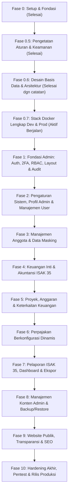

# Rencana Induk Pengembangan (Master Plan)

## Yayasan Nurjaman Bongas Purwakarta

Dokumen ini adalah cetak biru komprehensif pengembangan sistem web resmi dan panel administrasi terpadu Yayasan Nurjaman Bongas Purwakarta. Dokumen ini menjadi peta jalan tunggal (_single source of truth_) yang memandu urutan fase, lingkup kerja, checklist keamanan, dan pengujian kasus negatif. Rincian teknis lengkap tiap fase terorganisasi secara modular di [`docs/master-plan/`](file:///docs/master-plan/00-index.md).

---

## A. Tujuan & Ruang Lingkup Proyek

### 1. Tujuan Sistem

Membangun platform digital kelembagaan terintegrasi yang:

1. Menyediakan panel internal terpadu untuk tata kelola akuntansi nirlaba modern berbasis **ISAK 35** (Interpretasi Standar Akuntansi Keuangan untuk Entitas Berorientasi Nonlaba).
2. Mengelola keanggotaan (pengurus, relawan, donatur), anggaran kegiatan sosial, kalkulasi pajak berkonfigurasi tanggal, jejak audit nirubah (_immutable audit trail_), dan pencadangan data otomatis.
3. Menyajikan website profil publik editorial yang elegan dan akuntabel yang mengonsumsi data riil dari modul CMS dan laporan keuangan yang telah disahkan dari panel admin.

### 2. Prioritas Pengerjaan: Admin Panel Terlebih Dahulu, Situs Publik Terakhir

Urutan pembangunan mengutamakan **Fondasi Administratif dan Tata Kelola Keuangan Internal Terlebih Dahulu (Fase 1 s.d. 8)**, disusul oleh **Website Publik (Fase 9)**, dan diakhiri dengan **Hardening & Audit Akhir (Fase 10)**. Hal ini menjamin bahwa seluruh data profil, program, dokumentasi, dan transparansi yang ditampilkan ke publik bersumber dari basis data yang telah dikelola dan diverifikasi secara kredibel oleh pengurus.

---

## B. Pengguna & Peran Sistem (User Roles)

Sistem memiliki 7 tingkatan peran dengan pemisahan tugas (_segregation of duties_):

1. **Super Admin**: Pengaturan sistem, manajemen pengguna, role & permission, pemulihan cadangan data, dan audit keamanan.
2. **Pembina Yayasan**: Akses eksekutif _read-only_ ke seluruh laporan keuangan ISAK 35, evaluasi aset neto, dan ringkasan kepatuhan.
3. **Ketua Yayasan**: Persetujuan (_approver_) permohonan dana proyek, penutupan buku tahunan, dan kebijakan umum lembaga.
4. **Sekretaris**: Pengelolaan data anggota/relawan, surat keluar/masuk, arsip legalitas SK, dan verifikasi status anggota.
5. **Bendahara**: Operator keuangan utama (_maker_ penerimaan & _approver_ pencairan kas), penjurnalan, rekonsiliasi kas/bank, pemotongan pajak, tutup buku, dan penerbitan laporan keuangan.
6. **Pengawas Yayasan**: Akses pengawasan independen terhadap keabsahan transaksi jurnal dan integritas audit trail.
7. **Editor Konten**: Pengelolaan draf artikel berita, galeri dokumentasi kegiatan, dan konten informasi publik.

---

## C. Roadmap Sekuensial Fase Pengembangan

---

## D. Rincian Fase Pengembangan

Rincian lengkap ruang lingkup teknis, checklist keamanan terverifikasi, dan checklist kasus negatif per fase diorganisasikan pada berkas modular di [`docs/master-plan/`](file:///docs/master-plan/00-index.md):

### Fase 0: Setup Fondasi Proyek, Tooling & Konfigurasi (Status: Selesai)

Inisialisasi Next.js 15, TypeScript strict, Tailwind, ESLint, Prettier, Husky, token warna logo, dev routes `/dev/tokens`, dan changelog `0001`.
👉 _Spesifikasi lengkap: [`docs/master-plan/01-fondasi-dan-setup.md`](file:///docs/master-plan/01-fondasi-dan-setup.md#fase-0-setup-fondasi-proyek-tooling--konfigurasi-status-selesai)_

### Fase 0.5: Memperketat Aturan, Standar Kode & Fondasi Keamanan (Status: Selesai)

Audit Fase 0, `CODE-STANDARDS.md`, `SECURITY.md`, AST linter check-layers, scan-secrets hook, CSP nonce, dan Playwright E2E headers test (`0002`-`0006`).
👉 _Spesifikasi lengkap: [`docs/master-plan/01-fondasi-dan-setup.md`](file:///docs/master-plan/01-fondasi-dan-setup.md#fase-05-memperketat-aturan-standar-kode--fondasi-keamanan-status-selesai)_

### Fase 0.6: Desain Basis Data & Arsitektur Docker-First (Status: Selesai dengan catatan)

Spesifikasi 70 tabel 8 modul, ADR-008 s.d. ADR-023, 11-migration-plan (expand-contract), 14-traceability, 15-diff-vs-draf, 99-open-questions (`0007`-`0014`). Sisanya didelegasikan ke fase masing-masing: pemetaan auth tipis ke awal Fase 1, 8 skenario keuangan & uji invarian DDL tabel asli ke Fase 4, serta 10 kueri laporan ISAK 35 ke Fase 7.
👉 _Spesifikasi lengkap: [`docs/master-plan/01-fondasi-dan-setup.md`](file:///docs/master-plan/01-fondasi-dan-setup.md#fase-06-desain-basis-data--arsitektur-docker-first-status-selesai-dengan-catatan)_

### Fase 0.7: Stack Docker Lengkap (Dev dan Prod) (Status: Berjalan)

Orkestrasi Docker Compose dev (hot reload) & prod (`yayasan_internal`, Caddy TLS otomatis port 80/443 tunggal, Postgres Debian bookworm, migrator sekali jalan, backup worker terenkripsi lokal/S3, buildx multi-arch).
👉 _Spesifikasi lengkap: [`docs/master-plan/01-fondasi-dan-setup.md`](file:///docs/master-plan/01-fondasi-dan-setup.md#fase-07-stack-docker-lengkap-dev-dan-prod-status-berjalan)_

### Fase 1: Fondasi Admin: Autentikasi, 2FA, Sesi, RBAC, Layout Admin & Audit Log

Better Auth domain mapping, Argon2id, cookie `__Host-`, 2FA TOTP RFC 6238, `requirePermission()` server action, layout admin responsif, audit trail.
👉 _Spesifikasi lengkap: [`docs/master-plan/02-admin-dan-kelembagaan.md`](file:///docs/master-plan/02-admin-dan-kelembagaan.md#fase-1-fondasi-admin-autentikasi-2fa-sesi-rbac-layout-admin--audit-log)_

### Fase 2: Pengaturan Sistem, Profil Yayasan (Sisi Admin) & Manajemen Pengguna

Profil dinamis yayasan (SK Kemenkumham, rekening resmi), manajemen struktur pengurus, undangan admin, role assignment, step-up auth.
👉 _Spesifikasi lengkap: [`docs/master-plan/02-admin-dan-kelembagaan.md`](file:///docs/master-plan/02-admin-dan-kelembagaan.md#fase-2-pengaturan-sistem-profil-yayasan-sisi-admin--manajemen-pengguna)_

### Fase 3: Manajemen Anggota & Data Masking

Direktori anggota/relawan, NIK opsional terenkripsi AES-256-GCM + HMAC blind index, masking UI, ekspor data audit trail. Default non-publik.
👉 _Spesifikasi lengkap: [`docs/master-plan/03-anggota-dan-keuangan.md`](file:///docs/master-plan/03-anggota-dan-keuangan.md#fase-3-manajemen-anggota--data-masking)_

### Fase 4: Keuangan Inti & Akuntansi Nirlaba ISAK 35

Chart of Accounts nirlaba (Aset Neto Terikat & Bebas), penjurnalan Debit=Kredit real-time, status DRAFT/POSTED/VOID, tutup buku, maker-checker kas.
👉 _Spesifikasi lengkap: [`docs/master-plan/03-anggota-dan-keuangan.md`](file:///docs/master-plan/03-anggota-dan-keuangan.md#fase-4-keuangan-inti--akuntansi-nirlaba-isak-35)_

### Fase 5: Proyek, Anggaran & Keterkaitan Keuangan

RAB program sosial Purwakarta, pencairan dana otomatis menjurnal kas keluar, pelacakan serapan anggaran pagu vs realisasi vs sisa.
👉 _Spesifikasi lengkap: [`docs/master-plan/04-proyek-dan-pajak.md`](file:///docs/master-plan/04-proyek-dan-pajak.md#fase-5-proyek-anggaran--keterkaitan-keuangan)_

### Fase 6: Perpajakan Berkonfigurasi Dinamis

Master tarif pajak PPh 21/23/Final berversi rentang tanggal (GiST non-overlapping), pemotongan otomatis transaksi, cetak Bukti Potong standar.
👉 _Spesifikasi lengkap: [`docs/master-plan/04-proyek-dan-pajak.md`](file:///docs/master-plan/04-proyek-dan-pajak.md#fase-6-perpajakan-berkonfigurasi-dinamis)_

### Fase 7: Pelaporan Keuangan ISAK 35, Dashboard & Ekspor Dokumen

Laporan Posisi Keuangan, Aktivitas, Arus Kas, Perubahan Aset Neto, dashboard analitik Pembina/Ketua, ekspor PDF/Excel presisi.
👉 _Spesifikasi lengkap: [`docs/master-plan/05-pelaporan-dan-cms.md`](file:///docs/master-plan/05-pelaporan-dan-cms.md#fase-7-pelaporan-keuangan-isak-35-dashboard--ekspor-dokumen)_

### Fase 8: Manajemen Konten Admin (CMS) & Backup/Restore Sistem

Editor Tiptap tersanitasi ketat, galeri magic bytes + StorageProvider, backup dump terenkripsi offline + offsite S3, restore verification drill.
👉 _Spesifikasi lengkap: [`docs/master-plan/05-pelaporan-dan-cms.md`](file:///docs/master-plan/05-pelaporan-dan-cms.md#fase-8-manajemen-konten-admin-cms--backuprestore-sistem)_

### Fase 9: Website Publik, Transparansi & Optimasi SEO

Website profil resmi, berita/galeri kegiatan, halaman transparansi laporan ISAK 35 agregat, kontak anti-spam, sitemap, Core Web Vitals.
👉 _Spesifikasi lengkap: [`docs/master-plan/06-publik-dan-rilis.md`](file:///docs/master-plan/06-publik-dan-rilis.md#fase-9-website-publik-transparansi--optimasi-seo)_

### Fase 10: Hardening Akhir, Pentest Independen & Rilis Produksi

Simulated grey-box pentest, rekonsiliasi audit akuntan yayasan, deployment VPS Caddy TLS 1.3 otomatis, disaster recovery drill, serah terima.
👉 _Spesifikasi lengkap: [`docs/master-plan/06-publik-dan-rilis.md`](file:///docs/master-plan/06-publik-dan-rilis.md#fase-10-hardening-akhir-pentest-independen--rilis-produksi)_

---

## E. Tabel Status Fase Pengerjaan

| Fase         | Nama Fase & Ruang Lingkup                                | Status                     | Rincian Dokumen                                                     | ID Changelog Terkait           |
| :----------- | :------------------------------------------------------- | :------------------------- | :------------------------------------------------------------------ | :----------------------------- |
| **Fase 0**   | Setup Fondasi Proyek, Tooling & Design Tokens            | **Selesai**                | [`01-fondasi`](file:///docs/master-plan/01-fondasi-dan-setup.md)    | `[ID: 0001]`                   |
| **Fase 0.5** | Memperketat Aturan, Standar Kode & Fondasi Keamanan      | **Selesai**                | [`01-fondasi`](file:///docs/master-plan/01-fondasi-dan-setup.md)    | `[ID: 0002]` s.d. `[ID: 0006]` |
| **Fase 0.6** | Desain Basis Data & Arsitektur Docker-First              | **Selesai dengan catatan** | [`01-fondasi`](file:///docs/master-plan/01-fondasi-dan-setup.md)    | `[ID: 0007]` s.d. `[ID: 0014]` |
| **Fase 0.7** | Stack Docker Lengkap (Dev dan Prod)                      | **Berjalan**               | [`01-fondasi`](file:///docs/master-plan/01-fondasi-dan-setup.md)    | `[ID: 0007]` (Desain)          |
| **Fase 1**   | Fondasi Admin: Auth, 2FA, RBAC, Layout Admin & Audit Log | Belum Dimulai              | [`02-admin`](file:///docs/master-plan/02-admin-dan-kelembagaan.md)  | -                              |
| **Fase 2**   | Pengaturan Sistem, Profil Admin & Manajemen User         | Belum Dimulai              | [`02-admin`](file:///docs/master-plan/02-admin-dan-kelembagaan.md)  | -                              |
| **Fase 3**   | Manajemen Anggota & Data Masking                         | Belum Dimulai              | [`03-anggota`](file:///docs/master-plan/03-anggota-dan-keuangan.md) | -                              |
| **Fase 4**   | Keuangan Inti & Akuntansi ISAK 35                        | Belum Dimulai              | [`03-anggota`](file:///docs/master-plan/03-anggota-dan-keuangan.md) | -                              |
| **Fase 5**   | Proyek, Anggaran & Keterkaitan Keuangan                  | Belum Dimulai              | [`04-proyek`](file:///docs/master-plan/04-proyek-dan-pajak.md)      | -                              |
| **Fase 6**   | Perpajakan Berkonfigurasi Dinamis                        | Belum Dimulai              | [`04-proyek`](file:///docs/master-plan/04-proyek-dan-pajak.md)      | -                              |
| **Fase 7**   | Pelaporan ISAK 35, Dashboard & Ekspor                    | Belum Dimulai              | [`05-laporan`](file:///docs/master-plan/05-pelaporan-dan-cms.md)    | -                              |
| **Fase 8**   | CMS Admin & Backup/Restore Sistem                        | Belum Dimulai              | [`05-laporan`](file:///docs/master-plan/05-pelaporan-dan-cms.md)    | -                              |
| **Fase 9**   | Website Publik, Transparansi & SEO                       | Belum Dimulai              | [`06-publik`](file:///docs/master-plan/06-publik-dan-rilis.md)      | -                              |
| **Fase 10**  | Hardening Akhir, Pentest & Rilis Produksi                | Belum Dimulai              | [`06-publik`](file:///docs/master-plan/06-publik-dan-rilis.md)      | -                              |

---

## F. Asumsi & Pertanyaan Terbuka untuk Pemilik Proyek

1. **Infrastruktur Produksi Final**: Apakah deployment akhir akan menggunakan VPS mandiri (Ubuntu + Docker Compose v2 + Caddy TLS otomatis) atau layanan cloud PaaS terkelola? _(Rekomendasi arsitektur: VPS mandiri Docker-first sesuai ADR-008)_.
2. **Ambang Batas Alur Persetujuan (Maker-Checker)**: Apakah seluruh pengeluaran kas wajib melalui persetujuan Ketua Yayasan, atau ada batas nominal tertentu (misal: di bawah Rp 2.000.000 cukup persetujuan Bendahara)?
3. **Format Bukti Potong Pajak**: Apakah format PDF standar yayasan mencukupi, atau memerlukan integrasi skema e-Bupot DJP? _(Perlu verifikasi akuntan/konsultan pajak)_.
4. **Tingkat Keterbukaan Transparansi Publik**: Apakah publik dapat melihat rincian realisasi program hingga level kuitansi, atau hanya ringkasan laporan keuangan teragregasi per semester?
5. **Daftar Akun Baku (COA)**: Siapa nama/kontak akuntan yayasan yang akan menandatangani daftar akun ISAK 35 sebelum dimigrasikan ke database?

---

## G. Bagian Temuan & Catatan Audit

1. **[SELESAI - Remediasi Keamanan] Binding Port PostgreSQL**: Port dev di `docker-compose.yml` sebelumnya terbuka ke `0.0.0.0`; telah diperketat menjadi terikat hanya pada `127.0.0.1`.
2. **[SELESAI - Remediasi Dependensi] Pembaruan Versi Next.js**: Next.js 15.2.1 memiliki kerentanan CVE middleware bypass dan SSR flight RCE; telah diperbarui ke versi stabil `15.5.28`.
3. **[SELESAI - Remediasi Dependensi] Patch PostCSS**: PostCSS di-override ke `8.5.23` untuk menambal kerentanan path traversal source map.
4. **[CATATAN ARSITEKTUR] Pengecekan Database Fase 0**: `src/lib/db.ts` saat ini menggunakan fallback socket TCP (`node:net`) untuk memverifikasi PostgreSQL karena `schema.prisma` belum memiliki model domain. Pada Fase 1, fallback ini wajib diganti dengan kueri otentikasi nyata Prisma setelah skema User/Session dimigrasikan.
5. **[CATATAN DEPENDENSI] Pemantauan CVE DevTooling**: `pnpm audit` melaporkan kerentanan pada paket tooling pengujian dev (`vitest`, `playwright`, `zod`, `minimatch`). Pustaka ini aman diisolasi pada devDependencies dan akan terus dipantau untuk pembaruan versi stabil dengan masa rilis > 14 hari.
