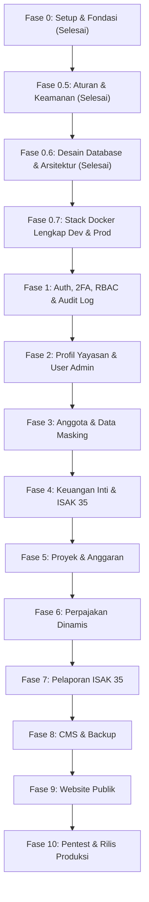

# Rencana Induk Pengembangan (Master Plan)

## Yayasan Nurjaman Bongas Purwakarta

Dokumen ini adalah cetak biru komprehensif pengembangan platform web resmi dan panel admin terpadu Yayasan Nurjaman Bongas Purwakarta. Dokumen ini menjadi peta jalan tunggal (_single source of truth_) yang memandu urutan fase, lingkup kerja, dan checklist pengujian.

---

## A. Tujuan & Ruang Lingkup Proyek

1. **Tujuan Sistem**:
   - Panel internal akuntansi nirlaba berbasis **ISAK 35** (Aset Neto Dengan & Tanpa Pembatasan).
   - Pengelolaan anggota, anggaran proyek, pajak berkonfigurasi tanggal, audit trail nirubah, dan backup otomatis.
   - Website profil publik editorial yang mengonsumsi data riil dari CMS dan laporan keuangan yang telah disahkan.
2. **Prioritas Pengerjaan**: **Admin Panel Terlebih Dahulu (Fase 1-8)**, disusul **Website Publik (Fase 9)**, dan **Hardening Akhir (Fase 10)**. Menjamin data publik bersumber dari data yang telah dikelola terverifikasi.

---

## B. Pengguna & Peran Sistem (User Roles)

1. **Super Admin**: Pengaturan sistem, manajemen user & RBAC, backup/restore, dan audit keamanan.
2. **Pembina**: Akses eksekutif _read-only_ laporan keuangan ISAK 35, aset neto, dan kepatuhan.
3. **Ketua**: Persetujuan (_approver_) permohonan dana proyek, penutupan buku tahunan, dan kebijakan lembaga.
4. **Sekretaris**: Pengelolaan data anggota/relawan, surat keluar/masuk, arsip legalitas SK, verifikasi status.
5. **Bendahara**: Operator keuangan (_maker_ penerimaan & _approver_ pencairan kas), penjurnalan, rekonsiliasi kas/bank, pemotongan pajak, tutup buku, pelaporan.
6. **Pengawas**: Akses pengawasan independen terhadap keabsahan transaksi jurnal dan integritas audit trail.
7. **Editor Konten**: Pengelolaan draf artikel berita, galeri dokumentasi kegiatan, dan informasi publik.

---

## C. Roadmap Sekuensial Fase Pengembangan

---

## D. Rincian Fase Pengembangan

### Fase 0: Setup Fondasi Proyek, Tooling & Konfigurasi (Status: Selesai)

- **Ruang Lingkup Selesai**: Next.js 15, TypeScript strict, Tailwind, ESLint, Prettier, Husky. Token warna logo resmi (`#29c668`, `#ffff00`, `#020202`, `#ff4745`), `/dev/tokens`, `/api/health`, changelog system `[ID: 0001]`.

### Fase 0.5: Memperketat Aturan, Standar Kode & Keamanan (Status: Selesai)

- **Ruang Lingkup Selesai**: `CODE-STANDARDS.md`, `SECURITY.md`, AST linter check-layers, scan-secrets hook, CSP nonce, security headers, E2E headers test, changelogs `[ID: 0002]` - `[ID: 0006]`.

### Fase 0.6: Desain Basis Data & Arsitektur Docker-First (Status: Selesai)

- **Ruang Lingkup Selesai**: Spesifikasi 70 tabel 8 modul (`docs/database/`), konvensi `01-conventions.md`, ERD `02-erd-overview.md`, ADR-008 s.d. ADR-013, 11-migration-plan (expand-contract), 12-reporting-queries, 13-scenarios, 14-traceability, 15-diff-vs-draf, 99-open-questions, DDL invariant verification, changelogs `[ID: 0007]` - `[ID: 0012]`.

### Fase 0.7: Stack Docker Lengkap Dev & Prod (Status: Belum Dimulai)

- **Ruang Lingkup**: `docker-compose.yml` (dev), `docker-compose.prod.yml` (prod, network `yayasan_internal`, no host port mapping for DB/app), Caddy reverse proxy TLS otomatis, container `migrate` sekali jalan, `backup-worker` (Postgres 17 client, offsite sync), multi-stage Dockerfile non-root.
- **Keamanan**: Port DB/app tidak dipublikasikan ke host (cegah UFW bypass VPS), image non-root, no secrets in image.

### Fase 1: Fondasi Admin: Auth, 2FA, Sesi, RBAC & Audit Log

- **Ruang Lingkup**: Better Auth terintegrasi schema, Argon2id, cookie HttpOnly `__Host-`, TOTP RFC 6238, `requirePermission()` server-side, layout admin, UI components, audit log append-only.
- **Keamanan**: Rate limiting login, session invalidation saat logout/password change, anti-bruteforce.

### Fase 2: Pengaturan Sistem, Profil Yayasan & Manajemen User

- **Ruang Lingkup**: FoundationProfile, OrganizationStructure, SystemSettings, undangan pengurus, role assignment.
- **Keamanan**: Hanya Super Admin yang berhak ubah sistem/role; step-up auth untuk perubahan peran sensitif.

### Fase 3: Manajemen Anggota & Data Masking

- **Ruang Lingkup**: Member, MemberCategory, NIK opsional terenkripsi AES-256-GCM + blind index HMAC-SHA256, data masking UI (`3201************`), ekspor berizin khusus dengan audit trail. Default data private.

### Fase 4: Keuangan Inti & Akuntansi Nirlaba ISAK 35

- **Ruang Lingkup**: Chart of Accounts nirlaba, JournalEntry, JournalLine, status DRAFT/POSTED/VOID, validasi Debit == Kredit real-time, tutup buku periode, maker-checker pencairan kas, imutabilitas jurnal posted.

### Fase 5: Proyek, Anggaran & Keterkaitan Keuangan

- **Ruang Lingkup**: Project, ProjectBudget, RAB kegiatan sosial Purwakarta, integrasi pencairan proyek langsung membentuk jurnal kas keluar, pelacakan serapan anggaran (Pagu vs Realisasi).

### Fase 6: Perpajakan Berkonfigurasi Dinamis

- **Ruang Lingkup**: TaxType, TaxRate berversi tanggal (`valid_range` non-overlapping via GiST), TaxWithholding, perhitungan otomatis honor/sewa/jasa, cetak Bukti Potong standar.

### Fase 7: Pelaporan Keuangan ISAK 35, Dashboard & Ekspor

- **Ruang Lingkup**: Laporan Posisi Keuangan, Laporan Penghasilan Komprehensif (Aset Neto Terikat & Tidak Terikat), Arus Kas, Perubahan Aset Neto, ekspor PDF/Excel presisi.

### Fase 8: CMS Admin & Backup/Restore Sistem

- **Ruang Lingkup**: Article Tiptap sanitized, MediaGallery dengan verifikasi magic bytes & StorageProvider, dump database otomatis terenkripsi, drill pemulihan bencana berkala.

### Fase 9: Website Publik, Transparansi & Optimasi SEO

- **Ruang Lingkup**: Beranda editorial, Profil Lembaga, Legalitas, Berita, Transparansi ISAK 35 agregat, formulir kontak anti-spam, sitemap.xml, SEO & Core Web Vitals.

### Fase 10: Hardening Akhir, Pentest & Rilis Produksi

- **Ruang Lingkup**: Grey-box penetration test, audit rekonsiliasi akhir dengan akuntan yayasan, deployment VPS Docker Caddy TLS 1.3, disaster recovery drill, SOP serah terima.

---

## E. Tabel Status Fase Pengerjaan

| Fase         | Nama Fase & Ruang Lingkup                           | Status        | ID Changelog                |
| :----------- | :-------------------------------------------------- | :------------ | :-------------------------- |
| **Fase 0**   | Setup Fondasi Proyek, Tooling & Design Tokens       | **Selesai**   | `[ID: 0001]`                |
| **Fase 0.5** | Memperketat Aturan, Standar Kode & Fondasi Keamanan | **Selesai**   | `[ID: 0002]` - `[ID: 0006]` |
| **Fase 0.6** | Desain Basis Data & Arsitektur Docker-First         | **Selesai**   | `[ID: 0007]` - `[ID: 0012]` |
| **Fase 0.7** | Stack Docker Lengkap (Dev dan Prod)                 | Belum Dimulai | -                           |
| **Fase 1**   | Fondasi Admin: Auth, 2FA, RBAC, Layout & Audit      | Belum Dimulai | -                           |
| **Fase 2**   | Pengaturan Sistem, Profil Admin & Manajemen User    | Belum Dimulai | -                           |
| **Fase 3**   | Manajemen Anggota & Data Masking                    | Belum Dimulai | -                           |
| **Fase 4**   | Keuangan Inti & Akuntansi ISAK 35                   | Belum Dimulai | -                           |
| **Fase 5**   | Proyek, Anggaran & Keterkaitan Keuangan             | Belum Dimulai | -                           |
| **Fase 6**   | Perpajakan Berkonfigurasi Dinamis                   | Belum Dimulai | -                           |
| **Fase 7**   | Pelaporan ISAK 35, Dashboard & Ekspor               | Belum Dimulai | -                           |
| **Fase 8**   | CMS Admin & Backup/Restore Sistem                   | Belum Dimulai | -                           |
| **Fase 9**   | Website Publik, Transparansi & SEO                  | Belum Dimulai | -                           |
| **Fase 10**  | Hardening Akhir, Pentest & Rilis Produksi           | Belum Dimulai | -                           |

---

## F. Asumsi & Pertanyaan Terbuka untuk Pemilik Proyek

1. **Infrastruktur Produksi Final**: VPS mandiri Docker-first sesuai ADR-008 (Ubuntu + Docker Compose v2 + Caddy).
2. **Ambang Batas Maker-Checker**: Batas nominal pencairan kas tanpa persetujuan Ketua Yayasan (lihat `docs/database/99-open-questions.md`).
3. **Format Bukti Potong Pajak & Pembulatan**: Verifikasi dengan konsultan pajak yayasan mengenai aturan pembulatan dan format e-Bupot.
4. **Tingkat Transparansi Publik**: Publik melihat laporan teragregasi ISAK 35 yang disahkan Ketua, bukan transaksi mentah.
5. **Bagan Akun Baku (COA)**: Verifikasi daftar akun dan pemetaan beban fungsional dengan akuntan yayasan.

---

## G. Bagian Temuan & Catatan Audit

1. **[SELESAI] Binding Port DB**: Port dev terikat ke `127.0.0.1` (mencegah ekspos publik).
2. **[SELESAI] Patch Dependensi**: Next.js diperbarui ke `15.5.28`; PostCSS di-override ke `8.5.23`.
3. **[SELESAI] Pengecekan Database Fase 0**: Menggunakan socket TCP net di `src/lib/db.ts` sebelum skema Prisma dibuat di Fase 1.
4. **[SELESAI] Desain Database**: 70 tabel spesifikasi modular tervalidasi 100% konsisten dengan draf pemilik (`15-diff-vs-draf.md`).
