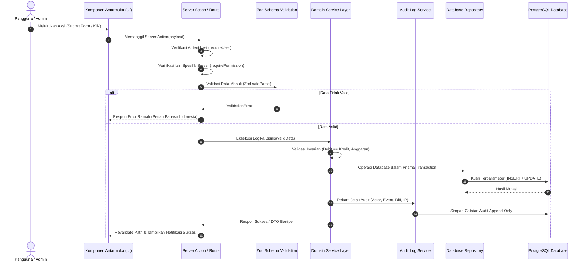
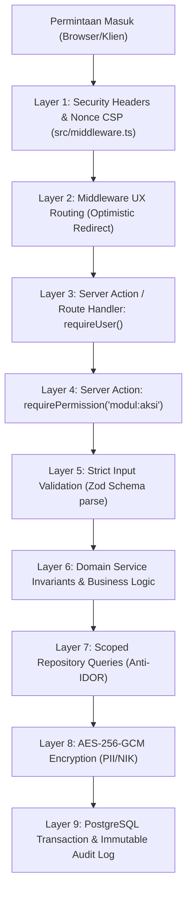

# 2. Alur Permintaan, Keamanan Siber & Model Data

Dokumen ini memuat spesifikasi sequence alur eksekusi, pertahanan berlapis, dan model entitas data konseptual. Dokumen induk: [`docs/ARCHITECTURE.md`](file:///docs/ARCHITECTURE.md).

---

## 3. Alur Permintaan (Request Flow)

---

## 4. Arsitektur Keamanan Siber & Pertahanan Berlapis (_Defense in Depth_)

### Prinsip Pertahanan Berlapis Utama

1. **Otorisasi Server-Side vs Middleware**:
   Next.js Middleware hanya bertindak sebagai pelindung rute awal (_optimistic redirect_). Seluruh evaluasi otorisasi otoritatif WAJIB dijalankan di sisi server (`requirePermission`) di dalam Server Action atau Route Handler guna menangkal risiko bypass rute.
2. **Keamanan Sesi & Kredensial**:
   - Sandi di-hash menggunakan Argon2id (memory 64MB, iterations 3, parallelism 4) atau bcrypt cost 12+.
   - Cookie sesi berflag `HttpOnly`, `Secure`, `SameSite=Lax`, prefiks `__Host-`.
   - TOTP 2FA wajib untuk Super Admin, Ketua, dan Bendahara.
3. **Enkripsi Data Pribadi (PII) at Rest**:
   Data NIK anggota dienkripsi menggunakan AES-256-GCM sebelum disimpan di basis data dan ditampilkan tersamar di antarmuka (`3201************`).
4. **Header Keamanan Ketat**:
   CSP berbasis nonce, HSTS (`max-age=63072000`), `X-Frame-Options: DENY`, `X-Content-Type-Options: nosniff`, serta pemblokiran mesin pencari pada panel admin (`X-Robots-Tag: noindex, nofollow, noarchive`).

---

## 5. Model Entitas Basis Data Konseptual

Model entitas relasional lengkap mencakup 70 tabel dalam 8 modul domain didefinisikan secara komprehensif pada [`docs/database/02-erd-overview.md`](../database/02-erd-overview.md) dan masing-masing berkas spesifikasi teknis modul domain di [`docs/database/00-README.md`](../database/00-README.md).
