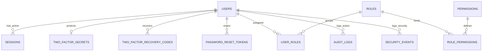

# Modul 1 — Identitas dan Akses (Fase 1–2)

_Bagian dari [Spesifikasi Database](./00-README.md) · 12 tabel · Sasaran: Fase 1 & 2 MASTER-PLAN_

## 1. Tujuan & Sasaran Modul

Modul ini mengelola siklus hidup kredensial, autentikasi multi-faktor (TOTP), pengikatan sesi, hierarki izin berbasis peran (_Multi-Role RBAC_), pembatasan brute force, serta jejak audit aktivitas yang nirubah (_append-only_).

---

## 2. Kamus Tabel

### users

| Kolom                  | Tipe        | Null  | Keterangan                                                                                |
| :--------------------- | :---------- | :---- | :---------------------------------------------------------------------------------------- |
| `username`             | text        | Tidak | Dipakai untuk login. Unik, lowercase, 3–32 karakter (a–z, 0–9, titik, garis bawah, strip) |
| `email`                | text        | Tidak | Unik, disimpan lowercase. Untuk reset password dan notifikasi, bukan untuk login          |
| `name`                 | text        | Tidak | Nama tampilan pengguna                                                                    |
| `password_hash`        | text        | Tidak | [hash] Argon2id                                                                           |
| `status`               | enum        | Tidak | ACTIVE, DISABLED                                                                          |
| `must_change_password` | boolean     | Tidak | Default false                                                                             |
| `password_changed_at`  | timestamptz | Tidak | Waktu perubahan sandi terakhir                                                            |
| `last_login_at`        | timestamptz | Ya    | Waktu login terakhir                                                                      |
| `member_id`            | uuid        | Ya    | FK → members, unik. Menghubungkan akun login dengan data anggota                          |

_Catatan: SD, v. UQ username dan UQ email (parsial untuk yang belum dihapus). Login memakai username dan password (plus 2FA). Pesan galat login tetap generik agar username tidak bisa ditebak, dan rate limit dihitung per username dan per IP._

---

### sessions

| Kolom                 | Tipe        | Null  | Keterangan                                                                                                    |
| :-------------------- | :---------- | :---- | :------------------------------------------------------------------------------------------------------------ |
| `user_id`             | uuid        | Tidak | FK → users, ON DELETE CASCADE                                                                                 |
| `token_hash`          | text        | Tidak | [hash], unik                                                                                                  |
| `ip`                  | inet        | Ya    | Alamat IP klien                                                                                               |
| `user_agent`          | text        | Ya    | Peramban klien                                                                                                |
| `last_seen_at`        | timestamptz | Tidak | Aktivitas terakhir                                                                                            |
| `idle_expires_at`     | timestamptz | Tidak | Batas waktu tidak aktif (30 menit)                                                                            |
| `absolute_expires_at` | timestamptz | Tidak | Batas mutlak sesi (8 jam), diindeks untuk pembersihan                                                         |
| `mfa_verified_at`     | timestamptz | Ya    | Terisi setelah verifikasi 2FA (sesi penuh). Null = sesi parsial. (ditambah, kebutuhan 2FA, disetujui pemilik) |
| `reauth_at`           | timestamptz | Ya    | Waktu re-autentikasi terakhir untuk aksi berisiko tinggi                                                      |
| `revoked_at`          | timestamptz | Ya    | Waktu pencabutan sesi                                                                                         |
| `revoked_reason`      | text        | Ya    | Alasan pencabutan (logout, ganti password, role revoked)                                                      |

---

### two_factor_secrets

| Kolom            | Tipe        | Null  | Keterangan                                                 |
| :--------------- | :---------- | :---- | :--------------------------------------------------------- |
| `user_id`        | uuid        | Tidak | FK → users, unik, ON DELETE CASCADE                        |
| `secret`         | bytea       | Tidak | [enc] Kunci rahasia TOTP                                   |
| `confirmed_at`   | timestamptz | Ya    | Terisi setelah verifikasi kode pertama                     |
| `last_used_step` | bigint      | Ya    | Langkah waktu TOTP terakhir yang dipakai (mencegah replay) |

---

### two_factor_recovery_codes

| Kolom       | Tipe        | Null  | Keterangan                        |
| :---------- | :---------- | :---- | :-------------------------------- |
| `user_id`   | uuid        | Tidak | FK → users, ON DELETE CASCADE     |
| `code_hash` | text        | Tidak | [hash] Kode cadangan sekali pakai |
| `used_at`   | timestamptz | Ya    | Waktu kode cadangan digunakan     |

---

### password_reset_tokens

| Kolom          | Tipe        | Null  | Keterangan                    |
| :------------- | :---------- | :---- | :---------------------------- |
| `user_id`      | uuid        | Tidak | FK → users, ON DELETE CASCADE |
| `token_hash`   | text        | Tidak | [hash], unik                  |
| `expires_at`   | timestamptz | Tidak | Berumur singkat (15–30 menit) |
| `used_at`      | timestamptz | Ya    | Sekali pakai                  |
| `requested_ip` | inet        | Ya    | IP pemohon reset              |

---

### rate_limit_counters

| Kolom           | Tipe        | Null  | Keterangan                                 |
| :-------------- | :---------- | :---- | :----------------------------------------- |
| `key`           | text        | Tidak | Misal `login:ip:...` atau `login:akun:...` |
| `window_start`  | timestamptz | Tidak | Awal jendela hitungan waktu                |
| `hit_count`     | int         | Tidak | Jumlah percobaan                           |
| `blocked_until` | timestamptz | Ya    | Waktu berakhir pemblokiran                 |

_Catatan: UQ (key, window_start). Tanpa FK, tahan terhadap restart server._

---

### roles

| Kolom         | Tipe    | Null  | Keterangan                                             |
| :------------ | :------ | :---- | :----------------------------------------------------- |
| `code`        | text    | Tidak | Unik, misal: SUPER_ADMIN, KETUA, BENDAHARA, SEKRETARIS |
| `name`        | text    | Tidak | Nama peran                                             |
| `description` | text    | Ya    | Penjelasan wewenang                                    |
| `is_system`   | boolean | Tidak | Role sistem bawaan tidak dapat dihapus                 |

---

### permissions

| Kolom         | Tipe | Null  | Keterangan                                             |
| :------------ | :--- | :---- | :----------------------------------------------------- |
| `code`        | text | Tidak | Unik, format modul.aksi (misal `finance.post_journal`) |
| `module`      | text | Tidak | Nama modul                                             |
| `action`      | text | Tidak | Aksi spesifik                                          |
| `description` | text | Ya    | Deskripsi izin                                         |

_Catatan: Katalog bersumber dari kode program, disinkronkan ke tabel ini._

---

### role_permissions

| Kolom           | Tipe | Null  | Keterangan                          |
| :-------------- | :--- | :---- | :---------------------------------- |
| `role_id`       | uuid | Tidak | FK → roles, ON DELETE CASCADE       |
| `permission_id` | uuid | Tidak | FK → permissions, ON DELETE CASCADE |

_Catatan: PK komposit (role_id, permission_id), tanpa kolom id._

---

### user_roles

| Kolom         | Tipe        | Null  | Keterangan                    |
| :------------ | :---------- | :---- | :---------------------------- |
| `user_id`     | uuid        | Tidak | FK → users, ON DELETE CASCADE |
| `role_id`     | uuid        | Tidak | FK → roles                    |
| `assigned_by` | uuid        | Tidak | FK → users (pelaku penugasan) |
| `assigned_at` | timestamptz | Tidak | Waktu penugasan peran         |

_Catatan: PK komposit (user_id, role_id)._

---

### audit_logs

| Kolom           | Tipe        | Null  | Keterangan                                  |
| :-------------- | :---------- | :---- | :------------------------------------------ |
| `occurred_at`   | timestamptz | Tidak | Stempel waktu kejadian                      |
| `actor_user_id` | uuid        | Ya    | FK → users. Null untuk aksi otomatis sistem |
| `action`        | text        | Tidak | Misal `finance.transaction.post`            |
| `entity_type`   | text        | Tidak | Nama entitas yang diubah                    |
| `entity_id`     | text        | Ya    | ID primer entitas                           |
| `before`        | jsonb       | Ya    | Nilai sebelum perubahan                     |
| `after`         | jsonb       | Ya    | Nilai sesudah perubahan                     |
| `ip`            | inet        | Ya    | Alamat IP aktor                             |
| `user_agent`    | text        | Ya    | Informasi peramban klien                    |
| `request_id`    | text        | Ya    | Pengenal penelusuran request                |
| `metadata`      | jsonb       | Ya    | Informasi tambahan                          |

_Catatan: Append-only murni, tanpa updated_at. Pengguna aplikasi tidak memiliki izin UPDATE/DELETE. Indeks: (entity_type, entity_id), (actor_user_id, occurred_at), (occurred_at)._

---

### security_events

| Kolom         | Tipe        | Null  | Keterangan                                                                                                                                                                                                                                                                         |
| :------------ | :---------- | :---- | :--------------------------------------------------------------------------------------------------------------------------------------------------------------------------------------------------------------------------------------------------------------------------------- |
| `occurred_at` | timestamptz | Tidak | Waktu kejadian                                                                                                                                                                                                                                                                     |
| `type`        | enum        | Tidak | LOGIN_SUCCESS, LOGIN_FAILED, LOCKOUT, PERMISSION_DENIED, ROLE_CHANGED, SESSION_REVOKED, TWO_FACTOR_CHANGED, MFA_CHALLENGE, MFA_VERIFIED, MFA_FAILED, MFA_RECOVERY_USED, MFA_RESET, BACKUP_DOWNLOADED, RESTORE_STARTED, dst. (Tipe MFA: ditambah, kebutuhan 2FA, disetujui pemilik) |
| `user_id`     | uuid        | Ya    | FK → users                                                                                                                                                                                                                                                                         |
| `ip`          | inet        | Ya    | Alamat IP                                                                                                                                                                                                                                                                          |
| `user_agent`  | text        | Ya    | Peramban                                                                                                                                                                                                                                                                           |
| `details`     | jsonb       | Ya    | Detail konteks (tanpa data pribadi/token)                                                                                                                                                                                                                                          |

_Catatan: Append-only._

---

## 3. Aturan Database vs Aplikasi & Siklus Hidup Data

1. **Aturan Database**:
   - `ON DELETE CASCADE` diterapkan pada relasi turunan pengguna: `sessions`, `two_factor_secrets`, `password_reset_tokens`, `user_roles`.
   - Batasan Unik parsial pada `users(username)` dan `users(email)` di mana `deleted_at IS NULL`.
   - Database Role Policy: Hak `UPDATE` dan `DELETE` dicabut mutlak pada `audit_logs` dan `security_events` bagi role aplikasi (`db_app`).
2. **Aturan Aplikasi**:
   - Validasi ketat format username (lowercase 3–32 karakter) dan password via Zod.
   - Pengecekan otorisasi server-side (`requirePermission`) wajib di setiap Server Action / Mutation.
   - Pesan galat autentikasi wajib generik guna mencegah enumerasi username.
3. **Siklus Hidup Data**:
   - Pembersihan sesi kedaluwarsa (`idle_expires_at` / `absolute_expires_at`) dijalankan oleh worker berkala.
   - Akun user yang dinonaktifkan / dihapus menggunakan Soft Delete (`deleted_at`), otomatis membatalkan seluruh sesi aktif.
   - `audit_logs` dan `security_events` berstatus nirubah (_immutable_) dan tidak dihapus.

---

## Usulan Tambahan, MENUNGGU PERSETUJUAN

_Tidak ada usulan tambahan untuk modul ini._
