# 02-erd-overview.md — Diagram Hubungan Entitas (ERD) Arsitektur Global

> **Status Dokumen**: Wajib Dipatuhi (Normatif & Mengikat)  
> **Klasifikasi**: Peta Relasi Skema Basis Data (70 Tabel dalam 8 Modul)  
> **Lokasi Berkas**: `docs/database/02-erd-overview.md`

Diagram berikut memetakan keterkaitan arsitektur lintas modul domain pada basis data Yayasan Nurjaman Bongas Purwakarta.

---

## 1. Diagram Relasi Antar-Modul Utama

```mermaid
erDiagram
    %% Modul 1: Identitas & Akses
    USERS ||--o{ SESSIONS : "owns"
    USERS ||--o{ USER_ROLES : "assigned"
    ROLES ||--o{ USER_ROLES : "groups"
    ROLES ||--o{ ROLE_PERMISSIONS : "authorizes"
    PERMISSIONS ||--o{ ROLE_PERMISSIONS : "grants"
    USERS ||--o{ AUDIT_LOGS : "acts"
    USERS ||--o{ SECURITY_EVENTS : "triggers"

    %% Modul 2 & 3: Profil, Media & Anggota
    USERS ||--o| MEMBERS : "linked_to"
    MEDIA_ASSETS ||--o{ MEMBERS : "profile_photo"
    MEMBER_POSITIONS ||--o{ MEMBER_POSITION_HISTORY : "defines"
    MEMBERS ||--o{ MEMBER_POSITION_HISTORY : "holds"
    MEMBERS ||--o{ MEMBER_DUES : "pays"

    %% Modul 4: Keuangan Inti & ISAK 35
    CHART_OF_ACCOUNTS ||--o{ CASH_BANK_ACCOUNTS : "binds_cash"
    CHART_OF_ACCOUNTS ||--o{ JOURNAL_LINES : "categorizes"
    PARTIES ||--o{ FINANCIAL_TRANSACTIONS : "counterparty"
    PARTIES ||--o{ JOURNAL_LINES : "attributes"
    FISCAL_YEARS ||--o{ ACCOUNTING_PERIODS : "contains"
    ACCOUNTING_PERIODS ||--o{ JOURNAL_ENTRIES : "bounds"
    FINANCIAL_TRANSACTIONS ||--o| JOURNAL_ENTRIES : "generates_when_posted"
    JOURNAL_ENTRIES ||--|{ JOURNAL_LINES : "contains_double_entry"
    RESTRICTED_FUNDS ||--o{ RESTRICTION_RELEASES : "releases"
    FINANCIAL_TRANSACTIONS ||--o{ APPROVAL_REQUESTS : "requires_approval"
    APPROVAL_POLICIES ||--o{ APPROVAL_REQUESTS : "governs"
    APPROVAL_REQUESTS ||--|{ APPROVAL_ACTIONS : "decides"

    %% Modul 5: Proyek & Keterkaitan Keuangan
    PROJECT_TYPES ||--o{ PROJECTS : "classifies"
    PROJECTS ||--o{ PROJECT_MILESTONES : "tracks"
    PROJECTS ||--o{ PROJECT_FILES : "attaches"
    PROJECTS ||--o{ FINANCIAL_TRANSACTIONS : "cost_center"
    PROJECTS ||--o{ JOURNAL_LINES : "tags_realization"
    RESTRICTED_FUNDS ||--o{ PROJECT_FUNDING_SOURCES : "funds"
    PROJECTS ||--o{ PROJECT_FUNDING_SOURCES : "receives"
    MEMBERS ||--o{ PROJECT_MEMBERS : "joins_committee"
    PROJECTS ||--o{ PROJECT_MEMBERS : "assigns"

    %% Modul 6: Perpajakan
    TAX_TYPES ||--|{ TAX_RATES : "schedules"
    TAX_TYPES ||--o{ TRANSACTION_TAXES : "calculates"
    FINANCIAL_TRANSACTIONS ||--o{ TRANSACTION_TAXES : "withholds"
    TRANSACTION_TAXES ||--o| WITHHOLDING_SLIPS : "documents"
    PARTIES ||--o{ WITHHOLDING_SLIPS : "deducted_party"
    TAX_TYPES ||--o{ TAX_PAYMENTS : "remits"
    TAX_PAYMENTS ||--o{ WITHHOLDING_SLIPS : "settles"

    %% Modul 7: Konten & Transparansi
    POST_CATEGORIES ||--o{ POSTS : "categorizes"
    POSTS ||--o{ POST_TAGS : "labels"
    TAGS ||--o{ POST_TAGS : "indexes"
    GALLERIES ||--o{ GALLERY_ITEMS : "exhibits"
    MEDIA_ASSETS ||--o{ GALLERY_ITEMS : "displays"
    MEDIA_ASSETS ||--o{ PUBLISHED_REPORTS : "attaches_pdf"

    %% Modul 8: Sistem & Cadangan Data
    BACKUP_SCHEDULES ||--o{ BACKUP_JOBS : "schedules"
    BACKUP_JOBS ||--o{ RESTORE_EVENTS : "restores_from"
    BACKUP_JOBS ||--o{ RESTORE_EVENTS : "pre_restore_snapshot"
    BACKUP_JOBS ||--o{ DOWNLOAD_TOKENS : "generates_token"
```

---

## 2. Invarian Arsitektur Pemetaan Kunci

1. **Jembatan Autentikasi ke Domain Anggota (`users.member_id`)**:
   Relasi 1-to-1 opsional antara akun sistem login dengan profil pengurus/anggota yayasan. Akun sistem tetap independen dari data anggota.
2. **Pemisahan Dokumen Transaksi vs Buku Besar Jurnal**:
   `financial_transactions` adalah dokumen entri kasir/pengurus yang mengikat persetujuan (`approval_requests`), berkas nota bukti (`transaction_attachments`), dan pemotongan pajak (`transaction_taxes`). Jurnal umum seimbang (`journal_entries` & `journal_lines`) baru dibentuk dan dikunci saat status transaksi mencapai `POSTED`.
3. **Akuntabilitas Multi-Dimensi pada Jurnal**:
   Tiap baris pembukuan (`journal_lines`) dapat mengaitkan dimensi:
   - `restricted_fund_id` (Dana Terikat ISAK 35)
   - `project_id` (Realisasi Kegiatan Sosial Purwakarta)
   - `party_id` (Penerima manfaat / Rekanan pihak ketiga)
4. **Isolasi Publikasi Transparansi**:
   Portal publik transparansi nirlaba membaca snapshot resmi bertanda tangan dari `published_reports`, dan dilarang keras mengueri langsung ke baris jurnal detail.
