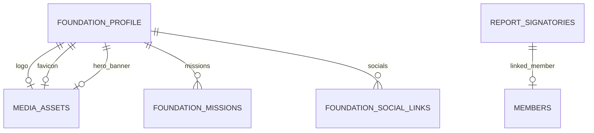

# Modul 2 — Pengaturan, Profil Yayasan, dan Media (Fase 2)

_Bagian dari [Spesifikasi Database](./00-README.md) · 7 tabel · Sasaran: Fase 2 MASTER-PLAN_

## 1. Tujuan & Sasaran Modul

Modul ini mengelola aset media terpusat, identitas hukum yayasan (SK Kemenkumham, akta notaris, kop surat resmi), misi kelembagaan, tautan media sosial, konfigurasi dinamis aplikasi, pejabat penandatangan laporan resmi, dan penomoran dokumen gapless.

---

## 2. Kamus Tabel

### media_assets

| Kolom             | Tipe   | Null  | Keterangan                                       |
| :---------------- | :----- | :---- | :----------------------------------------------- |
| `storage_backend` | enum   | Tidak | `LOCAL, S3`. Default `LOCAL`                     |
| `bucket`          | text   | Ya    | Nama bucket S3 (null bila `LOCAL`)               |
| `storage_key`     | text   | Tidak | Unik, pengenal path/nama berkas acak (bukan URL) |
| `original_name`   | text   | Tidak | Nama asli berkas saat diunggah                   |
| `mime`            | text   | Tidak | Divalidasi via magic bytes tanda tangan biner    |
| `size_bytes`      | bigint | Tidak | Ukuran berkas dalam byte                         |
| `sha256`          | text   | Tidak | Checksum integritas berkas                       |
| `visibility`      | enum   | Tidak | `PUBLIC, PRIVATE`                                |
| `width`           | int    | Ya    | Lebar piksel (untuk gambar)                      |
| `height`          | int    | Ya    | Tinggi piksel (untuk gambar)                     |
| `alt_text`        | text   | Ya    | Teks alternatif aksesibilitas                    |
| `uploaded_by`     | uuid   | Tidak | FK → users                                       |

_Catatan & Aturan Siklus Hidup Media:_

- _SD (Soft Delete): Soft delete media TIDAK menghapus berkas fisik di disk secara otomatis; pembersihan berkas fisik dilakukan oleh background cleanup job berkala setelah masa retensi._
- _Invarian Lampiran Transaksi: Berkas media yang ditautkan ke lampiran transaksi keuangan (`transaction_attachments`) DILARANG KERAS dihapus fisik maupun soft-delete._
- _Keamanan Berkas PRIVATE: Berkas berstatus `PRIVATE` DILARANG memiliki URL publik langsung. Akses wajib melalui streaming endpoint berizin atau token unduh berumur pendek (`download_tokens`)._
- _`storage_key` adalah pengenal path relatif di dalam volume penyimpanan (`uploads_private` / `uploads_public`), BUKAN URL publik._
- _Konteks Penyimpanan: Single VPS dengan berkas disimpan di disk lokal melalui lapisan abstraksi `StorageProvider`. Migrasi ke bucket kompatibel S3 dapat dilakukan di masa mendatang tanpa mengubah skema tabel._

---

### foundation_profile

| Kolom              | Tipe     | Null  | Keterangan                                      |
| :----------------- | :------- | :---- | :---------------------------------------------- |
| `id`               | smallint | Tidak | Singleton, CHECK id = 1                         |
| `name`             | text     | Tidak | Nama resmi yayasan                              |
| `short_name`       | text     | Ya    | Nama singkat / singkatan                        |
| `tagline`          | text     | Ya    | Slogan kelembagaan                              |
| `description`      | text     | Tidak | Deskripsi profil yayasan                        |
| `history`          | text     | Ya    | Sejarah berdirinya yayasan                      |
| `vision`           | text     | Ya    | Pernyataan visi yayasan                         |
| `logo_asset_id`    | uuid     | Ya    | FK → media_assets                               |
| `favicon_asset_id` | uuid     | Ya    | FK → media_assets                               |
| `hero_asset_id`    | uuid     | Ya    | FK → media_assets                               |
| `address`          | text     | Tidak | Alamat sekretariat lengkap (Bongas, Purwakarta) |
| `map_url`          | text     | Ya    | Tautan koordinat peta Google Maps               |
| `phone`            | text     | Ya    | Nomor telepon resmi                             |
| `email`            | text     | Ya    | Email resmi lembaga                             |
| `deed_no`          | text     | Ya    | Nomor akta pendirian notaris                    |
| `deed_date`        | date     | Ya    | Tanggal akta pendirian                          |
| `decree_no`        | text     | Ya    | Nomor SK Pengesahan Kemenkumham                 |
| `decree_date`      | date     | Ya    | Tanggal SK Pengesahan Kemenkumham               |
| `letterhead_note`  | text     | Ya    | Teks tambahan kop surat resmi                   |
| `updated_by`       | uuid     | Tidak | FK → users                                      |

_Catatan: Singleton, v._

---

### foundation_missions

| Kolom        | Tipe    | Null  | Keterangan                 |
| :----------- | :------ | :---- | :------------------------- |
| `text`       | text    | Tidak | Satu butir pernyataan misi |
| `sort_order` | int     | Tidak | Urutan tampilan            |
| `is_active`  | boolean | Tidak | Status aktif               |

---

### foundation_social_links

| Kolom        | Tipe | Null  | Keterangan                                         |
| :----------- | :--- | :---- | :------------------------------------------------- |
| `platform`   | text | Tidak | Nama platform (Facebook, Instagram, YouTube, dll.) |
| `url`        | text | Tidak | Tautan URL profil resmi                            |
| `sort_order` | int  | Tidak | Urutan tampilan                                    |

---

### app_settings

| Kolom         | Tipe  | Null  | Keterangan                              |
| :------------ | :---- | :---- | :-------------------------------------- |
| `key`         | text  | Tidak | Kunci pengaturan unik                   |
| `value`       | jsonb | Tidak | Nilai pengaturan (divalidasi skema Zod) |
| `description` | text  | Ya    | Penjelasan pengaturan                   |
| `updated_by`  | uuid  | Tidak | FK → users                              |

---

### report_signatories

| Kolom         | Tipe    | Null  | Keterangan                                         |
| :------------ | :------ | :---- | :------------------------------------------------- |
| `label`       | text    | Tidak | Jabatan penandatangan (Ketua, Bendahara, Pengawas) |
| `person_name` | text    | Tidak | Nama pejabat penandatangan                         |
| `member_id`   | uuid    | Ya    | FK → members                                       |
| `sort_order`  | int     | Tidak | Posisi urutan kolom tanda tangan                   |
| `is_active`   | boolean | Tidak | Status aktif                                       |

---

### number_sequences

| Kolom        | Tipe     | Null  | Keterangan                                        |
| :----------- | :------- | :---- | :------------------------------------------------ |
| `scope`      | enum     | Tidak | JOURNAL, TRANSACTION, MEMBER, WHT_SLIP, dst.      |
| `year`       | int      | Ya    | Null bila nomor urut tidak direset per tahun buku |
| `prefix`     | text     | Ya    | Awalan nomor registrasi                           |
| `next_value` | bigint   | Tidak | Nilai urutan berikutnya                           |
| `pad_length` | smallint | Tidak | Jumlah digit pengisi nol di depan                 |

_Catatan: UQ (scope, year) dengan NULLS NOT DISTINCT. Alokasi nomor menggunakan row-level lock di dalam transaksi basis data guna menjamin penomoran tanpa celah (gapless)._

---

## 3. Aturan Database vs Aplikasi & Siklus Hidup Data

1. **Aturan Database**:
   - `foundation_profile` diisolasi sebagai _singleton_ via batasan `CHECK (id = 1)`.
   - `number_sequences`: Alokasi nomor wajib menggunakan transaksi dengan row-level lock (`SELECT ... FOR UPDATE`) untuk menjamin nomor transaksi dan jurnal tidak pernah bolong (_gapless_).
   - Validasi MIME type: Basis data menyimpan tipe MIME hasil verifikasi biner.
2. **Aturan Aplikasi**:
   - Lapisan `StorageProvider` mengisolasi berkas fisik. `storage_key` adalah path aman teracak, bukan URL publik.
   - Nilai pada `app_settings.value` (JSONB) wajib divalidasi skema Zod sebelum disimpan.
3. **Siklus Hidup Data**:
   - Soft delete pada `media_assets` menandai berkas tidak aktif. Penghapusan berkas fisik di disk dilakukan secara aman oleh background worker setelah melewati masa retensi (default 30 hari).
   - Berkas media yang terhubung ke dokumen keuangan resmi tidak dapat dihapus.

---

## Usulan Tambahan, MENUNGGU PERSETUJUAN

Tabel-tabel berikut **tidak ada dalam draf 70 tabel pemilik** dan diusulkan oleh tim arsitektur. Implementasi memerlukan persetujuan tertulis pemilik:

### (Usulan) legal_documents

Penyimpanan dokumen hukum yayasan (akta, SK, perjanjian). Saat ini informasi legalitas disimpan sebagai teks di `foundation_profile`. Jika dokumen-dokumen ini perlu disimpan sebagai file, dapat menggunakan `media_assets` dengan metadata terpisah tanpa perlu tabel baru.

- **Dampak**: Menambah kompleksitas relasi dan UI upload dokumen hukum.
- **Alternatif**: Gunakan `media_assets` dengan penamaan file konvensional tanpa tabel terpisah.

### (Usulan) letterheads

Konfigurasi template kop surat (logo, alamat, font, tata letak). Saat ini `foundation_profile.letterhead_note` sudah mengakomodasi kebutuhan dasar.

- **Dampak**: Perlu UI template builder kop surat yang belum ada dalam roadmap.
- **Alternatif**: Data kop surat diambil dari `foundation_profile` saja.

### (Usulan) media_tags dan media_asset_tags

Sistem penandaan (_tagging_) media untuk kategorisasi aset di pustaka media.

- **Dampak**: Menambah 2 tabel relasi dan UI tag management.
- **Alternatif**: Gunakan kolom `alt_text` atau penamaan `storage_key` terstruktur.

### (Usulan) Kolom Tambahan `media_assets`: `etag` dan `scan_status`

- `etag` (text, nullable): Checksum ETag objek untuk validasi multipart upload S3 dan invalidasi cache browser/CDN.
- `scan_status` (enum `PENDING, CLEAN, INFECTED`, default `PENDING`): Status pemindaian antivirus/malware secara asinkron sebelum file private disajikan.
- **Status**: MENUNGGU PERSETUJUAN pemilik.
