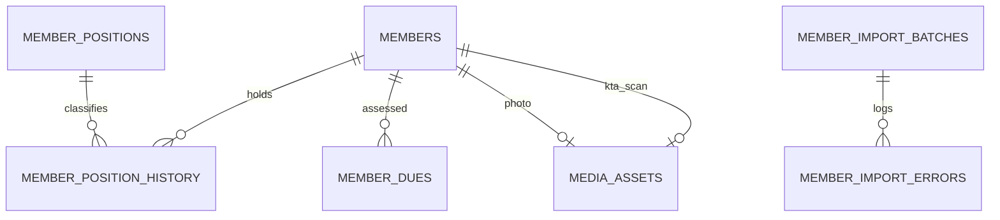

# Modul 3 — Anggota (Fase 3)

_Bagian dari [Spesifikasi Database](./00-README.md) · 6 tabel (3 inti + 3 opsional) · Sasaran: Fase 3 MASTER-PLAN_

## 1. Tujuan & Sasaran Modul

Modul ini mengelola basis data keanggotaan yayasan, histori mutasi jabatan pengurus/pembina/pengawas, penerbitan KTA berfoto (status default PRIVATE), penagihan iuran anggota, serta proses impor data massal yang aman tanpa kebocoran PII.

---

## 2. Kamus Tabel

### member_positions

| Kolom               | Tipe    | Null  | Keterangan                                    |
| :------------------ | :------ | :---- | :-------------------------------------------- |
| `code`              | text    | Tidak | Unik, kode posisi                             |
| `name`              | text    | Tidak | Nama posisi/jabatan                           |
| `category`          | enum    | Tidak | PEMBINA, PENGURUS, PENGAWAS, ANGGOTA, LAINNYA |
| `sort_order`        | int     | Tidak | Urutan tampilan struktur                      |
| `show_in_structure` | boolean | Tidak | Ditampilkan di bagan struktur pengurus publik |
| `is_active`         | boolean | Tidak | Status aktif                                  |

---

### members

| Kolom                | Tipe    | Null  | Keterangan                                                                     |
| :------------------- | :------ | :---- | :----------------------------------------------------------------------------- |
| `member_no`          | text    | Tidak | Unik, nomor registrasi anggota                                                 |
| `full_name`          | text    | Tidak | Nama lengkap                                                                   |
| `gender`             | enum    | Ya    | L, P                                                                           |
| `birth_place`        | text    | Ya    | Tempat lahir                                                                   |
| `birth_date`         | date    | Ya    | Tanggal lahir                                                                  |
| `nik_enc`            | bytea   | Ya    | [enc] NIK terenkripsi AES-256-GCM                                              |
| `nik_blind_index`    | text    | Ya    | HMAC-SHA256 dengan kunci rahasia terpisah untuk pencarian persis. Unik parsial |
| `address`            | text    | Ya    | Alamat domisili                                                                |
| `phone`              | text    | Ya    | Nomor telepon / WhatsApp                                                       |
| `email`              | text    | Ya    | Alamat surel                                                                   |
| `photo_asset_id`     | uuid    | Ya    | FK → media_assets (foto profil anggota)                                        |
| `kta_no`             | text    | Ya    | Nomor Kartu Tanda Anggota (KTA). Unik parsial, berbeda dari member_no          |
| `kta_status`         | enum    | Tidak | NOT_ISSUED (KTA belum dibuat), ISSUED (KTA sudah dibuat). Default NOT_ISSUED   |
| `kta_issued_on`      | date    | Ya    | Tanggal penerbitan KTA                                                         |
| `kta_photo_asset_id` | uuid    | Ya    | FK → media_assets. Foto KTA hasil scan, visibility wajib PRIVATE               |
| `status`             | enum    | Tidak | ACTIVE, INACTIVE, RESIGNED                                                     |
| `joined_on`          | date    | Tidak | Tanggal bergabung                                                              |
| `left_on`            | date    | Ya    | CHECK left_on ≥ joined_on                                                      |
| `show_public`        | boolean | Tidak | Tampil di direktori publik (default false)                                     |
| `notes`              | text    | Ya    | Catatan internal sekretariat                                                   |

_Catatan: SD, v. Foto KTA yang diunggah berstatus PRIVATE pada media_assets._

---

### member_position_history

| Kolom         | Tipe | Null  | Keterangan                        |
| :------------ | :--- | :---- | :-------------------------------- |
| `member_id`   | uuid | Tidak | FK → members                      |
| `position_id` | uuid | Tidak | FK → member_positions             |
| `start_date`  | date | Tidak | Tanggal mulai menjabat            |
| `end_date`    | date | Ya    | CHECK end_date ≥ start_date       |
| `decree_ref`  | text | Ya    | Nomor SK Pengangkatan / Penugasan |
| `notes`       | text | Ya    | Keterangan mutasi                 |

_Catatan: EXCLUDE constraint agar periode masa jabatan tidak tumpang tindih untuk kombinasi (member, position) yang sama._

---

### member_dues (Opsional)

| Kolom            | Tipe   | Null  | Keterangan                    |
| :--------------- | :----- | :---- | :---------------------------- |
| `member_id`      | uuid   | Tidak | FK → members                  |
| `period`         | date   | Tidak | Tanggal 1 bulan tagihan iuran |
| `amount`         | bigint | Tidak | CHECK amount ≥ 0              |
| `status`         | enum   | Tidak | UNPAID, PAID, WAIVED          |
| `paid_on`        | date   | Ya    | Tanggal pembayaran iuran      |
| `transaction_id` | uuid   | Ya    | FK → financial_transactions   |

_Catatan: UQ (member_id, period)._

---

### member_import_batches (Opsional)

| Kolom          | Tipe        | Null  | Keterangan                  |
| :------------- | :---------- | :---- | :-------------------------- |
| `file_name`    | text        | Tidak | Nama berkas impor CSV/Excel |
| `total_rows`   | int         | Tidak | Jumlah total baris          |
| `success_rows` | int         | Tidak | Jumlah baris berhasil       |
| `failed_rows`  | int         | Tidak | Jumlah baris gagal          |
| `status`       | enum        | Tidak | RUNNING, DONE, FAILED       |
| `created_by`   | uuid        | Tidak | FK → users                  |
| `finished_at`  | timestamptz | Ya    | Waktu selesai proses        |

---

### member_import_errors (Opsional)

| Kolom        | Tipe | Null  | Keterangan                                    |
| :----------- | :--- | :---- | :-------------------------------------------- |
| `batch_id`   | uuid | Tidak | FK → member_import_batches, ON DELETE CASCADE |
| `row_number` | int  | Tidak | Nomor baris berkas sumber                     |
| `field`      | text | Ya    | Kolom bermasalah                              |
| `message`    | text | Tidak | Pesan galat validasi                          |

_Catatan: Tidak menyimpan data mentah baris agar NIK tidak bocor ke tabel log ini._

---

## 3. Aturan Database vs Aplikasi & Siklus Hidup Data

1. **Aturan Database**:
   - Keunikan Parsial NIK: `nik_blind_index` unik hanya untuk baris aktif (`WHERE deleted_at IS NULL AND nik_blind_index IS NOT NULL`).
   - Anti Tumpang Tindih Jabatan: `member_position_history` menerapkan `EXCLUDE USING gist` pada `(member_id WITH =, position_id WITH =, daterange(start_date, end_date) WITH &&)`.
   - Integritas Impor: `member_import_errors` dilarang keras menyimpan baris mentah untuk mencegah kebocoran NIK ke tabel log unencrypted.
2. **Aturan Aplikasi**:
   - Enkripsi Aplikasi: NIK didekripsi hanya di memori server dan wajib dimasking sebelum dikirim ke UI client (`3201************`).
   - Seluruh data anggota default `show_public = false` (private by default).
   - Penggunaan `BLIND_INDEX_SECRET` terpisah untuk mendeteksi duplikasi pendaftaran NIK tanpa mendekripsi basis data.
3. **Siklus Hidup Data**:
   - Anggota keluar / mengundurkan diri: `status` beralih ke `RESIGNED`, `left_on` terisi, data historis tetap tersimpan untuk integritas laporan keuangan.
   - Soft Delete: Pembatalan pendaftaran anggota menggunakan soft delete; data fisik tidak langsung dimusnahkan demi audit kepengurusan.

---

## Usulan Tambahan, MENUNGGU PERSETUJUAN

### (Usulan) member_id_cards

Riwayat penerbitan KTA (Kartu Tanda Anggota) per periode/tahun. Memungkinkan pencatatan histori KTA yang diterbitkan berulang kali untuk satu anggota.

| Kolom            | Tipe | Null  | Keterangan                                       |
| :--------------- | :--- | :---- | :----------------------------------------------- |
| `member_id`      | uuid | Tidak | FK → members                                     |
| `kta_no`         | text | Tidak | Nomor KTA yang diterbitkan                       |
| `issued_on`      | date | Tidak | Tanggal penerbitan                               |
| `expired_on`     | date | Ya    | Tanggal kedaluwarsa                              |
| `photo_asset_id` | uuid | Ya    | FK → media_assets (scan KTA), visibility PRIVATE |
| `issued_by`      | uuid | Tidak | FK → users                                       |
| `notes`          | text | Ya    | Catatan                                          |

- **Status**: MENUNGGU PERSETUJUAN pemilik.
- **Ketentuan Mengikat**: Kolom `kta_no`, `kta_status`, `kta_issued_on`, `kta_photo_asset_id` di tabel `members` **tetap berlaku** dan merupakan desain utama aktif. Tabel ini hanya usulan untuk kebutuhan riwayat multi-KTA di masa mendatang.
- **Dampak**: Menambah tabel histori jika disetujui, tanpa mengubah skema inti `members`.
