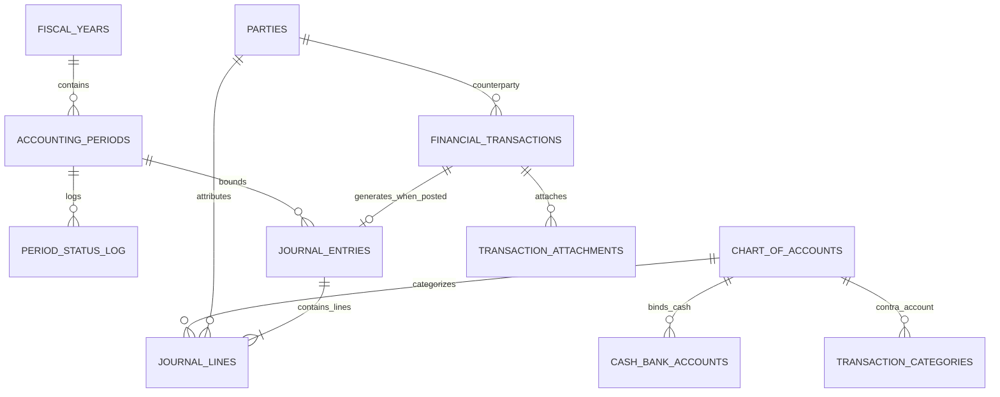

# Modul 4a — Keuangan Inti & Pembukuan Jurnal (Fase 4)

_Bagian dari [Spesifikasi Database](./00-README.md) · 11 tabel · Sasaran: Fase 4 MASTER-PLAN_

## 1. Tujuan & Sasaran Modul

Modul ini mengelola struktur tahun buku, siklus pembukaan/penutupan periode akuntansi, hierarki Bagan Akun (COA), rekening kas/bank, pihak ketiga (rekanan/donatur/penerima), serta pencatatan transaksi pengguna dan pembukuan jurnal umum berpasangan seimbang (_double-entry balanced journal_).

---

## 2. Kamus Tabel

### fiscal_years

| Kolom        | Tipe        | Null  | Keterangan                   |
| :----------- | :---------- | :---- | :--------------------------- |
| `code`       | text        | Tidak | Unik, misal: "2026"          |
| `start_date` | date        | Tidak | Tanggal awal tahun buku      |
| `end_date`   | date        | Tidak | CHECK end_date > start_date  |
| `status`     | enum        | Tidak | OPEN, CLOSED                 |
| `closed_at`  | timestamptz | Ya    | Waktu penutupan buku tahunan |
| `closed_by`  | uuid        | Ya    | FK → users                   |

_Catatan: EXCLUDE constraint agar rentang tahun buku tidak tumpang tindih._

### accounting_periods

| Kolom            | Tipe        | Null  | Keterangan               |
| :--------------- | :---------- | :---- | :----------------------- |
| `fiscal_year_id` | uuid        | Tidak | FK → fiscal_years        |
| `period_no`      | smallint    | Tidak | 1 sampai 12 (bulan buku) |
| `start_date`     | date        | Tidak | Awal bulan               |
| `end_date`       | date        | Tidak | Akhir bulan              |
| `status`         | enum        | Tidak | OPEN, CLOSED             |
| `closed_at`      | timestamptz | Ya    | Waktu tutup buku periode |
| `closed_by`      | uuid        | Ya    | FK → users               |

_Catatan: UQ (fiscal_year_id, period_no). Transaksi jurnal pada periode CLOSED ditolak mutlak oleh trigger database._

### period_status_log

| Kolom          | Tipe        | Null  | Keterangan                                   |
| :------------- | :---------- | :---- | :------------------------------------------- |
| `period_id`    | uuid        | Tidak | FK → accounting_periods                      |
| `action`       | enum        | Tidak | CLOSE, REOPEN                                |
| `reason`       | text        | Ya    | Alasan pembukaan kembali (wajib saat REOPEN) |
| `performed_by` | uuid        | Tidak | FK → users                                   |
| `performed_at` | timestamptz | Tidak | Waktu aksi                                   |

_Catatan: Append-only._

### chart_of_accounts

| Kolom                | Tipe    | Null  | Keterangan                                                |
| :------------------- | :------ | :---- | :-------------------------------------------------------- |
| `code`               | text    | Tidak | Unik, nomor akun. Terkunci setelah akun dipakai           |
| `name`               | text    | Tidak | Nama akun                                                 |
| `type`               | enum    | Tidak | ASSET, LIABILITY, NET_ASSET, REVENUE, EXPENSE             |
| `normal_balance`     | enum    | Tidak | DEBIT, CREDIT                                             |
| `parent_id`          | uuid    | Ya    | FK → chart_of_accounts (induk hierarki)                   |
| `is_postable`        | boolean | Tidak | Hanya akun daun yang boleh diposting                      |
| `is_cash_bank`       | boolean | Tidak | Penanda akun kas atau setara kas                          |
| `cash_flow_category` | enum    | Ya    | OPERATING, INVESTING, FINANCING. **PERLU VERIFIKASI**     |
| `expense_function`   | enum    | Ya    | PROGRAM, GENERAL_ADMIN, FUNDRAISING. **PERLU VERIFIKASI** |
| `is_system`          | boolean | Tidak | Akun bawaan sistem yang tidak boleh dihapus               |
| `is_active`          | boolean | Tidak | Status keaktifan akun                                     |
| `notes`              | text    | Ya    | Penjelasan peruntukan akun                                |

### cash_bank_accounts

| Kolom                 | Tipe    | Null  | Keterangan                                   |
| :-------------------- | :------ | :---- | :------------------------------------------- |
| `account_id`          | uuid    | Tidak | FK → chart_of_accounts, unik                 |
| `name`                | text    | Tidak | Nama rekening / kas kasir                    |
| `kind`                | enum    | Tidak | CASH, BANK                                   |
| `bank_name`           | text    | Ya    | Nama bank (BCA, Mandiri, BSI, dll.)          |
| `account_number_enc`  | bytea   | Ya    | [enc] Nomor rekening bank terenkripsi        |
| `account_number_mask` | text    | Ya    | Nomor rekening tersamar (misal `******7890`) |
| `holder_name`         | text    | Ya    | Nama pemilik rekening                        |
| `is_active`           | boolean | Tidak | Status aktif                                 |

### parties

| Kolom            | Tipe    | Null  | Keterangan                                   |
| :--------------- | :------ | :---- | :------------------------------------------- |
| `name`           | text    | Tidak | Nama pihak ketiga (rekanan/donatur/penerima) |
| `kind`           | enum    | Tidak | PERSON, ORGANIZATION                         |
| `is_donor`       | boolean | Tidak | Entitas donatur                              |
| `is_vendor`      | boolean | Tidak | Entitas pemasok/rekanan                      |
| `is_beneficiary` | boolean | Tidak | Entitas penerima manfaat program             |
| `tax_id_enc`     | bytea   | Ya    | [enc] NPWP atau NIK terenkripsi              |
| `tax_id_mask`    | text    | Ya    | Penyamaran NPWP/NIK                          |
| `address`        | text    | Ya    | Alamat                                       |
| `phone`          | text    | Ya    | Nomor kontak                                 |
| `email`          | text    | Ya    | Surel                                        |
| `notes`          | text    | Ya    | Catatan (SD)                                 |

### transaction_categories

| Kolom                     | Tipe    | Null  | Keterangan                              |
| :------------------------ | :------ | :---- | :-------------------------------------- |
| `type`                    | enum    | Tidak | INCOME, EXPENSE                         |
| `name`                    | text    | Tidak | Nama kategori transaksi operasional     |
| `account_id`              | uuid    | Tidak | FK → chart_of_accounts (Akun lawan kas) |
| `default_net_asset_class` | enum    | Ya    | WITHOUT_RESTRICTION, WITH_RESTRICTION   |
| `sort_order`              | int     | Tidak | Urutan tampilan                         |
| `is_active`               | boolean | Tidak | Status aktif                            |

### financial_transactions

| Kolom                  | Tipe        | Null  | Keterangan                                                |
| :--------------------- | :---------- | :---- | :-------------------------------------------------------- |
| `txn_no`               | text        | Ya    | Nomor bukti transaksi saat POSTED (unik parsial)          |
| `type`                 | enum        | Tidak | INCOME, EXPENSE, TRANSFER                                 |
| `txn_date`             | date        | Tidak | Tanggal transaksi                                         |
| `cash_bank_account_id` | uuid        | Tidak | FK → cash_bank_accounts                                   |
| `counter_account_id`   | uuid        | Ya    | FK → cash_bank_accounts (hanya TRANSFER)                  |
| `category_id`          | uuid        | Ya    | FK → transaction_categories                               |
| `party_id`             | uuid        | Ya    | FK → parties                                              |
| `project_id`           | uuid        | Ya    | FK → projects                                             |
| `restricted_fund_id`   | uuid        | Ya    | FK → restricted_funds                                     |
| `net_asset_class`      | enum        | Ya    | WITHOUT_RESTRICTION, WITH_RESTRICTION                     |
| `amount`               | bigint      | Tidak | CHECK amount > 0                                          |
| `description`          | text        | Tidak | Rincian keperluan transaksi                               |
| `reference_no`         | text        | Ya    | Nomor nota / kuitansi eksternal                           |
| `status`               | enum        | Tidak | DRAFT, PENDING_APPROVAL, APPROVED, POSTED, REJECTED, VOID |
| `journal_entry_id`     | uuid        | Ya    | FK → journal_entries, unik                                |
| `created_by`           | uuid        | Tidak | FK → users                                                |
| `posted_at`            | timestamptz | Ya    | Waktu pembukuan ke jurnal                                 |
| `posted_by`            | uuid        | Ya    | FK → users                                                |
| `void_reason`          | text        | Ya    | Alasan pembatalan (wajib saat VOID). (v)                  |

### transaction_attachments

| Kolom            | Tipe | Null  | Keterangan                                    |
| :--------------- | :--- | :---- | :-------------------------------------------- |
| `transaction_id` | uuid | Tidak | FK → financial_transactions                   |
| `media_asset_id` | uuid | Tidak | FK → media_assets (visibilitas wajib PRIVATE) |
| `description`    | text | Ya    | Keterangan lampiran kuitansi/struk            |
| `sort_order`     | int  | Tidak | Urutan tampilan                               |

_Catatan: UQ (transaction_id, media_asset_id). Invarian: berkas tidak boleh dihapus jika transaksi posted._

### journal_entries

| Kolom               | Tipe        | Null  | Keterangan                                                            |
| :------------------ | :---------- | :---- | :-------------------------------------------------------------------- |
| `entry_no`          | text        | Ya    | Nomor jurnal umum saat POSTED (unik parsial)                          |
| `entry_date`        | date        | Tidak | Tanggal pencatatan buku                                               |
| `period_id`         | uuid        | Tidak | FK → accounting_periods                                               |
| `source`            | enum        | Tidak | MANUAL, TRANSACTION, REVERSAL, CLOSING, OPENING, RELEASE, TAX_PAYMENT |
| `description`       | text        | Tidak | Keterangan ringkas jurnal                                             |
| `status`            | enum        | Tidak | DRAFT, POSTED, VOID                                                   |
| `reverses_entry_id` | uuid        | Ya    | FK → journal_entries (self), unik                                     |
| `posted_at`         | timestamptz | Ya    | Stempel waktu posting                                                 |
| `posted_by`         | uuid        | Ya    | FK → users                                                            |
| `created_by`        | uuid        | Tidak | FK → users. (v)                                                       |

### journal_lines

| Kolom                | Tipe     | Null  | Keterangan                                   |
| :------------------- | :------- | :---- | :------------------------------------------- |
| `entry_id`           | uuid     | Tidak | FK → journal_entries                         |
| `line_no`            | smallint | Tidak | Urutan baris dalam jurnal                    |
| `account_id`         | uuid     | Tidak | FK → chart_of_accounts                       |
| `debit`              | bigint   | Tidak | Default 0                                    |
| `credit`             | bigint   | Tidak | Default 0                                    |
| `memo`               | text     | Ya    | Catatan detail per baris akun                |
| `net_asset_class`    | enum     | Ya    | Wajib untuk akun REVENUE, EXPENSE, NET_ASSET |
| `restricted_fund_id` | uuid     | Ya    | FK → restricted_funds                        |
| `project_id`         | uuid     | Ya    | FK → projects                                |
| `party_id`           | uuid     | Ya    | FK → parties                                 |

---

## 3. Aturan Database vs Aplikasi & Siklus Hidup Data

1. **Invarian Keseimbangan Debit = Kredit**:
   Trigger database bertindak saat transaksi `POSTED`: total nilai debit wajib sama persis dengan total kredit pada satu `entry_id`.
2. **Kekebalan Mutasi Jurnal POSTED (_Immutability_)**:
   Trigger PostgreSQL menolak perintah `UPDATE` dan `DELETE` pada `journal_entries` dan `journal_lines` yang berstatus `POSTED`. Koreksi pembukuan HANYA dapat dilakukan via jurnal pembalik (_reversal entry_).
3. **Penolakan Periode Tertutup**:
   Trigger database menolak posting transaksi atau jurnal jika tanggal transaksi berada di dalam `accounting_periods` berstatus `CLOSED`.
4. **Siklus Hidup Data**:
   Transaksi berstatus `POSTED` tidak dapat dihapus (hanya `VOID`). Pembatalan (`VOID`) mewajibkan pengisian `void_reason` dan memicu jurnal pembalik otomatis.
