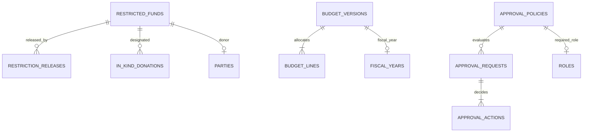

# Modul 4b — Keuangan Inti: Dana Terikat, Anggaran & Approval (Fase 4)

_Bagian dari [Spesifikasi Database](./00-README.md) · 8 tabel · Sasaran: Fase 4 MASTER-PLAN_

## 1. Tujuan & Sasaran Modul

Modul ini mengelola klasifikasi Aset Neto Terikat (ISAK 35), pelepasan pembatasan dana terikat (_restriction releases_), donasi non-kas (_in-kind donations_), penyusunan pagu anggaran organisasi & proyek, serta penegakan alur persetujuan bertingkat (_multi-step approval policies_).

---

## 2. Kamus Tabel

### restricted_funds

| Kolom              | Tipe   | Null  | Keterangan                              |
| :----------------- | :----- | :---- | :-------------------------------------- |
| `code`             | text   | Tidak | Unik, kode dana terikat                 |
| `name`             | text   | Tidak | Nama dana terikat                       |
| `purpose`          | text   | Tidak | Batasan atau tujuan khusus              |
| `donor_party_id`   | uuid   | Ya    | FK → parties                            |
| `project_id`       | uuid   | Ya    | FK → projects                           |
| `restriction_type` | enum   | Tidak | PURPOSE, TIME, PURPOSE_AND_TIME         |
| `expires_on`       | date   | Ya    | Batas waktu berlakunya pembatasan       |
| `target_amount`    | bigint | Ya    | Target nominal dana                     |
| `status`           | enum   | Tidak | ACTIVE, FULLY_RELEASED, EXPIRED, CLOSED |
| `notes`            | text   | Ya    | Catatan akad dana                       |

_Catatan: Saldo dana dihitung dari agregasi baris journal_lines, bukan disimpan statis._

### restriction_releases

| Kolom                | Tipe   | Null  | Keterangan                         |
| :------------------- | :----- | :---- | :--------------------------------- |
| `restricted_fund_id` | uuid   | Tidak | FK → restricted_funds              |
| `release_date`       | date   | Tidak | Tanggal pembebasan pembatasan dana |
| `amount`             | bigint | Tidak | CHECK amount > 0                   |
| `reason`             | enum   | Tidak | PURPOSE_MET, TIME_EXPIRED, OTHER   |
| `journal_entry_id`   | uuid   | Tidak | FK → journal_entries, unik         |
| `transaction_id`     | uuid   | Ya    | FK → financial_transactions        |
| `notes`              | text   | Ya    | Keterangan pembebasan              |
| `created_by`         | uuid   | Tidak | FK → users                         |

### in_kind_donations

| Kolom                | Tipe          | Null  | Keterangan                                 |
| :------------------- | :------------ | :---- | :----------------------------------------- |
| `donation_date`      | date          | Tidak | Tanggal penerimaan barang/jasa             |
| `donor_party_id`     | uuid          | Ya    | FK → parties                               |
| `description`        | text          | Tidak | Rincian barang donasi non-kas              |
| `quantity`           | numeric(14,3) | Ya    | Jumlah fisik                               |
| `unit`               | text          | Ya    | Satuan (dus, kg, unit, rim)                |
| `estimated_value`    | bigint        | Tidak | Nilai wajar estimasi. **PERLU VERIFIKASI** |
| `valuation_basis`    | text          | Ya    | Dasar penentuan nilai wajar                |
| `net_asset_class`    | enum          | Tidak | WITHOUT_RESTRICTION, WITH_RESTRICTION      |
| `project_id`         | uuid          | Ya    | FK → projects                              |
| `restricted_fund_id` | uuid          | Ya    | FK → restricted_funds                      |
| `is_recognized`      | boolean       | Tidak | Diakui di neraca atau diungkapkan di CaLK  |
| `journal_entry_id`   | uuid          | Ya    | FK → journal_entries, unik                 |
| `created_by`         | uuid          | Tidak | FK → users                                 |

### budget_versions

| Kolom            | Tipe        | Null  | Keterangan                                                  |
| :--------------- | :---------- | :---- | :---------------------------------------------------------- |
| `fiscal_year_id` | uuid        | Tidak | FK → fiscal_years                                           |
| `scope`          | enum        | Tidak | ORGANIZATION, PROJECT                                       |
| `project_id`     | uuid        | Ya    | FK → projects                                               |
| `version_no`     | int         | Tidak | Nomor revisi anggaran                                       |
| `name`           | text        | Tidak | Nama pagu anggaran                                          |
| `status`         | enum        | Tidak | DRAFT, APPROVED, SUPERSEDED                                 |
| `approved_by`    | uuid        | Ya    | FK → users                                                  |
| `approved_at`    | timestamptz | Ya    | Waktu persetujuan anggaran                                  |
| `notes`          | text        | Ya    | Catatan revisi. UQ (fiscal_year_id, project_id, version_no) |

### budget_lines

| Kolom               | Tipe     | Null  | Keterangan                                                           |
| :------------------ | :------- | :---- | :------------------------------------------------------------------- |
| `budget_version_id` | uuid     | Tidak | FK → budget_versions                                                 |
| `account_id`        | uuid     | Tidak | FK → chart_of_accounts                                               |
| `period_no`         | smallint | Ya    | 1 sampai 12 (null = pagu setahun)                                    |
| `amount`            | bigint   | Tidak | CHECK amount ≥ 0                                                     |
| `notes`             | text     | Ya    | Rincian alokasi biaya. UQ (budget_version_id, account_id, period_no) |

### approval_policies

| Kolom                  | Tipe     | Null  | Keterangan                                             |
| :--------------------- | :------- | :---- | :----------------------------------------------------- |
| `name`                 | text     | Tidak | Nama kebijakan persetujuan                             |
| `applies_to`           | enum     | Tidak | INCOME, EXPENSE, TRANSFER, MANUAL_JOURNAL, VOID        |
| `min_amount`           | bigint   | Tidak | Ambang batas minimal nominal (default 0)               |
| `max_amount`           | bigint   | Ya    | Ambang batas maksimal nominal                          |
| `required_role_id`     | uuid     | Tidak | FK → roles (peran penyetuju berwenang)                 |
| `steps_required`       | smallint | Tidak | Jumlah tahapan persetujuan                             |
| `forbid_self_approval` | boolean  | Tidak | Larangan persetujuan permohonan sendiri (default true) |
| `priority`             | int      | Tidak | Prioritas evaluasi kebijakan                           |
| `is_active`            | boolean  | Tidak | Status aktif                                           |

### approval_requests

| Kolom              | Tipe        | Null  | Keterangan                             |
| :----------------- | :---------- | :---- | :------------------------------------- |
| `transaction_id`   | uuid        | Ya    | FK → financial_transactions            |
| `journal_entry_id` | uuid        | Ya    | FK → journal_entries                   |
| `policy_id`        | uuid        | Tidak | FK → approval_policies                 |
| `requested_by`     | uuid        | Tidak | FK → users                             |
| `requested_at`     | timestamptz | Tidak | Waktu pengajuan persetujuan            |
| `status`           | enum        | Tidak | PENDING, APPROVED, REJECTED, CANCELLED |
| `decided_at`       | timestamptz | Ya    | Waktu penetapan keputusan              |

_Catatan: CHECK tepat satu dari transaction_id atau journal_entry_id yang terisi._

### approval_actions

| Kolom           | Tipe        | Null  | Keterangan                                               |
| :-------------- | :---------- | :---- | :------------------------------------------------------- |
| `request_id`    | uuid        | Tidak | FK → approval_requests                                   |
| `step_no`       | smallint    | Tidak | Nomor tahapan                                            |
| `actor_user_id` | uuid        | Tidak | FK → users                                               |
| `decision`      | enum        | Tidak | APPROVE, REJECT                                          |
| `comment`       | text        | Ya    | Catatan alasan keputusan                                 |
| `decided_at`    | timestamptz | Tidak | Waktu keputusan. UQ (request_id, step_no, actor_user_id) |

---

## 3. Aturan Database vs Aplikasi & Siklus Hidup Data

1. **Aturan Database**:
   - Saldo dana terikat dilarang disimpan statis; selalu dihitung dinamis dari `journal_lines` ber-filter `restricted_fund_id`.
   - `forbid_self_approval`: Pengecekan `requested_by != actor_user_id` ditegakkan saat pembuatan `approval_actions`.
2. **Aturan Aplikasi**:
   - Reklasifikasi Aset Neto: Pembebasan dana terikat (`restriction_releases`) otomatis membukukan jurnal reklasifikasi dari Aset Neto Terikat ke Aset Neto Tidak Terikat.
   - Pagu anggaran berstatus `APPROVED` terkunci; perubahan nilai memerlukan versi revisi baru (`SUPERSEDED`).
3. **Siklus Hidup Data**:
   - `approval_actions` berstatus _append-only_ untuk menjaga integritas tata kelola kelembagaan.

---

## Usulan Tambahan, MENUNGGU PERSETUJUAN

Tabel-tabel berikut **tidak ada dalam draf 70 tabel pemilik** dan diusulkan oleh tim arsitektur. Status: menunggu persetujuan tertulis pemilik.

### (Usulan) bank_reconciliations dan bank_reconciliation_lines

Rekonsiliasi saldo buku dengan mutasi rekening koran bank. Ditunda karena di luar lingkup versi ini.

### (Usulan) recurring_transactions

Template transaksi berulang untuk tagihan periodik rutin.

### (Usulan) asset_inventories dan depreciation_schedules

Inventaris aset tetap yayasan dan perhitungan penyusutan. Ditunda karena di luar lingkup versi ini.

### (Usulan) closing_entries

Template jurnal penutup akhir tahun otomatis.
