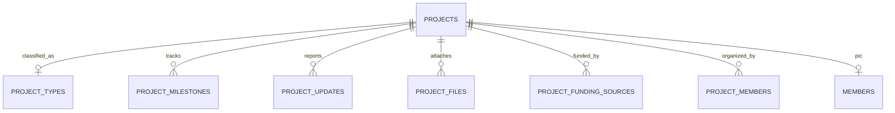

# Modul 5 — Proyek dan Kegiatan (Fase 5)

_Bagian dari [Spesifikasi Database](./00-README.md) · 7 tabel (5 inti + 2 opsional) · Sasaran: Fase 5 MASTER-PLAN_

## 1. Tujuan & Sasaran Modul

Modul ini mengelola inisiatif program kerja yayasan di Purwakarta, tahapan termin kerja (_milestones_), laporan kabar progres, dokumentasi berkas kegiatan, alokasi sumber dana terikat, dan kepanitiaan anggota relawan.

---

## 2. Kamus Tabel

### project_types

| Kolom       | Tipe    | Null  | Keterangan                                              |
| :---------- | :------ | :---- | :------------------------------------------------------ |
| `code`      | text    | Tidak | Unik, kode kategori proyek                              |
| `name`      | text    | Tidak | Nama jenis (Sosial, Pendidikan, Keagamaan, Pembangunan) |
| `is_active` | boolean | Tidak | Status aktif                                            |

---

## projects

| Kolom            | Tipe    | Null  | Keterangan                                        |
| :--------------- | :------ | :---- | :------------------------------------------------ |
| `code`           | text    | Tidak | Unik, nomor registrasi kegiatan                   |
| `name`           | text    | Tidak | Nama kegiatan/program kerja                       |
| `type_id`        | uuid    | Tidak | FK → project_types                                |
| `description`    | text    | Ya    | Deskripsi dan latar belakang program              |
| `location_text`  | text    | Ya    | Lokasi pelaksanaan di Purwakarta                  |
| `status`         | enum    | Tidak | PLANNED, ONGOING, COMPLETED, CANCELLED            |
| `start_date`     | date    | Ya    | Tanggal rencana mulai                             |
| `end_date`       | date    | Ya    | CHECK end_date ≥ start_date                       |
| `pic_member_id`  | uuid    | Ya    | FK → members (Penanggung Jawab / PIC)             |
| `budget_total`   | bigint  | Ya    | Pagu anggaran total yang disetujui                |
| `is_public`      | boolean | Tidak | Tampil di portofolio situs publik (default false) |
| `slug`           | text    | Ya    | Unik parsial untuk URL publik                     |
| `cover_asset_id` | uuid    | Ya    | FK → media_assets                                 |

_Catatan: SD, v._

---

## project_milestones

| Kolom                    | Tipe        | Null  | Keterangan                         |
| :----------------------- | :---------- | :---- | :--------------------------------- |
| `project_id`             | uuid        | Tidak | FK → projects, ON DELETE CASCADE   |
| `name`                   | text        | Tidak | Nama termin / tahapan kerja        |
| `description`            | text        | Ya    | Rincian target capaian             |
| `planned_start`          | date        | Ya    | Rencana awal                       |
| `planned_end`            | date        | Ya    | Rencana selesai                    |
| `planned_payment_amount` | bigint      | Ya    | Rencana pembayaran termin bertahap |
| `status`                 | enum        | Tidak | PENDING, IN_PROGRESS, DONE         |
| `completed_at`           | timestamptz | Ya    | Waktu penyelesaian termin          |
| `sort_order`             | int         | Tidak | Urutan tahapan                     |

---

## project_updates

| Kolom         | Tipe    | Null  | Keterangan                                    |
| :------------ | :------ | :---- | :-------------------------------------------- |
| `project_id`  | uuid    | Tidak | FK → projects, ON DELETE CASCADE              |
| `title`       | text    | Tidak | Judul kabar kemajuan proyek                   |
| `body`        | text    | Tidak | Laporan naratif perkembangan                  |
| `update_date` | date    | Tidak | Tanggal laporan                               |
| `is_public`   | boolean | Tidak | Ditampilkan di website publik (default false) |
| `created_by`  | uuid    | Tidak | FK → users                                    |

---

## project_files

| Kolom            | Tipe    | Null  | Keterangan                       |
| :--------------- | :------ | :---- | :------------------------------- |
| `project_id`     | uuid    | Tidak | FK → projects, ON DELETE CASCADE |
| `update_id`      | uuid    | Ya    | FK → project_updates             |
| `media_asset_id` | uuid    | Tidak | FK → media_assets                |
| `kind`           | enum    | Tidak | PHOTO, DOCUMENT, CONTRACT, OTHER |
| `title`          | text    | Ya    | Judul berkas                     |
| `is_public`      | boolean | Tidak | Ditampilkan di publik            |
| `sort_order`     | int     | Tidak | Urutan                           |

---

### project_funding_sources (Opsional)

| Kolom                | Tipe   | Null  | Keterangan                          |
| :------------------- | :----- | :---- | :---------------------------------- |
| `project_id`         | uuid   | Tidak | FK → projects, ON DELETE CASCADE    |
| `restricted_fund_id` | uuid   | Ya    | FK → restricted_funds               |
| `planned_amount`     | bigint | Tidak | Alokasi dana terikat untuk kegiatan |
| `note`               | text   | Ya    | Keterangan akad                     |

_Catatan: UQ (project_id, restricted_fund_id)._

---

### project_members (Opsional)

| Kolom        | Tipe | Null  | Keterangan                            |
| :----------- | :--- | :---- | :------------------------------------ |
| `project_id` | uuid | Tidak | FK → projects, ON DELETE CASCADE      |
| `member_id`  | uuid | Tidak | FK → members                          |
| `role_text`  | text | Tidak | Peran spesifik dalam panitia kegiatan |

_Catatan: UQ (project_id, member_id)._

---

## 3. Aturan Database vs Aplikasi & Siklus Hidup Data

1. **Aturan Database**:
   - `ON DELETE CASCADE` diterapkan pada relasi komposisi milik proyek: `project_milestones`, `project_updates`, `project_files`, `project_funding_sources`, `project_members`.
   - Batasan tanggal: `CHECK (end_date >= start_date)`.
   - Keunikan: `slug` unik parsial untuk proyek yang belum dihapus (`deleted_at IS NULL`).
2. **Aturan Aplikasi**:
   - Realisasi biaya proyek tidak disimpan statis; dihitung runtime dari agregasi `journal_lines WHERE project_id = ...`.
   - Publikasi ke situs portal publik (`is_public = true`) memicu pembentukan rute publik `/program/[slug]`.
3. **Siklus Hidup Data**:
   - Pembatalan atau penutupan proyek beralih status ke `COMPLETED` atau `CANCELLED`.
   - Proyek yang telah memiliki jurnal pembukuan tidak boleh dihapus fisik (hanya soft delete).

---

## Usulan Tambahan, MENUNGGU PERSETUJUAN

_Tidak ada usulan tambahan untuk modul ini._
