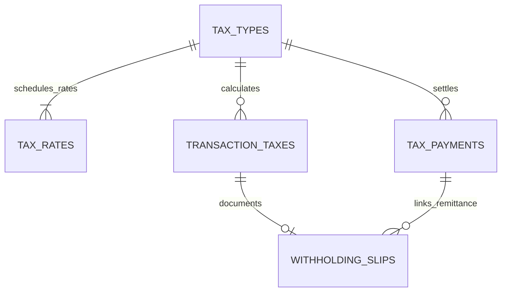

# Modul 6 — Pajak (Fase 6)

_Bagian dari [Spesifikasi Database](./00-README.md) · 6 tabel · Sasaran: Fase 6 MASTER-PLAN_

## 1. Tujuan & Sasaran Modul

Modul ini mengelola profil wajib pajak nirlaba, katalog jenis pajak (PPh 21, PPh 23, PPh 4(2), PPN), master tarif berversi tanggal efektif (tanpa hardcoding), snapshot pemotongan pajak per transaksi, penerbitan bukti potong terstandarisasi, dan rekonsiliasi setoran NTPN ke kas negara. Seluruh modul ini **PERLU VERIFIKASI** konsultan pajak sebelum operasional penuh.

---

## 2. Kamus Tabel

### tax_profile

| Kolom                  | Tipe     | Null  | Keterangan                              |
| :--------------------- | :------- | :---- | :-------------------------------------- |
| `id`                   | smallint | Tidak | Singleton, CHECK id = 1                 |
| `npwp_enc`             | bytea    | Ya    | [enc] NPWP yayasan terenkripsi          |
| `npwp_mask`            | text     | Ya    | NPWP tersamar untuk tampilan            |
| `taxpayer_name`        | text     | Ya    | Nama resmi wajib pajak                  |
| `is_vat_registered`    | boolean  | Tidak | Status Pengusaha Kena Pajak (PKP)       |
| `vat_registered_since` | date     | Ya    | Tanggal pengukuhan PKP                  |
| `tax_office`           | text     | Ya    | Kantor Pelayanan Pajak (KPP) terdaftar  |
| `rounding_mode`        | enum     | Tidak | NEAREST, UP, DOWN. **PERLU VERIFIKASI** |
| `updated_by`           | uuid     | Tidak | FK → users                              |

_Catatan: Singleton._

---

## tax_types

| Kolom                | Tipe    | Null  | Keterangan                                            |
| :------------------- | :------ | :---- | :---------------------------------------------------- |
| `code`               | text    | Tidak | Unik, misal: PPH21, PPH23, PPH4_2, PPN                |
| `name`               | text    | Tidak | Nama jenis pajak                                      |
| `kind`               | enum    | Tidak | WITHHOLDING, COLLECTION, VAT_OUTPUT, VAT_INPUT, OTHER |
| `payable_account_id` | uuid    | Tidak | FK → chart_of_accounts (Akun Hutang Pajak)            |
| `expense_account_id` | uuid    | Ya    | FK → chart_of_accounts                                |
| `requires_slip`      | boolean | Tidak | Wajib menerbitkan bukti potong atau tidak             |
| `description`        | text    | Ya    | Keterangan regulasi                                   |
| `is_active`          | boolean | Tidak | Status aktif                                          |

---

## tax_rates

| Kolom            | Tipe         | Null  | Keterangan                        |
| :--------------- | :----------- | :---- | :-------------------------------- |
| `tax_type_id`    | uuid         | Tidak | FK → tax_types                    |
| `rate`           | numeric(7,4) | Tidak | Persentase tarif (CHECK rate ≥ 0) |
| `basis_note`     | text         | Ya    | Dasar pengenaan pajak             |
| `effective_from` | date         | Tidak | Tanggal awal mulai berlaku        |
| `effective_to`   | date         | Ya    | Tanggal akhir masa berlaku        |
| `notes`          | text         | Ya    | Dasar hukum/PMK                   |

_Catatan: EXCLUDE constraint (btree_gist) agar rentang masa berlaku untuk satu jenis pajak tidak tumpang tindih._

---

## transaction_taxes

| Kolom             | Tipe         | Null  | Keterangan                                     |
| :---------------- | :----------- | :---- | :--------------------------------------------- |
| `transaction_id`  | uuid         | Tidak | FK → financial_transactions                    |
| `tax_type_id`     | uuid         | Tidak | FK → tax_types                                 |
| `tax_rate_id`     | uuid         | Ya    | FK → tax_rates                                 |
| `rate_snapshot`   | numeric(7,4) | Tidak | Snapshot tarif saat transaksi dibuat           |
| `base_amount`     | bigint       | Tidak | Dasar Pengenaan Pajak (DPP)                    |
| `tax_amount`      | bigint       | Tidak | Nilai nominal pajak yang dipotong              |
| `treatment`       | enum         | Tidak | WITHHOLD (memotong pembayaran), ADD (menambah) |
| `is_overridden`   | boolean      | Tidak | Tarif dimodifikasi manual                      |
| `override_reason` | text         | Ya    | Alasan pemodifikasian manual                   |

_Catatan: Menggunakan snapshot tarif sehingga perubahan master tarif di masa mendatang tidak mengubah riwayat transaksi lampau._

---

## withholding_slips

Bukti potong pajak. Skema terstandar yang kompatibel baik dengan format bukti potong internal maupun skema eksternal e-Bupot DJP.

| Kolom                       | Tipe         | Null  | Keterangan                            |
| :-------------------------- | :----------- | :---- | :------------------------------------ |
| `slip_no`                   | text         | Tidak | Nomor bukti potong unik (tanpa celah) |
| `external_ref`              | text         | Ya    | Nomor referensi DJP e-Bupot           |
| `slip_date`                 | date         | Tidak | Tanggal penerbitan bukti potong       |
| `tax_period_year`           | smallint     | Tidak | Masa pajak: tahun                     |
| `tax_period_month`          | smallint     | Tidak | Masa pajak: bulan (1–12)              |
| `tax_type_id`               | uuid         | Tidak | FK → tax_types                        |
| `transaction_tax_id`        | uuid         | Ya    | FK → transaction_taxes, unik          |
| `party_id`                  | uuid         | Tidak | FK → parties (pihak yang dipotong)    |
| `party_name_snapshot`       | text         | Tidak | Snapshot nama penerima honor/jasa     |
| `party_tax_id_snapshot_enc` | bytea        | Ya    | [enc] Snapshot NPWP/NIK penerima      |
| `gross_amount`              | bigint       | Tidak | Penghasilan bruto                     |
| `tax_amount`                | bigint       | Tidak | Nilai pajak dipotong                  |
| `rate_snapshot`             | numeric(7,4) | Tidak | Snapshot tarif persen                 |
| `status`                    | enum         | Tidak | DRAFT, ISSUED, CANCELLED              |
| `tax_payment_id`            | uuid         | Ya    | FK → tax_payments                     |
| `file_asset_id`             | uuid         | Ya    | FK → media_assets (PDF bukti potong)  |
| `notes`                     | text         | Ya    | Keterangan                            |

---

## tax_payments

Catatan setoran pajak ke kas negara.

| Kolom              | Tipe     | Null  | Keterangan                               |
| :----------------- | :------- | :---- | :--------------------------------------- |
| `payment_date`     | date     | Tidak | Tanggal penyetoran                       |
| `tax_period_year`  | smallint | Tidak | Masa tahun pajak                         |
| `tax_period_month` | smallint | Tidak | Masa bulan pajak                         |
| `tax_type_id`      | uuid     | Tidak | FK → tax_types                           |
| `amount`           | bigint   | Tidak | CHECK amount > 0                         |
| `billing_code`     | text     | Ya    | Kode billing pajak                       |
| `ntpn`             | text     | Ya    | Nomor Transaksi Penerimaan Negara (NTPN) |
| `transaction_id`   | uuid     | Ya    | FK → financial_transactions              |
| `journal_entry_id` | uuid     | Ya    | FK → journal_entries                     |
| `proof_asset_id`   | uuid     | Ya    | FK → media_assets (bukti setor BPN)      |
| `status`           | enum     | Tidak | PLANNED, PAID                            |
| `notes`            | text     | Ya    | Catatan                                  |

---

## 3. Aturan Database vs Aplikasi & Siklus Hidup Data

1. **Aturan Database**:
   - `tax_profile` adalah entitas _singleton_ ber-constraint `CHECK (id = 1)`.
   - `tax_rates`: Mencegah rentang tanggal tarif tumpang tindih untuk satu jenis pajak via constraint `EXCLUDE USING gist (tax_type_id WITH =, daterange(effective_from, effective_to) WITH &&)`.
   - `transaction_taxes.rate_snapshot`: Tarif disalin permanen sebagai snapshot angka numerik agar perubahan tarif di masa depan tidak mengubah histori transaksi lampau.
2. **Aturan Aplikasi**:
   - Nilai pembulatan nominal pajak mengikuti konfigurasi `rounding_mode` pada `tax_profile`.
   - Penomoran bukti potong (`withholding_slips.slip_no`) dikelola via `number_sequences` ber-lock transaksi.
3. **Siklus Hidup Data**:
   - Bukti potong berstatus `ISSUED` tidak dapat dihapus (hanya `CANCELLED`).
   - Penyetoran pajak ke kas negara mencatat kode billing, tanggal setor, dan NTPN resmi.

---

## Usulan Tambahan, MENUNGGU PERSETUJUAN

### (Usulan) tax_invoices

Faktur pajak (e-Faktur) untuk Pengusaha Kena Pajak (PKP). Hanya relevan jika yayasan terdaftar sebagai PKP dan perlu menerbitkan Faktur Pajak Keluaran.

**Dampak**: Memerlukan integrasi dengan sistem e-Faktur DJP dan UI penerbitan faktur.
**Catatan**: Integrasi e-Faktur langsung di luar lingkup versi ini (lihat Poin 6 Keputusan Arsitektur di 00-README.md).
**Status**: MENUNGGU PERSETUJUAN pemilik dan konfirmasi status PKP yayasan.
