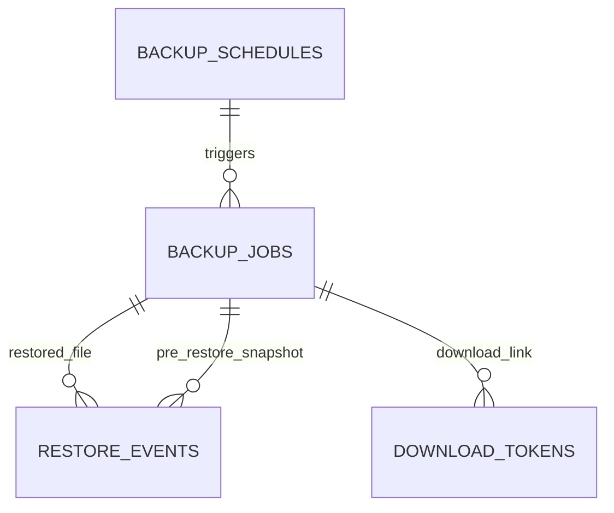

# Modul 8 — Sistem dan Cadangan Data (Fase 8)

_Bagian dari [Spesifikasi Database](./00-README.md) · 5 tabel · Sasaran: Fase 8 MASTER-PLAN_

## 1. Tujuan & Sasaran Modul

Modul ini mengelola orkestrasi pencadangan otomatis (lokal dan offsite S3), riwayat pemulihan (_restore_), validasi versi lingkungan pra-restore, penguncian tugas terjadwal (_distributed job locks_), dan token unduhan berkas berumur pendek.

---

## 2. Kamus Tabel

### backup_schedules

| Kolom             | Tipe    | Null  | Keterangan                                |
| :---------------- | :------ | :---- | :---------------------------------------- |
| `cron_expr`       | text    | Tidak | Pola cron penjadwalan                     |
| `kind`            | enum    | Tidak | DB_ONLY, DB_AND_FILES                     |
| `retention_count` | int     | Tidak | Batas jumlah arsip cadangan yang disimpan |
| `retention_days`  | int     | Ya    | Batas umur retensi hari                   |
| `destination`     | enum    | Tidak | LOCAL, S3                                 |
| `encrypt`         | boolean | Tidak | Enkripsi cadangan (default true)          |
| `is_active`       | boolean | Tidak | Status aktif                              |
| `updated_by`      | uuid    | Tidak | FK → users                                |

---

### backup_jobs

Model data cadangan yang dilengkapi pencatatan versi lingkungan guna validasi kompatibilitas pemulihan data sebelum dieksekusi.

| Kolom                 | Tipe        | Null  | Keterangan                                                 |
| :-------------------- | :---------- | :---- | :--------------------------------------------------------- |
| `trigger`             | enum        | Tidak | MANUAL, SCHEDULED, PRE_RESTORE, PRE_DEPLOY                 |
| `kind`                | enum        | Tidak | DB_ONLY, DB_AND_FILES                                      |
| `status`              | enum        | Tidak | RUNNING, SUCCESS, FAILED                                   |
| `started_at`          | timestamptz | Tidak | Waktu mulai proses                                         |
| `finished_at`         | timestamptz | Ya    | Waktu selesai proses                                       |
| `postgres_version`    | text        | Tidak | Versi PostgreSQL saat backup dibuat (disahkan pemilik)     |
| `schema_version`      | text        | Tidak | Nama migrasi Prisma terakhir yang aktif (disahkan pemilik) |
| `app_version`         | text        | Tidak | Versi rilis atau Git commit SHA (disahkan pemilik)         |
| `storage_key`         | text        | Ya    | Lokasi path berkas cadangan lokal (bukan URL)              |
| `size_bytes`          | bigint      | Ya    | Ukuran arsip cadangan lokal                                |
| `sha256`              | text        | Ya    | Hash integritas berkas cadangan                            |
| `encrypted`           | boolean     | Tidak | Status enkripsi arsip                                      |
| `key_id`              | text        | Ya    | ID kunci enkripsi yang dipakai                             |
| `destination`         | enum        | Tidak | LOCAL, S3                                                  |
| `offsite_status`      | enum        | Tidak | `NONE, PENDING, SUCCESS, FAILED`. Default `NONE`           |
| `offsite_storage_key` | text        | Ya    | Lokasi path objek pada penyimpanan offsite S3              |
| `offsite_copied_at`   | timestamptz | Ya    | Waktu berhasil direplikasi ke offsite                      |
| `schedule_id`         | uuid        | Ya    | FK → backup_schedules                                      |
| `requested_by`        | uuid        | Ya    | FK → users                                                 |
| `error_message`       | text        | Ya    | Pesan galat tersanitasi jika gagal                         |

_Catatan Arsitektur & Aturan Siklus Hidup Cadangan:_

- _Status 4 Kolom Tambahan: `postgres_version`, `schema_version`, `app_version`, dan nilai enum `PRE_DEPLOY` pada `trigger` **RESMI DISETUJUI PEMILIK** (ADR-009)._
- _Pemisahan Salinan Lokal & Offsite: Sistem membedakan salinan lokal (`storage_key`) dan salinan offsite (`offsite_storage_key`). Admin panel memunculkan peringatan (warning banner) untuk backup berstatus lokal `SUCCESS` namun `offsite_status != SUCCESS`._
- _Kunci Enkripsi Cadangan: Kunci enkripsi backup **DILARANG KERAS DISIMPAN DI VPS MAUPUN DATABASE**. Kunci master enkripsi disimpan offline/cold storage atau dipasok manual oleh operator saat prosedur pemulihan._
- _Siklus Hidup Penyimpanan & Media: Soft delete media tidak menghapus file fisik di disk (perlu background cleanup job). Lampiran transaksi keuangan (`transaction_attachments`) dilarang dihapus. Berkas `PRIVATE` tidak pernah memiliki URL publik langsung._

---

### restore_events

| Kolom                   | Tipe        | Null  | Keterangan                                                  |
| :---------------------- | :---------- | :---- | :---------------------------------------------------------- |
| `backup_job_id`         | uuid        | Tidak | FK → backup_jobs (berkas cadangan yang dipulihkan)          |
| `pre_restore_backup_id` | uuid        | Tidak | FK → backup_jobs (snapshot otomatis sebelum restore, wajib) |
| `requested_by`          | uuid        | Tidak | FK → users (Super Admin)                                    |
| `started_at`            | timestamptz | Tidak | Waktu mulai                                                 |
| `finished_at`           | timestamptz | Ya    | Waktu selesai                                               |
| `status`                | enum        | Tidak | RUNNING, SUCCESS, FAILED                                    |
| `notes`                 | text        | Ya    | Keterangan audit pemulihan                                  |

_Catatan: Prosedur Pre-Restore & Validasi Penolakan Mutlak (lihat detail di `docs/database/14-traceability.md`):_

1. _Target PostgreSQL Version Check: Restore DITOLAK KERAS jika versi PostgreSQL target lebih tua daripada `postgres_version` berkas cadangan._
2. _Schema Version Compatibility Check: Restore DITOLAK OTOMATIS jika skema target tidak kompatibel dengan `schema_version` cadangan._
3. _Cryptographic Key Check: Restore DITOLAK KERAS jika key ring target tidak memiliki `key_id` yang cocok atau `BLIND_INDEX_SECRET` berbeda._
4. _Snapshot Wajib: Snapshot otomatis `pre_restore_backup_id` wajib sukses dibuat sebelum pemulihan basis data dieksekusi._

---

### job_locks

| Kolom          | Tipe        | Null  | Keterangan                                      |
| :------------- | :---------- | :---- | :---------------------------------------------- |
| `job_name`     | text        | Tidak | Primary key (tanpa kolom id)                    |
| `locked_by`    | text        | Tidak | Pengenal instance worker                        |
| `locked_until` | timestamptz | Tidak | Batas waktu sewa lock (mencegah eksekusi ganda) |

---

### download_tokens

Tautan unduh berumur pendek untuk file cadangan atau ekspor sensitif.

| Kolom            | Tipe        | Null  | Keterangan        |
| :--------------- | :---------- | :---- | :---------------- |
| `token_hash`     | text        | Tidak | [hash], unik      |
| `backup_job_id`  | uuid        | Ya    | FK → backup_jobs  |
| `media_asset_id` | uuid        | Ya    | FK → media_assets |
| `expires_at`     | timestamptz | Tidak | Waktu kedaluwarsa |
| `used_at`        | timestamptz | Ya    | Sekali pakai      |
| `created_by`     | uuid        | Tidak | FK → users        |

_Catatan: CHECK tepat salah satu dari backup_job_id atau media_asset_id yang terisi._

---

## 3. Aturan Database vs Aplikasi & Siklus Hidup Data

1. **Aturan Database**:
   - `job_locks`: Mencegah eksekusi ganda job terjadwal menggunakan `job_name` sebagai Primary Key dan sewa waktu `locked_until`.
   - `download_tokens`: Token bersifat sekali pakai (`used_at`) dan berumur pendek (`expires_at`), disimpan sebagai hash SHA-256 (`token_hash`).
2. **Aturan Aplikasi**:
   - Validasi Pra-Pemulihan (Pre-Restore Drill): Aplikasi menolak mutlak pemulihan jika versi PostgreSQL target lebih tua daripada `postgres_version`, atau skema tidak kompatibel dengan `schema_version`.
   - Snapshot Otomatis: Restorasi mewajibkan pembuatan snapshot `pre_restore_backup_id` terlebih dahulu sebelum database target ditimpa.
   - Peringatan Offsite: Worker memicu alert kepada admin jika backup lokal sukses namun `offsite_status != SUCCESS`.
3. **Siklus Hidup Data**:
   - Berkas cadangan lokal dibersihkan sesuai kuota retensi (`retention_count` dan `retention_days`).
   - Kunci enkripsi arsip backup tidak disimpan di VPS maupun database; disimpan di cold storage operator.

---

## Usulan Tambahan, MENUNGGU PERSETUJUAN

_Tidak ada usulan tambahan untuk modul ini._
