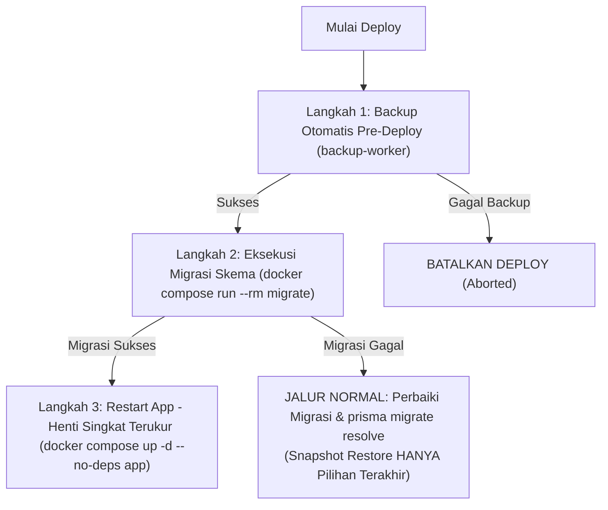

# 11-migration-plan.md — Panduan Migrasi Basis Data, Deployment & Portabilitas Mesin Docker

> **Status Dokumen**: Wajib Dipatuhi (Normatif & Mengikat)  
> **Klasifikasi**: Prosedur Operasional Standar (SOP) DevOps & Database Administrator  
> **Lokasi Berkas**: `docs/database/11-migration-plan.md`  
> **Sasaran**: Seluruh pengembang dan operator sistem Yayasan Nurjaman Bongas Purwakarta.

Dokumen ini mendefinisikan tata kelola migrasi skema basis data, urutan sakral deployment produksi, rancangan container worker cadangan/pemulihan, pencadangan offsite wajib, serta prosedur resmi pemindahan mesin (_cross-machine transfer_) antara server VPS produksi dan laptop pengembang.

---

## 1. Prinsip Utama Migrasi Basis Data

1. **Layanan Sekali Jalan (_One-Off Container_)**:
   Migrasi basis data dieksekusi melalui container khusus sekali jalan (`prisma migrate deploy`), **BUKAN** dijalankan otomatis pada saat container aplikasi (`app`) dinyalakan (_start/entrypoint_).
2. **Alasan Arsitektural**:
   - Menghindari _race condition_ atau _deadlock_ DDL ketika beberapa replika container aplikasi dijalankan secara bersamaan.
   - Mencegah container aplikasi mengalami _restart loop_ berulang tanpa akhir jika migrasi mengalami kegagalan.
   - Memberikan kontrol deterministik bagi operator/pipeline CI-CD untuk memverifikasi keberhasilan migrasi sebelum lalu lintas pengguna diarahkan ke kode baru.
3. **Pola Evolusi Skema: Expand lalu Contract (_Expand-Contract Pattern_)**:
   Setiap perubahan skema basis data **WAJIB** dirancang agar senantiasa kompatibel dengan versi kode aplikasi yang sedang berjalan (_backward & forward compatible_):
   - **Tahap Expand**: Menambahkan kolom baru (harus nullable atau memiliki default value) atau tabel baru tanpa menghapus kolom lama. Aplikasi versi baru mulai menulis ke kedua kolom atau kolom baru secara aman.
   - **Tahap Backfill / Migrasi Data**: Mengisi atau menyelaraskan data historis dari kolom lama ke kolom baru bila diperlukan.
   - **Tahap Contract**: Setelah seluruh instance aplikasi dipastikan berjalan penuh menggunakan versi baru, buat migrasi terpisah berikutnya untuk menghapus kolom atau tabel lama yang sudah usang (_deprecated_).

---

## 2. Urutan Deployment Produksi Baku (Urutan Sakral 3 Langkah)

Setiap proses pembaruan sistem di lingkungan produksi wajib mematuhi urutan sekuensial berikut tanpa kompromi:



### Langkah 1: Cadangan Otomatis Pre-Deploy

Sebelum menyentuh skema atau kode aplikasi, container `backup-worker` secara otomatis mengeksekusi dump logis basis data lengkap via `pg_dump`. Snapshot ini diberi label penanda `PRE_DEPLOY_<TIMESTAMP>` sebagai jaring pengaman utama.

### Langkah 2: Eksekusi Migrasi Skema

Jalankan layanan migrasi sekali jalan menggunakan sintaks Docker Compose v2:

```bash
docker compose run --rm migrate
```

Layanan ini mengeksekusi `prisma migrate deploy` terhadap PostgreSQL.

#### Penanganan dan Resolusi Bila Migrasi Gagal:

- **Prinsip Fail-Fast & Abort**: Proses deployment kode aplikasi baru **SEGERA DIBATALKAN**. Container aplikasi versi lama tetap dibiarkan berjalan melayani pengguna dengan skema yang ada.
- **Jalur Normal Penanganan (Perbaikan Forward & Resolve)**:
  1. Operator atau insinyur menelaah log galat DDL dari container `migrate`.
  2. Perbaiki berkas migrasi SQL yang bermasalah agar kompatibel.
  3. Tandai dan selaraskan riwayat migrasi menggunakan perintah resmi Prisma:
     ```bash
     # Tandai migrasi yang gagal sebagai telah diselesaikan / dibatalkan
     docker compose run --rm migrate npx prisma migrate resolve --rolled-back "<migration_name>"
     # Atau tandai telah diterapkan setelah perbaikan manual
     docker compose run --rm migrate npx prisma migrate resolve --applied "<migration_name>"
     ```
- **Pilihan Terakhir (_Last Resort_): Pemulihan dari Snapshot**:
  Restorasi basis data dari snapshot cadangan `PRE_DEPLOY` **HANYA** dilakukan sebagai langkah darurat terakhir jika migrasi mengalami kegagalan fatal yang merusak integritas tabel/data yang tidak dapat diperbaiki secara logis melalui `prisma migrate resolve`.

### Langkah 3: Start / Restart Aplikasi & Toleransi Henti Singkat (_Brief Downtime_)

Hanya jika container `migrate` keluar dengan kode status sukses (`exit code 0`), container aplikasi diperbarui dan di-restart:

```bash
docker compose up -d --no-deps app
```

> [!IMPORTANT] **Koreksi Realitas: Henti Singkat Terukur (_Brief Interruption_), Bukan Zero-Downtime**
> Pada arsitektur single-host container monolit, proses penggantian container aplikasi Next.js membutuhkan waktu beberapa detik untuk inisialisasi Node.js runtime dan verifikasi kesiapan rute `/api/health`.
> Selama jeda singkat ini (sekitar 2–5 detik), reverse proxy Caddy akan menahan request atau merespons henti singkat terukur (_graceful brief downtime_). Sistem **TIDAK** berasumsi zero-downtime tanpa cluster multi-node orkestrator.

---

## 3. Arsitektur Worker Backup & Restore Terpisah

Pencadangan dan pemulihan data tidak dibebankan pada container aplikasi Next.js demi isolasi beban kerja dan pembatasan hak akses (_least privilege_).

### 3.1 Karakteristik Container `backup-worker`

1. **Kesetaraan Versi PostgreSQL Client**:
   Container `backup-worker` dibangun menggunakan image PostgreSQL Alpine dengan versi mayor yang persis sama dengan database server (contoh: `postgres:17.2-alpine`). Hal ini mencegah ketidakcocokan format dump logis pada `pg_dump` dan `pg_restore`.
2. **Kredensial Hak Minimal (_Least Privilege_)**:
   Container cadangan terhubung ke PostgreSQL menggunakan pengguna khusus (`backup_user`), bukan akun `superuser`. Akun ini hanya memiliki izin `SELECT` pada seluruh tabel dan hak `LOCK TABLES` untuk pembacaan konsisten, tanpa izin melakukan `DROP`, `DELETE`, atau `ALTER`.
3. **Pencadangan Offsite S3-Compatible Adalah WAJIB**:
   Selain menyimpan cadangan di volume lokal (`LOCAL`), container worker **WAJIB** mengirimkan arsip cadangan terenkripsi ke media penyimpanan awan eksternal (_offsite_) yang kompatibel dengan protokol S3 (seperti Cloudflare R2, AWS S3, Wasabi, atau MinIO).
   - Pemilihan penyedia cloud diatur secara fleksibel melalui variabel lingkungan tanpa kode khusus:
     `S3_ENDPOINT`, `S3_BUCKET`, `S3_ACCESS_KEY`, `S3_SECRET_KEY`, `S3_REGION`.

### 3.2 Model Data `backup_jobs` yang Diperluas

Tabel `backup_jobs` pada basis data wajib mencatat metadata lingkungan saat pencadangan dilakukan:

| Kolom Tambahan     | Tipe | Null  | Keterangan                                                                           |
| :----------------- | :--- | :---- | :----------------------------------------------------------------------------------- |
| `postgres_version` | text | Tidak | Versi PostgreSQL saat backup dibuat (misal: `"17.2"`)                                |
| `schema_version`   | text | Tidak | Nama berkas migrasi Prisma terakhir yang aktif (misal: `"20261105000000_init_auth"`) |
| `app_version`      | text | Tidak | Versi rilis aplikasi atau Git commit SHA (misal: `"0.1.0-e825d51"`)                  |

### 3.3 Validasi Kecocokan Sebelum Restore

Saat proses pemulihan (_restore_) dipicu melalui tabel `restore_events`:

1. Container `backup-worker` membaca manifest metadata dari berkas cadangan.
2. **Pemeriksaan Versi PostgreSQL**: Mesin target wajib memiliki versi mayor PostgreSQL yang **SAMA atau LEBIH BARU** dari `postgres_version` pada berkas cadangan. Jika versi mesin target lebih tua, **PROSES RESTORE OTOMATIS DITOLAK KERAS**.
3. **Pemeriksaan Keselarasan `schema_version`**: Jika skema pada berkas cadangan tidak kompatibel atau lebih baru dari migrasi yang didukung kode aplikasi target, proses restore **DITOLAK SECARA OTOMATIS** guna mencegah ketidakkonsistenan relasi basis data.
4. **Pemeriksaan Ketersediaan Kunci Kriptografi**: Memastikan kunci enkripsi (`key_id`) dan kunci blind index (`BLIND_INDEX_SECRET`) yang bersesuaian tersedia di mesin target sebelum data dipulihkan.
5. **Snapshot Otomatis Sebelum Restore**: Wajib membuat cadangan `PRE_RESTORE` terlebih dahulu sebelum menimpa data yang ada.

---

## 4. Prosedur Resmi Pemindahan Mesin (_Cross-Machine Transfer_)

Panduan ini mengatur pemindahan sistem secara menyeluruh antara **Server VPS $\leftrightarrow$ Laptop Pengembang** atau **Antar-Server VPS**.

### 4.1 Larangan Mutlak Pemindahan Data Mentah

> [!CAUTION] **Dilarang Keras Memindahkan Direktori Data Mentah PostgreSQL**
> DILARANG memindahkan direktori data fisik `/var/lib/postgresql/data` atau folder named volume Docker mentah antar-mesin. Berkas biner database mentah **TIDAK AMAN** dipindahkan lintas versi mayor PostgreSQL, lintas arsitektur prosesor (x86_64 vs ARM64), maupun perbedaan kompilasi pustaka C (glibc vs musl libc).
> Pemindahan data **HANYA BOLEH** dilakukan melalui **dump logis terstruktur (`pg_dump`)**.

### 4.2 Empat Komponen Wajib yang Dipindahkan

Untuk memindahkan sistem secara utuh tanpa kehilangan data, 4 komponen berikut wajib ditransfer:

```text
[ Paket Pemindahan Mesin ]
├── 1. Dump Logis Basis Data            (dump_<timestamp>.pgdump)
├── 2. Arsip Berkas Uploads             (uploads_private.tar.gz & uploads_public.tar.gz)
├── 3. Konfigurasi Lingkungan           (.env)
└── 4. SELURUH KUNCI KRIPTOGRAFI        (Key Ring Enkripsi + Kunci Blind Index di .env) ──> WAJIB IDENTIK!
```

> [!WARNING] **SELURUH KUNCI KRIPTOGRAFI WAJIB DIPINDAHKAN SECARA LENGKAP**
> Sistem menggunakan dua jenis rahasia kriptografi yang disimpan di variabel lingkungan:
>
> 1. **Key Ring Enkripsi Aplikasi (`ENCRYPTION_KEY_ACTIVE_ID` dan `ENCRYPTION_KEYS`)**:
>    - Berisi pasangan ID kunci dan string kunci heksadesimal 32-byte (AES-256-GCM).
>    - Mendukung rotasi: mencakup kunci aktif untuk data baru dan seluruh kunci lama untuk dekripsi data historis.
>    - **Dampak jika hilang/tidak sama**: Seluruh kolom terenkripsi `[enc]` (NIK anggota, nomor rekening bank, NPWP, rahasia 2FA TOTP) **TIDAK DAPAT DIDEKRIPSI SELAMANYA (_PERMANENT DATA LOSS_)**, meskipun data berhasil di-restore penuh.
> 2. **Kunci HMAC Blind Index (`BLIND_INDEX_SECRET`)**:
>    - Kunci terpisah untuk menghasilkan hash deterministik HMAC-SHA256 pada kolom pencarian rahasia (seperti `nik_blind_index`).
>    - **Dampak jika hilang/tidak sama**: Seluruh pencarian anggota via NIK dan validasi keunikan / deteksi duplikasi NIK akan menghasilkan nilai hash yang sama sekali berbeda. Akibatnya, pencarian gagal total dan sistem berisiko mengizinkan data duplikat yang merusak integritas registrasi (_search failure & duplicate integrity breach_).

### 4.3 Panduan Langkah demi Langkah Pemindahan

#### Tahap A: Pencadangan di Mesin Asal (Sumber)

1. Buat dump logis basis data via container worker:
   ```bash
   docker compose exec backup-worker pg_dump -U backup_user -d yayasan_db -Fc -f /backups/migration_transfer.dump
   ```
2. Buat arsip volume unggahan:
   ```bash
   docker run --rm -v yayasan_uploads_private:/data/private -v yayasan_uploads_public:/data/public -v $(pwd):/backup alpine \
     tar -czvf /backup/uploads_archive.tar.gz -C /data private public
   ```
3. Salin berkas `migration_transfer.dump`, `uploads_archive.tar.gz`, dan `.env` (pastikan memuat seluruh key ring `ENCRYPTION_KEYS` dan `BLIND_INDEX_SECRET`) ke mesin tujuan melalui saluran aman terenkripsi (SCP/SSH).

#### Tahap B: Pemulihan di Mesin Tujuan (Target)

1. Pastikan Docker dan Docker Compose v2 telah terpasang di mesin target.
2. Tempatkan berkas `.env` dan verifikasi bahwa seluruh kunci kriptografi (`ENCRYPTION_KEY_ACTIVE_ID`, `ENCRYPTION_KEYS`, `BLIND_INDEX_SECRET`) telah identik dengan mesin asal.
3. Nyalakan basis data PostgreSQL:
   ```bash
   docker compose up -d postgres
   ```
4. Pulihkan data basis data logis:
   ```bash
   docker compose run --rm -v $(pwd)/migration_transfer.dump:/tmp/transfer.dump backup-worker \
     pg_restore -U postgres -d yayasan_db --clean --if-exists /tmp/transfer.dump
   ```
5. Ekstrak volume unggahan ke named volume tujuan:
   ```bash
   docker run --rm -v yayasan_uploads_private:/data/private -v yayasan_uploads_public:/data/public -v $(pwd):/backup alpine \
     tar -xzvf /backup/uploads_archive.tar.gz -C /data
   ```
6. Jalankan migrasi basis data untuk memastikan keselarasan skema:
   ```bash
   docker compose run --rm migrate
   ```
7. Jalankan seluruh layanan aplikasi dengan reverse proxy Caddy:
   ```bash
   docker compose up -d
   ```
8. Verifikasi status kesehatan sistem via `curl http://127.0.0.1:3000/api/health` atau dashboard admin.

---

## 5. Standar Docker Multi-Arsitektur (_Multi-Arch_)

Agar sistem dapat dijalankan dengan mulus baik di laptop pengembang (arsitektur ARM64 seperti Apple Silicon M1/M2/M3 atau prosesor ARM) maupun di server VPS produksi (arsitektur x86_64 / amd64):

1. **Docker Buildx**:
   Seluruh image kustom (`app`, `migrate`, `backup-worker`) wajib dibangun dengan dukungan multi-platform:
   ```bash
   docker buildx build --platform linux/amd64,linux/arm64 -t yayasan/app:0.1.0 .
   ```
2. **Kemandirian Platform**:
   Dilarang keras menggunakan biner atau pustaka pihak ketiga yang hanya mendukung satu jenis arsitektur CPU tanpa varian multi-arch resmi.
