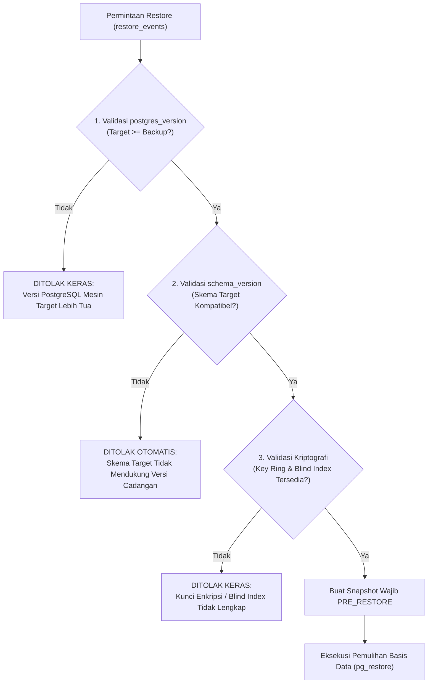

# 14-traceability.md — Matriks Keterlacakan Skema Basis Data, Kepatuhan Regulasi & Kompatibilitas Versi

> **Status Dokumen**: Wajib Dipatuhi (Normatif & Mengikat)  
> **Klasifikasi**: Spesifikasi Keterlacakan Sistem & Audit Kepatuhan Basis Data  
> **Lokasi Berkas**: `docs/database/14-traceability.md`  
> **Sasaran**: Seluruh pengembang, database administrator, auditor internal, dan pemangku kepentingan Yayasan Nurjaman Bongas Purwakarta.

Dokumen ini mendefinisikan matriks keterlacakan (_traceability matrix_) dua arah antara amanat regulasi/kebutuhan bisnis yayasan dengan 70 tabel skema basis data, pelacakan versi lingkungan eksekusi cadangan/pemulihan, serta prosedur verifikasi kepatuhan yang ketat.

---

## 1. Matriks Keterlacakan Regulasi & Kebutuhan Domain ke Entitas Skema

Setiap modul dan tabel dalam basis data memiliki rujukan landasan hukum, standar akuntansi, atau kebijakan tata kelola institusional:

| Domain / Acuan (rujukan, PERLU VERIFIKASI)          | Kebutuhan & Kebijakan                                                                                                        | Entitas Skema Terkait (Tabel & Kolom)                                                                              | Mekanisme Penegakan Teknis                                                                                                                                          |
| :-------------------------------------------------- | :--------------------------------------------------------------------------------------------------------------------------- | :----------------------------------------------------------------------------------------------------------------- | :------------------------------------------------------------------------------------------------------------------------------------------------------------------ |
| **ISAK 35 (rujukan, PERLU VERIFIKASI)**             | Penyajian laporan posisi keuangan dan aktivitas nirlaba dengan klasifikasi Aset Neto (Tanpa Pembatasan / Dengan Pembatasan). | `chart_of_accounts`, `restricted_funds`, `restriction_releases`, `in_kind_donations`                               | Klasifikasi baku COA; saldo dana terikat dihitung _runtime_ dari `journal_lines` (bukan nominal statis).                                                            |
| **Invarian Akuntansi Berpasangan**                  | Keseimbangan sakral: Total Debit WAJIB sama dengan Total Kredit. Transaksi `POSTED` dilarang diedit/dihapus fisik.           | `financial_transactions`, `journal_entries`, `journal_lines`                                                       | Pemisahan dokumen transaksi dari jurnal umum. Baris jurnal berpasangan hanya dibentuk saat `POSTED`. Status transaksi dijaga state machine ketat.                   |
| **UU PDP No. 27/2022 (rujukan, PERLU VERIFIKASI)**  | Perlindungan data kependudukan (NIK anggota terenkripsi, nomor rekening perbankan, secret 2FA).                              | `members.nik_enc`, `members.nik_blind_index`, `cash_bank_accounts.account_number_enc`, `two_factor_secrets.secret` | Enkripsi AES-256-GCM tingkat aplikasi dengan Key Ring (`key_id`). Kueri pencarian & keunikan menggunakan HMAC-SHA256 (`BLIND_INDEX_SECRET`). Masking pada tampilan. |
| **Regulasi Perpajakan (rujukan, PERLU VERIFIKASI)** | Pemotongan dan penyetoran PPh 21, PPh 23, dan PPh Final. Tarif tidak boleh di-hardcode di kode program.                      | `tax_types`, `tax_rates`, `transaction_taxes`, `withholding_slips`, `tax_payments`                                 | Tarif berversi tanggal (`effective_from` s.d. `effective_to`). Rekonsiliasi NTPN dan bukti potong tersimpan relasional.                                             |
| **Tata Kelola Institusional & SK Kemenkumham**      | Legalitas yayasan, profil kepengurusan, kop surat resmi, dan dokumentasi kelembagaan nirlaba.                                | `foundation_profile`, `member_positions`, `member_position_history`, `report_signatories`                          | Profil entitas singleton; dokumen SK Kemenkumham dan kop surat terpusat dan berversi.                                                                               |
| **Akuntabilitas Proyek Sosial Purwakarta**          | Monitoring kegiatan sosial/pendidikan di Purwakarta yang terhubung langsung ke pagu anggaran dan realisasi kas.              | `projects`, `project_milestones`, `project_updates`, `project_files`, `budget_versions`, `budget_lines`            | Setiap transaksi pengeluaran proyek dapat menautkan `project_id` dan pagu anggaran terkait.                                                                         |
| **Transparansi Publik Aman (Anti-Exfiltration)**    | Publikasi laporan keuangan dan kegiatan ke publik tanpa membocorkan rincian transaksi mentah atau identitas donatur privat.  | `published_reports`, `posts`, `galleries`, `contact_messages`                                                      | Portal publik hanya membaca snapshot agregat yang disahkan di `published_reports`, dilarang query transaksi mentah.                                                 |
| **Keamanan Akses & Anti-Brute Force (OWASP L2)**    | Autentikasi kuat, pertahanan sandi Argon2id, kontrol sesi, multi-role RBAC, dan pencegahan abuse.                            | `users`, `sessions`, `roles`, `permissions`, `user_roles`, `rate_limit_counters`                                   | Otorisasi server-side (`requirePermission`). Rate limit dihitung per-kunci pada basis data yang tahan restart server.                                               |

---

## 2. Keterlacakan Versi Lingkungan Cadangan Data (`backup_jobs`)

Untuk menjamin pemulihan data (_restore_) yang deterministik dan mencegah inkonsistensi biner atau kerusakan data, model data `backup_jobs` secara mandatori mencatat metadata 3 pilar versi:

```text
                        ┌─────────────────────────────────────────────────────────┐
                        │              Manifest Metadata Cadangan                 │
                        │                 (Tabel: backup_jobs)                    │
                        ├─────────────────────────────────────────────────────────┤
                        │ 1. postgres_version : Versi server PostgreSQL (17.2)    │
                        │ 2. schema_version   : Nama migrasi Prisma terakhir      │
                        │ 3. app_version      : Versi semantik / Commit SHA Git   │
                        │ 4. key_id           : ID kunci enkripsi yang aktif      │
                        └─────────────────────────────────────────────────────────┘
```

### Rincian Kolom Keterlacakan Versi pada `backup_jobs`:

1. **`postgres_version` (text, Not Null)**:
   - Mencatat versi mesin basis data PostgreSQL saat pencadangan dibuat (contoh: `"17.2"`).
   - Menghindari restorasi dump biner/logis pada versi database server yang lebih tua yang dapat menyebabkan kegagalan sintaks atau hilangnya dukungan fitur tipe data.
2. **`schema_version` (text, Not Null)**:
   - Mencatat nama unik berkas migrasi Prisma terakhir yang diaplikasikan pada saat snapshot diambil (contoh: `"20261105000000_init_auth"`).
   - Memastikan histori evolusi skema tercatat akurat dan dapat dicocokkan dengan direktori `prisma/migrations`.
3. **`app_version` (text, Not Null)**:
   - Mencatat versi semantik rilis aplikasi (contoh: `"0.1.0"`) atau hash commit Git (contoh: `"commit:e31eceb"`).
   - Menyediakan keterlacakan langsung terhadap basis kode sumber yang menghasilkan data terkait.

---

## 3. Matriks Logika Validasi Pre-Restore (Aturan Penolakan Otomatis)

Ketika proses pemulihan basis data dipicu (`restore_events`), container `backup-worker` wajib menjalankan 4 validasi berurutan sebelum menyentuh tabel operasional:



### Aturan Penolakan Mutlak:

1. **Aturan 1 (Versi PostgreSQL Target Lebih Tua)**:
   - _Kondisi_: Versi mayor/minor PostgreSQL mesin target < `postgres_version` berkas cadangan.
   - _Aksi_: **RESTORE DITOLAK KERAS**.
   - _Alasan_: PostgreSQL tidak menjamin kompatibilitas mundur saat memulihkan dump dari versi server baru ke server lama (_forward incompatibility_).
2. **Aturan 2 (Skema Tidak Kompatibel / Ketinggalan)**:
   - _Kondisi_: Kode aplikasi target belum memiliki migrasi yang memuat `schema_version` berkas cadangan.
   - _Aksi_: **RESTORE DITOLAK OTOMATIS**.
   - _Alasan_: Mencegah situasi di mana data baru dipulihkan ke struktur tabel lama yang belum memiliki kolom terkait, yang akan merusak integritas kueri ORM.
3. **Aturan 3 (Ketiadaan Kunci Enkripsi atau Kunci Blind Index)**:
   - _Kondisi_: Berkas `.env` mesin target tidak memuat `key_id` yang dipakai pada cadangan dalam daftar `ENCRYPTION_KEYS`, atau `BLIND_INDEX_SECRET` berbeda.
   - _Aksi_: **RESTORE DITOLAK KERAS**.
   - _Alasan_: Tanpa kunci enkripsi yang sesuai, data PII sensitif (NIK, rekening) tidak akan pernah bisa dibaca (_unrecoverable ciphertext_). Tanpa kunci blind index yang cocok, pencarian dan validasi keunikan NIK akan rusak total.
4. **Aturan 4 (Snapshot PRE_RESTORE Wajib Dibuat)**:
   - Sebelum mengeksekusi `pg_restore`, container `backup-worker` **WAJIB** secara otomatis membuat snapshot `pre_restore_backup_id` dari kondisi database saat ini. Jika proses snapshot pra-pemulihan gagal, proses pemulihan utama **DIBATALKAN**.

---

## 4. Keterlacakan Evolusi Skema: Pola Expand-Contract

Setiap migrasi basis data yang dirancang dalam direktori `prisma/migrations` wajib dapat dilacak fase perubahannya untuk menjamin ketiadaan gangguan layanan:

| Fase Evolusi             | Tindakan DDL pada Basis Data                                                                 | Tindakan Aplikasi (Kode Next.js)                                                              | Kriteria Sukses Keterlacakan                                             |
| :----------------------- | :------------------------------------------------------------------------------------------- | :-------------------------------------------------------------------------------------------- | :----------------------------------------------------------------------- |
| **Fase 1: Expand**       | Tambahkan kolom baru (wajib nullable atau bernilai default) atau buat tabel baru.            | Aplikasi mulai membaca data lama dan menulis ke struktur baru (_dual-writing_ jika transisi). | Aplikasi versi lama dan baru sama-sama dapat beroperasi tanpa galat SQL. |
| **Fase 2: Migrasi Data** | Jalankan skrip migrasi data (backfill) untuk menyelaraskan baris data historis.              | Monitor kelengkapan data baru melalui log audit.                                              | Seluruh baris lama terkonversi ke format baru dengan integritas penuh.   |
| **Fase 3: Contract**     | Buat migrasi DDL baru untuk menghapus kolom/tabel usang atau menerapkan constraint NOT NULL. | Aplikasi sepenuhnya menggunakan kolom baru; kode lama telah dibersihkan.                      | Basis data bersih dari redundansi kolom tanpa menimbulkan _downtime_.    |

---

## 5. Keterlacakan Jejak Audit Nirubah (_Audit Trail & Immutability_)

1. **Jejak Mutasi Data**:
   Seluruh aksi mutasi (INSERT, UPDATE, DELETE/VOID) pada tabel domain finansial, perpajakan, anggota, izin pengguna, dan konfigurasi sistem wajib mencatat entri pada `audit_logs` yang memuat:
   - `user_id`: Pengguna yang melakukan aksi.
   - `action`: Jenis aksi (misal: `"POST_TRANSACTION"`, `"VOID_TRANSACTION"`, `"GRANT_PERMISSION"`).
   - `entity_type` & `entity_id`: Tabel dan UUID target mutasi.
   - `old_values` & `new_values`: Snapshot perubahan dalam format JSON.
   - `ip_address` & `user_agent`: Konteks jaringan asal permintaan.
2. **Immutability (Sifat Nirubah)**:
   Tabel `audit_logs` berstatus _append-only_. Kebijakan basis data (RLS & trigger pelindung) melarang perintah `UPDATE` dan `DELETE` pada tabel ini untuk menjamin integritas forensik jika terjadi audit kepatuhan eksternal.
