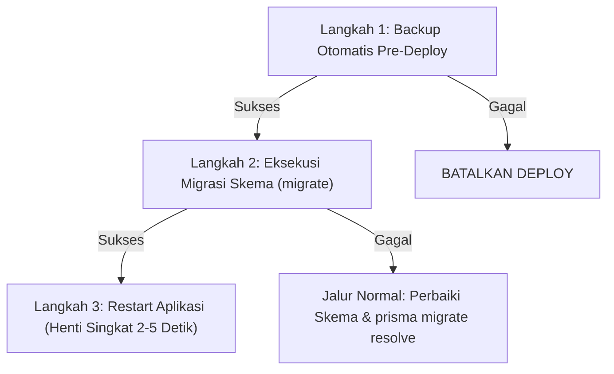

# RUNBOOK — Panduan Operasional Deployment, Portabilitas & Pemulihan Sistem

> **Dokumen Operasional Resmi**: Yayasan Nurjaman Bongas Purwakarta  
> **Klasifikasi**: Prosedur Operasional Standar (SOP) DevOps & Administrator Sistem  
> **Acuan Arsitektur**: [`docs/architecture/03-docker-first.md`](file:///docs/architecture/03-docker-first.md) dan [`docs/database/11-migration-plan.md`](file:///docs/database/11-migration-plan.md)

---

## 1. Panduan Deploy Pertama di Server VPS Baru

### 1.1 Persyaratan Sistem

- Sistem Operasi: Ubuntu 22.04/24.04 LTS atau Debian 12 (64-bit).
- Perangkat Lunak: Docker Engine v24+ dan Docker Compose Plugin v2 (`docker compose`).
- Spesifikasi Minimum: 1 vCPU, 2 GB RAM, 25 GB SSD Storage.

### 1.2 Catatan Kritis Keamanan Firewall (UFW Bypass oleh Docker)

> [!CAUTION] **Docker Mem-Bypass Aturan Firewall UFW di Linux**
> Docker Daemon secara default memanipulasi rantai `PREROUTING` iptables secara langsung. Seluruh port yang dipublikasikan via deklarasi `ports:` akan **melewati aturan firewall UFW**.
> **ATURAN MUTLAK**:
>
> 1. Port database (`5432`) dan port aplikasi (`3000`) **DILARANG KERAS** dipublikasikan ke host publik.
> 2. **HANYA** layanan `reverse-proxy` (Caddy) yang diizinkan membuka port `80` (HTTP) dan `443` (HTTPS).
> 3. Firewall host cukup mengizinkan SSH dan port web publik:
>    ```bash
>    sudo ufw default deny incoming
>    sudo ufw default allow outgoing
>    sudo ufw allow 22/tcp
>    sudo ufw allow 80/tcp
>    sudo ufw allow 443/tcp
>    sudo ufw enable
>    ```

### 1.3 Langkah Inisialisasi Pertama

1. Klon repositori ke direktori kerja server:
   ```bash
   git clone <URL_REPOSITORI> /opt/yayasan-nurjaman
   cd /opt/yayasan-nurjaman
   ```
2. Buat berkas konfigurasi `.env` dari template:
   ```bash
   cp .env.example .env
   chmod 600 .env
   ```
3. Konfigurasikan seluruh variabel wajib di `.env` (password database, kunci enkripsi, secret auth, nama domain).
4. Jalankan stack awal untuk pertama kali:
   ```bash
   docker compose -f docker-compose.prod.yml up -d postgres
   docker compose -f docker-compose.prod.yml run --rm migrate
   docker compose -f docker-compose.prod.yml up -d
   ```

---

## 2. Urutan Sakral Deployment Produksi (3 Langkah Baku)

Setiap pembaruan kode aplikasi ke lingkungan produksi **WAJIB** mengikuti urutan 3 langkah berikut:



### Langkah 1: Pencadangan Otomatis Pre-Deploy

Ambil snapshot basis data dan berkas sebelum modifikasi apa pun:

```bash
docker compose -f docker-compose.prod.yml exec backup-worker /backup-scripts/backup.sh PRE_DEPLOY
```

_Jika pencadangan gagal, proses deployment WAJIB dibatalkan segera._

### Langkah 2: Eksekusi Migrasi Basis Data Sekali Jalan

Jalankan migrasi skema basis data secara deterministik:

```bash
docker compose -f docker-compose.prod.yml run --rm migrate
```

#### Penanganan Bila Migrasi Gagal:

1. **Prinsip Fail-Fast**: Hentikan rilis baru. Container aplikasi lama tetap melayani trafik.
2. **Jalur Normal**: Telusuri galat migrasi, perbaiki berkas SQL, dan lakukan rekonsiliasi:
   ```bash
   docker compose -f docker-compose.prod.yml run --rm migrate npx prisma migrate resolve --rolled-back "<migration_name>"
   ```
3. **Pilihan Terakhir (Last Resort)**: Restorasi dari snapshot `PRE_DEPLOY` hanya dilakukan jika terjadi kegagalan DDL destruktif yang merusak skema aktif.

### Langkah 3: Restart Aplikasi & Toleransi Henti Singkat

Hanya jika migrasi keluar dengan status sukses (`exit code 0`):

```bash
docker compose -f docker-compose.prod.yml up -d --no-deps app
```

> [!NOTE] **Henti Singkat Terukur (2–5 Detik)**
> Container Next.js memerlukan waktu inisialisasi singkat sebelum rute `/api/health` merespons sukses. Caddy menahan sementara request selama jeda ini.

---

## 3. Prosedur Pemindahan Mesin (Cross-Machine Transfer)

> [!CAUTION] **Dilarang Keras Memindahkan Folder Data Mentah PostgreSQL**
> Dilarang menyalin direktori fisik `/var/lib/postgresql/data` antar-mesin karena risiko ketidakcocokan glibc, arsitektur prosesor, dan versi library.

### 4 Komponen Wajib Transfer:

1. **Dump Logis Basis Data**: Format biner terstruktur (`pg_dump -Fc`).
2. **Arsip Unggahan Berkas**: `uploads_private` dan `uploads_public`.
3. **Konfigurasi Lingkungan**: Berkas `.env`.
4. **SELURUH KUNCI KRIPTOGRAFI IDENTIK**:
   - `ENCRYPTION_KEY_ACTIVE_ID` dan `ENCRYPTION_KEYS` (ketiadaan kunci = _permanent data loss_ data terenkripsi).
   - `BLIND_INDEX_SECRET` (ketiadaan kunci = pencarian dan deteksi duplikasi NIK gagal).
   - `BACKUP_ENCRYPTION_KEY`.

### Langkah Eksekusi Pemindahan:

1. **Di Mesin Sumber**: Buat backup menyeluruh:
   ```bash
   docker compose -f docker-compose.prod.yml exec backup-worker /backup-scripts/backup.sh PINDAH_MESIN
   ```
2. Salin folder cadangan di `/backups/backup_<TIMESTAMP>_PINDAH_MESIN/` dan berkas `.env` ke mesin target via SCP/SSH.
3. **Di Mesin Target**:
   - Letakkan `.env` dan verifikasi seluruh kunci identik.
   - Nyalakan database: `docker compose -f docker-compose.prod.yml up -d postgres`
   - Jalankan pemulihan:
     ```bash
     docker compose -f docker-compose.prod.yml exec backup-worker /backup-scripts/restore.sh /backups/backup_<TIMESTAMP>_PINDAH_MESIN
     ```
   - Jalankan migrasi dan seluruh layanan:
     ```bash
     docker compose -f docker-compose.prod.yml run --rm migrate
     docker compose -f docker-compose.prod.yml up -d
     ```

---

## 4. Prosedur Drill Verifikasi Pemulihan (Disaster Recovery Drill)

Uji pemulihan wajib dijalankan secara berkala pada database uji untuk memastikan integritas cadangan:

1. Buat cadangan uji:
   ```bash
   docker compose -f docker-compose.prod.yml exec backup-worker /backup-scripts/backup.sh DRILL_TEST
   ```
2. Jalankan restorasi pada instance uji atau container database bersih:
   ```bash
   docker compose -f docker-compose.prod.yml exec backup-worker /backup-scripts/restore.sh /backups/backup_<TIMESTAMP>_DRILL_TEST
   ```
3. Verifikasi hasil restorasi:
   - Skrip `restore.sh` otomatis menolak jika versi PostgreSQL target lebih tua.
   - Skrip memverifikasi kecocokan checksum SHA-256 berkas biner terdekripsi.
   - Verifikasi jumlah tabel skema public sesuai output skrip.

---

## 5. Standar Docker Multi-Arsitektur (Docker Buildx)

Untuk memastikan kompatibilitas arsitektur ganda (`linux/amd64` untuk server VPS x86_64 dan `linux/arm64` untuk laptop ARM pengembang):

```bash
# Inisialisasi builder buildx multi-platform
docker buildx create --name yayasan-builder --use
docker buildx inspect --bootstrap

# Bangun dan push image aplikasi multi-arsitektur
docker buildx build \
  --platform linux/amd64,linux/arm64 \
  -t yayasan/app:0.1.0 \
  -f Dockerfile \
  --push .
```

Semua base image resmi (`postgres:17.2-bookworm`, `node:22-alpine`, `caddy:2.9.1-alpine`) secara bawaan mendukung multi-arsitektur `amd64` dan `arm64`.
